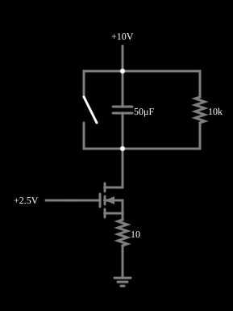

# Rampa de corrente: capacitor carregado por fonte de corrente

<!-- navegacao:inicio -->
[Índice](README.md) · [Anterior: Current Source](moscurrentsrc.md) · [Próximo: Current Mirror](mosmirror.md)
<!-- navegacao:fim -->

## Objetivo

Mostrar que uma fonte de corrente constante carrega um capacitor com uma **rampa linear** de tensão, $V_C = It/C$, e que a rampa termina quando a fonte de corrente (um MOSFET) perde a conformidade, isto é, quando sai da saturação.

## O circuito

<!-- esquema:inicio -->

<!-- esquema:fim -->

Um NMOS (modelo padrão, sem diodo de corpo) tem a porta em $2{,}5\ \text{V}$ e um resistor de $10\ \Omega$ entre a fonte e a terra (degeneração de fonte). O dreno liga-se a $+10\ \text{V}$ por um capacitor de $50\ \mu\text{F}$, em paralelo com um resistor de $10\ \text{k}\Omega$ (a fuga) e com um botão (chave momentânea) que descarrega o capacitor. Um osciloscópio mostra a tensão do capacitor.

<!-- componentes:inicio -->
| N.º | Tipo | Elemento | Valores |
|----:|------|----------|---------|
| 0 | `ResistorElm` | resistor | Resistance (ohms) = 10 |
| 1 | `GroundElm` | ground | Symbol = Earth |
| 2 | `RailElm` | voltage source | Voltage = 2.5; Waveform = D/C; DC Offset (V) = 0; Internal Resistance (ohms) = 0 |
| 6 | `RailElm` | voltage source | Voltage = 10; Waveform = D/C; DC Offset (V) = 0; Internal Resistance (ohms) = 0 |
| 7 | `CapacitorElm` | capacitor | Capacitance (F) = 50μ; Trapezoidal Approximation = sim; Initial Voltage (on Reset) = 1m; Series Resistance = 0 |
| 8 | `ResistorElm` | resistor | Resistance (ohms) = 10k |
| 11 | `SwitchElm` | switch (SPST) | Momentary Switch = sim; IEC Symbol = não; Label (for linking) = ; Keyboard Shortcut = ; On Resistance (ohms) = 0 |
| 12 | `NMosfetElm` | MOSFET | Model = default-nodiode; Swap D/S = não |
<!-- componentes:fim -->

## Teoria

A degeneração de fonte fixa a corrente: $V_{GS} = 2{,}5 - 10 I$ e, na saturação, $I = \tfrac12\beta (V_{GS} - V_t)^2 = 0{,}01\,(1 - 10 I)^2$ ($\beta = 0{,}02\ \text{A/V}^2$, $V_t = 1{,}5\ \text{V}$), ou seja, $I^2 - 1{,}2 I + 0{,}01 = 0$, de raiz útil

$$I = \frac{1{,}2 - \sqrt{1{,}44 - 0{,}04}}{2} = 8{,}39\ \text{mA}, \qquad V_{ov} = 1 - 10 I = 0{,}916\ \text{V}.$$

Se não houvesse o resistor de $10\ \text{k}\Omega$, a tensão do capacitor cresceria em rampa, $dV_C/dt = I/C = 8{,}39\ \text{mA}/50\ \mu\text{F} = 167{,}8\ \text{V/s}$. Com ele, a corrente do capacitor é $I - V_C/R$ e a solução é exponencial,

$$V_C(t) = I R\left(1 - e^{-t/RC}\right), \qquad IR = 83{,}9\ \text{V},\quad RC = 0{,}5\ \text{s},$$

que no início é uma reta de inclinação $I/C$ (a fuga só tira $0{,}2\%$ a $1\ \text{ms}$). O transistor deixa a saturação quando $V_{DS} = V_D - V_S < V_{ov}$, isto é, quando o dreno cai a $V_S + V_{ov} \approx 1{,}0\ \text{V}$ e $V_C$ chega a $9\ \text{V}$.

## Resultados esperados

A fórmula dá $V_C(1\ \text{ms}) = 83{,}92(1 - e^{-0{,}002}) = 0{,}1677\ \text{V}$, $V_C(10\ \text{ms}) = 1{,}662\ \text{V}$ e $V_C(50\ \text{ms}) = 7{,}986\ \text{V}$; o simulador dá $0{,}1673\ \text{V}$, $1{,}661\ \text{V}$ e $7{,}986\ \text{V}$ (a reta ideal $I t/C$ daria $8{,}39\ \text{V}$ em $50\ \text{ms}$: a fuga já pesa). A tensão no resistor de fonte é $0{,}0839\ \text{V}$ e a corrente do transistor, $8{,}392\ \text{mA}$, constante enquanto ele está na saturação. O fim da rampa é previsto em $t = -0{,}5\ln(1 - 9/83{,}92) = 56{,}8\ \text{ms}$; em $50\ \text{ms}$ o dreno está em $1{,}93\ \text{V}$ (saturado) e em $60\ \text{ms}$ em $0{,}48\ \text{V}$: a corrente caiu a $6{,}68\ \text{mA}$ (triodo). Em $0{,}1\ \text{s}$ o capacitor chegou a $9{,}9385\ \text{V}$, o transistor está no triodo com $0{,}052\ \text{V}$ nele e a corrente é só a da fuga ($0{,}994\ \text{mA}$ em $10\ \text{k}\Omega$). As verificações conferem a tensão do capacitor em $1$, $10$, $50$ e $100\ \text{ms}$, a queda no resistor de fonte, e a corrente do transistor em $10$ e $60\ \text{ms}$ (tolerância de $0{,}5\%$).

## O que observar

No osciloscópio, uma rampa quase reta que se curva e termina em torno de $9{,}9\ \text{V}$. Aperte o botão para descarregar o capacitor e reiniciar a rampa. Para testar: aumente o resistor de $10\ \text{k}\Omega$ (por exemplo, para $1\ \text{M}\Omega$) e veja a rampa ficar mais reta, até a saturação do transistor; aumente a tensão de porta e veja a rampa ficar mais inclinada ($I$ maior).

## Limites do modelo

- Com $\lambda = 0$ a corrente é perfeitamente constante na saturação; num MOSFET real ela cresce um pouco com $V_{DS}$ e a rampa ficaria levemente curva.
- A rampa termina na transição para o triodo, e o valor final depende da fuga do resistor.
- O capacitor é ideal (sem resistência série nem fuga própria).

## Referências

Sedra e Smith, *Microelectronic Circuits*, capítulos sobre o MOSFET e sobre fontes de corrente e espelhos de corrente; Razavi, *Fundamentals of Microelectronics*, capítulo sobre o MOSFET.

O circuito deste exemplo faz parte da coleção do simulador original de Paul Falstad e Iain Sharp (CircuitJS1); a explicação é deste projeto.
