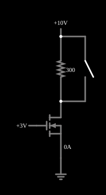

# Fonte de corrente com MOSFET

<!-- navegacao:inicio -->
[Índice](README.md) · [Anterior: Source Follower](mosfollower.md) · [Próximo: Current Ramp](moscurrentramp.md)
<!-- navegacao:fim -->

## Objetivo

Mostrar que um MOSFET na região de saturação se comporta como uma **fonte de corrente**: a corrente de dreno depende da tensão de porta e quase não depende da tensão de dreno, de modo que a carga pode variar sem alterar a corrente.

## O circuito

<!-- esquema:inicio -->

<!-- esquema:fim -->

Um NMOS (modelo padrão, sem diodo de corpo) tem a porta ligada a uma fonte de $3\ \text{V}$, a fonte (*source*) na terra e o dreno ligado a $+10\ \text{V}$ por uma carga de $300\ \Omega$. Uma chave em paralelo com a carga permite curto-circuitá-la.

<!-- componentes:inicio -->
| N.º | Tipo | Elemento | Valores |
|----:|------|----------|---------|
| 0 | `NMosfetElm` | MOSFET | Model = default-nodiode; Swap D/S = não |
| 2 | `GroundElm` | ground | Symbol = Earth |
| 3 | `RailElm` | voltage source | Voltage = 10; Waveform = D/C; DC Offset (V) = 0; Internal Resistance (ohms) = 0 |
| 5 | `ResistorElm` | resistor | Resistance (ohms) = 300 |
| 8 | `SwitchElm` | switch (SPST) | Momentary Switch = não; IEC Symbol = não; Label (for linking) = ; Keyboard Shortcut = ; On Resistance (ohms) = 0 |
| 9 | `RailElm` | voltage source | Voltage = 3; Waveform = D/C; DC Offset (V) = 0; Internal Resistance (ohms) = 0 |
<!-- componentes:fim -->

## Teoria

Na saturação (modelo de lei quadrática de [n-MOSFET](nmosfet.md), $\lambda = 0$) a corrente de dreno é

$$I_D = \tfrac12\beta\,(V_{GS} - V_t)^2,$$

que **não** depende de $V_{DS}$: o transistor mantém a corrente fixada por $V_{GS}$ enquanto $V_{DS} \ge V_{GS} - V_t$ (a tensão de conformidade mínima). Se a carga muda, a tensão sobre ela se ajusta por $V = R I_D$, e o dreno acompanha.

## Resultados esperados

Com $V_{GS} = 3\ \text{V}$, $V_{ov} = 1{,}5\ \text{V}$ e

$$I_D = \tfrac12 \cdot 0{,}02 \cdot 1{,}5^2 = 22{,}5\ \text{mA}.$$

Com a carga de $300\ \Omega$ a queda é $6{,}75\ \text{V}$ e o dreno fica em $10 - 6{,}75 = 3{,}25\ \text{V}$, acima de $V_{ov} = 1{,}5\ \text{V}$ (saturação confirmada). Fechando a chave, a carga é curto-circuitada e o dreno vai a $10\ \text{V}$, mas a corrente continua $22{,}5\ \text{mA}$. As verificações conferem a corrente e a tensão do dreno nos dois casos (tolerância de $1\%$ e $0{,}5\%$).

## O que observar

Feche e abra a chave: a corrente do transistor não muda, só a tensão do dreno. Para testar: troque a carga por $400\ \Omega$: uma corrente de $22{,}5\ \text{mA}$ exigiria $9\ \text{V}$ na carga e deixaria só $1\ \text{V}$ no dreno, abaixo de $V_{ov}$; o transistor sai da saturação, entra no triodo e a corrente cai a $21{,}9\ \text{mA}$, com $1{,}25\ \text{V}$ no dreno (valores medidos no simulador): a fonte de corrente perdeu a conformidade; mude a tensão de porta e veja a corrente variar com $(V_{GS} - V_t)^2$.

## Limites do modelo

- Com $\lambda = 0$ a resistência de saída é infinita; num MOSFET real a corrente cresce um pouco com $V_{DS}$ (resistência de saída finita, $r_o = 1/(\lambda I_D)$).
- O limite de conformidade é $V_{DS,min} = V_{GS} - V_t = 1{,}5\ \text{V}$, que só vale para a lei quadrática.
- A corrente depende de $V_t$ e de $\beta$, que variam de transistor para transistor e com a temperatura; por isso, na prática, usa-se um espelho de corrente ([Current Mirror](mosmirror.md)).

## Referências

Sedra e Smith, *Microelectronic Circuits*, capítulos sobre o MOSFET e sobre fontes de corrente e espelhos de corrente; Razavi, *Fundamentals of Microelectronics*, capítulo sobre o MOSFET.

O circuito deste exemplo faz parte da coleção do simulador original de Paul Falstad e Iain Sharp (CircuitJS1); a explicação é deste projeto.
