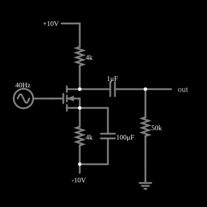

# Amplificador de fonte comum

<!-- navegacao:inicio -->
[Índice](README.md) · [Anterior: Current Mirror](mosmirror.md) · [Próximo: CMOS Inverter](cmosinverter.md)
<!-- navegacao:fim -->

## Objetivo

Mostrar o amplificador de tensão de **fonte comum** com MOSFET: um sinal pequeno aplicado à porta aparece muito maior e invertido no dreno, graças à transcondutância do transistor. O exemplo mostra a polarização com um resistor de fonte e como o capacitor de passagem recupera o ganho.

## O circuito

<!-- esquema:inicio -->

<!-- esquema:fim -->

Um NMOS (modelo padrão, sem diodo de corpo) tem o dreno ligado a $+10\ \text{V}$ por um resistor de $4\ \text{k}\Omega$ e a fonte ligada a $-10\ \text{V}$ por outro de $4\ \text{k}\Omega$, em paralelo com um capacitor de passagem de $100\ \mu\text{F}$. A porta recebe diretamente uma fonte senoidal de $50\ \text{mV}$ de pico e $40\ \text{Hz}$, sem tensão contínua. A saída é tirada do dreno por um capacitor de acoplamento de $1\ \mu\text{F}$, para uma carga de $50\ \text{k}\Omega$. Dois osciloscópios mostram a entrada e a saída.

<!-- componentes:inicio -->
| N.º | Tipo | Elemento | Valores |
|----:|------|----------|---------|
| 0 | `ResistorElm` | resistor | Resistance (ohms) = 4k |
| 1 | `RailElm` | A/C source | Max Voltage = 50m; Waveform = A/C; DC Offset (V) = 0; Internal Resistance (ohms) = 0; Show Voltage = não; Frequency (Hz) = 40; Phase Offset (degrees) = 0 |
| 2 | `RailElm` | voltage source | Voltage = 10; Waveform = D/C; DC Offset (V) = 0; Internal Resistance (ohms) = 0 |
| 3 | `ResistorElm` | resistor | Resistance (ohms) = 4k |
| 4 | `CapacitorElm` | capacitor | Capacitance (F) = 1μ; Trapezoidal Approximation = sim; Initial Voltage (on Reset) = 1m; Series Resistance = 0 |
| 5 | `ResistorElm` | resistor | Resistance (ohms) = 50k |
| 6 | `GroundElm` | ground | Symbol = Earth |
| 7 | `OutputElm` | output | Show Voltage = não |
| 9 | `CapacitorElm` | capacitor | Capacitance (F) = 100μ; Trapezoidal Approximation = sim; Initial Voltage (on Reset) = 1m; Series Resistance = 0 |
| 11 | `NMosfetElm` | MOSFET | Model = default-nodiode; Swap D/S = não |
| 12 | `RailElm` | voltage source | Voltage = -10; Waveform = D/C; DC Offset (V) = 0; Internal Resistance (ohms) = 0 |
<!-- componentes:fim -->

## Teoria

**Polarização.** Com a porta em $0\ \text{V}$ em corrente contínua, a tensão da fonte é $V_S = -10 + 4\,\text{k}\Omega \cdot I_D$, de modo que $V_{GS} = 10 - 4000 I_D$. Na saturação ($\beta = 0{,}02\ \text{A/V}^2$, $V_t = 1{,}5\ \text{V}$, modelo de [n-MOSFET](nmosfet.md)), $I_D = 0{,}01\,(8{,}5 - 4000 I_D)^2$, de solução

$$I_D = 2{,}013\ \text{mA},\quad V_{GS} = 1{,}95\ \text{V},\quad V_{ov} = 0{,}45\ \text{V},\quad V_D = 10 - 4\,\text{k}\Omega \cdot I_D = 1{,}95\ \text{V}, \quad V_{DS} = 3{,}9\ \text{V} \ge V_{ov}.$$

**Pequenos sinais.** A transcondutância é $g_m = \beta V_{ov} = 9{,}0\ \text{mS}$. Com o resistor de fonte totalmente curto-circuitado pelo capacitor de passagem, o ganho de tensão na faixa média é

$$A_v = -g_m\,(R_D \parallel R_L) = -9{,}0\ \text{mS} \cdot (4\ \text{k}\Omega \parallel 50\ \text{k}\Omega) = -9{,}0\ \text{mS} \cdot 3{,}70\ \text{k}\Omega \approx -33{,}3.$$

Sem o capacitor de passagem, o resistor de fonte degeneraria o ganho para $-g_m R_L'/(1 + g_m R_S) = -33{,}3/37 \approx -0{,}90$ (o simulador, sem o capacitor, dá $0{,}898$ em módulo). A $40\ \text{Hz}$ o capacitor de $100\ \mu\text{F}$ tem reatância de $39{,}8\ \Omega$, não desprezível diante de $1/g_m = 111\ \Omega$, e a degeneração residual reduz o módulo do ganho e acrescenta uma defasagem:

$$A_v(40\ \text{Hz}) = -\frac{g_m R_L'}{1 + g_m Z_S}, \quad Z_S = R_S \parallel \frac{1}{j\omega C} \approx 39{,}8\ \Omega\angle{-89{,}4^\circ} \Rightarrow |A_v| \approx 31{,}3,\ \varphi \approx 180^\circ + 20^\circ.$$

## Resultados esperados

Em regime, a corrente média do dreno é $2{,}013\ \text{mA}$, como previsto. A amplitude do componente de $40\ \text{Hz}$ na saída (Fourier, $0{,}1\ \text{s}$) é $1{,}552\ \text{V}$ para $0{,}05\ \text{V}$ de entrada: ganho de módulo $31{,}0$ (o previsto, $31{,}3$, difere $0{,}8\%$) e fase de $-156^\circ$ (o previsto, $-160^\circ$). A saída vai de $-1{,}592\ \text{V}$ a $+1{,}512\ \text{V}$, com valor eficaz de $1{,}098\ \text{V}$; a assimetria entre os picos ($\pm 0{,}04\ \text{V}$) é a **distorção de segunda harmônica** da lei quadrática: $I_D$ varia com $(V_{GS} - V_t)^2$, e não linearmente. A frequência é $40\ \text{Hz}$ e a média da saída é nula (o capacitor de acoplamento bloqueia a tensão contínua do dreno). As verificações conferem a corrente média, o valor eficaz da entrada e o máximo, o mínimo, o valor eficaz e a frequência da saída (tolerância de $0{,}5\%$ a $1\%$).

## O que observar

Nos osciloscópios, a saída tem amplitude de cerca de $1{,}5\ \text{V}$ contra $0{,}05\ \text{V}$ na entrada, e em oposição de fase quase total. Para testar: retire o capacitor de $100\ \mu\text{F}$ e veja o ganho cair a $0{,}90$ ($0{,}045\ \text{V}$ de saída para $0{,}05\ \text{V}$ de entrada), pela degeneração; aumente a amplitude da entrada para $0{,}2\ \text{V}$ e veja a distorção crescer (a assimetria dos picos); troque o resistor de dreno por um de $2\ \text{k}\Omega$ e veja o ganho cair quase à metade: a saída passa a $0{,}806\ \text{V}$ de amplitude (ganho de $16{,}1$ contra $31{,}0$), pois $R_D \parallel R_L$ cai de $3{,}70\ \text{k}\Omega$ para $1{,}92\ \text{k}\Omega$ (valores medidos no simulador).

## Limites do modelo

- O ganho de pequenos sinais usa $g_m = \beta V_{ov}$, o da lei quadrática; um MOSFET real tem $g_m$ menor em canais curtos e uma resistência de saída $r_o$ finita, que o simulador despreza com $\lambda = 0$.
- Não há efeito de corpo e não há capacitâncias de porta: o ganho não cai em frequências altas.
- A fonte de sinal está ligada direto à porta, e a porta não conduz corrente: a resistência de entrada é infinita (num circuito real, ela é a de um resistor de polarização).
- Os valores de ganho e de fase de $40\ \text{Hz}$ vêm da análise de Fourier do simulador e da fórmula com os capacitores; as verificações automáticas cobrem a polarização e as amplitudes.

## Referências

Sedra e Smith, *Microelectronic Circuits*, capítulos sobre o MOSFET e sobre fontes de corrente e espelhos de corrente; Razavi, *Fundamentals of Microelectronics*, capítulo sobre o MOSFET.

O circuito deste exemplo faz parte da coleção do simulador original de Paul Falstad e Iain Sharp (CircuitJS1); a explicação é deste projeto.
