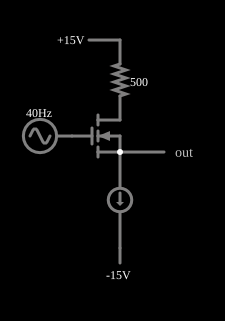

# Seguidor de fonte (dreno comum)

<!-- navegacao:inicio -->
[Índice](README.md) · [Anterior: Switch](mosswitch.md) · [Próximo: Current Source](moscurrentsrc.md)
<!-- navegacao:fim -->

## Objetivo

Mostrar o **seguidor de fonte** (amplificador de dreno comum): a saída, tomada na fonte do MOSFET, segue a tensão da porta com ganho próximo de $1$, deslocada para baixo por uma tensão constante $V_{GS}$, e o circuito tem baixa resistência de saída.

## O circuito

<!-- esquema:inicio -->

<!-- esquema:fim -->

Um NMOS (modelo padrão, sem diodo de corpo) tem o dreno ligado a $+15\ \text{V}$ por um resistor de $500\ \Omega$, a porta ligada a uma fonte senoidal de $5\ \text{V}$ de pico e $40\ \text{Hz}$, e a fonte ligada a uma **fonte de corrente** de $5\ \text{mA}$ que vai a $-15\ \text{V}$. A saída é o nó da fonte. Um osciloscópio mostra a saída.

<!-- componentes:inicio -->
| N.º | Tipo | Elemento | Valores |
|----:|------|----------|---------|
| 0 | `RailElm` | A/C source | Max Voltage = 5; Waveform = A/C; DC Offset (V) = 0; Internal Resistance (ohms) = 0; Show Voltage = não; Frequency (Hz) = 40; Phase Offset (degrees) = 0 |
| 1 | `OutputElm` | output | Show Voltage = não |
| 2 | `NMosfetElm` | MOSFET | Model = default-nodiode; Swap D/S = não |
| 3 | `ResistorElm` | resistor | Resistance (ohms) = 500 |
| 4 | `RailElm` | voltage source | Voltage = 15; Waveform = D/C; DC Offset (V) = 0; Internal Resistance (ohms) = 0 |
| 5 | `RailElm` | voltage source | Voltage = -15; Waveform = D/C; DC Offset (V) = 0; Internal Resistance (ohms) = 0 |
| 6 | `CurrentElm` | current source | Current (A) = 5m; Max Voltage (V, 0=unlimited) = 0 |
<!-- componentes:fim -->

## Teoria

A fonte de corrente fixa a corrente de dreno em $I_D = 5\ \text{mA}$ qualquer que seja a entrada. Na saturação (modelo de lei quadrática de [n-MOSFET](nmosfet.md), $\lambda = 0$), a tensão porta-fonte que sustenta essa corrente é constante:

$$I_D = \tfrac12\beta (V_{GS} - V_t)^2 \ \Rightarrow\ V_{GS} = V_t + \sqrt{\frac{2I_D}{\beta}} = 1{,}5 + \sqrt{\frac{2 \cdot 0{,}005}{0{,}02}} = 1{,}5 + 0{,}7071 = 2{,}2071\ \text{V}.$$

Logo $v_{out} = v_{in} - V_{GS}$, um ganho de tensão de exatamente $1$ com $\lambda = 0$ (em geral, $g_m R_L/(1 + g_m R_L)$ com carga $R_L$). A resistência de saída vista da fonte é $1/g_m$, com $g_m = \beta V_{ov} = 0{,}02 \cdot 0{,}7071 = 14{,}1\ \text{mS}$, ou $70{,}7\ \Omega$. O resistor de dreno só define a tensão $V_{DS}$ do transistor, e não participa do ganho.

## Resultados esperados

A saída é a senoide de entrada, com a mesma amplitude, deslocada em $-2{,}2071\ \text{V}$: vai de $-7{,}2071\ \text{V}$ a $+2{,}7929\ \text{V}$, com média $-2{,}2071\ \text{V}$ e valor eficaz $4{,}168\ \text{V}$ (a entrada tem $3{,}536\ \text{V}$ eficaz: $\sqrt{3{,}536^2 + 2{,}207^2} = 4{,}168$). A corrente do MOSFET é constante, $5\ \text{mA}$, e a tensão dreno-fonte, $V_{DS} = 12{,}5 - v_{out}$, varia entre $9{,}71\ \text{V}$ e $19{,}71\ \text{V}$, sempre acima de $V_{ov} = 0{,}71\ \text{V}$: o transistor permanece na saturação, e por isso o ganho é exatamente $1$ (a análise por Fourier dá $5{,}000\ \text{V}$ de amplitude na saída em $40\ \text{Hz}$). As verificações conferem a saída nos picos positivo e negativo, o valor médio, o máximo, o mínimo, o valor eficaz e a corrente constante no MOSFET (tolerância de $0{,}5\%$).

## O que observar

No osciloscópio, saída e entrada têm a mesma forma e amplitude, deslocadas em $2{,}2\ \text{V}$. Para testar: mude a corrente da fonte para $20\ \text{mA}$ e veja o deslocamento aumentar ($V_{GS} = 1{,}5 + \sqrt{2 \cdot 0{,}02/0{,}02} = 2{,}91\ \text{V}$); aumente a amplitude de entrada até que $V_{DS}$ caia abaixo de $V_{ov}$ e veja o ganho cair, por o transistor entrar na região de triodo.

## Limites do modelo

- Com $\lambda = 0$ o ganho em vazio é exatamente $1$; um MOSFET real tem ganho um pouco menor que $1$ ($g_m r_o/(1 + g_m r_o)$) e o efeito de corpo (o limiar aumenta com a tensão fonte-corpo), que o simulador não inclui neste exemplo.
- A fonte de corrente é ideal; na prática ela é feita com outro transistor (veja [Current Source](moscurrentsrc.md)).
- Sem capacitâncias: não há limitação de frequência.

## Referências

Sedra e Smith, *Microelectronic Circuits*, capítulo sobre o MOSFET (características $i$–$v$ e modelo de lei quadrática); Razavi, *Fundamentals of Microelectronics*, capítulo sobre o MOSFET.

O circuito deste exemplo faz parte da coleção do simulador original de Paul Falstad e Iain Sharp (CircuitJS1); a explicação é deste projeto.
