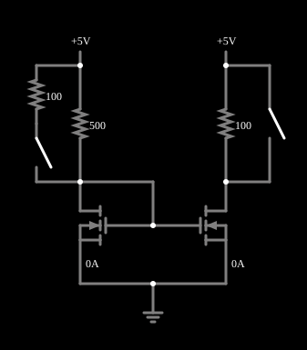

# Espelho de corrente com MOSFET

<!-- navegacao:inicio -->
[Índice](README.md) · [Anterior: Current Ramp](moscurrentramp.md) · [Próximo: Common-Source Amplifier](mosfetamp.md)
<!-- navegacao:fim -->

## Objetivo

Mostrar o **espelho de corrente** com MOSFETs: dois transistores iguais copiam, no ramo de saída, a corrente de um ramo de referência, qualquer que seja a carga. Compare com a versão bipolar, [Current Mirror](mirror.md).

## O circuito

<!-- esquema:inicio -->

<!-- esquema:fim -->

Dois NMOS iguais (modelo padrão, sem diodo de corpo) têm as portas ligadas entre si e as fontes na terra. O dreno do primeiro (M1) está ligado à própria porta ("transistor diodo") e a $+5\ \text{V}$ por um resistor de $500\ \Omega$; uma chave pode ligar em paralelo outro resistor, de $100\ \Omega$, aumentando a corrente de referência. O dreno do segundo (M2), a saída, liga-se a $+5\ \text{V}$ por uma carga de $100\ \Omega$, que outra chave pode curto-circuitar.

<!-- componentes:inicio -->
| N.º | Tipo | Elemento | Valores |
|----:|------|----------|---------|
| 0 | `NMosfetElm` | MOSFET | Model = default-nodiode; Swap D/S = não |
| 1 | `NMosfetElm` | MOSFET | Model = default-nodiode; Swap D/S = não |
| 9 | `GroundElm` | ground | Symbol = Earth |
| 10 | `RailElm` | voltage source | Voltage = 5; Waveform = D/C; DC Offset (V) = 0; Internal Resistance (ohms) = 0 |
| 11 | `RailElm` | voltage source | Voltage = 5; Waveform = D/C; DC Offset (V) = 0; Internal Resistance (ohms) = 0 |
| 13 | `ResistorElm` | resistor | Resistance (ohms) = 100 |
| 16 | `SwitchElm` | switch (SPST) | Momentary Switch = não; IEC Symbol = não; Label (for linking) = ; Keyboard Shortcut = ; On Resistance (ohms) = 0 |
| 19 | `ResistorElm` | resistor | Resistance (ohms) = 500 |
| 20 | `ResistorElm` | resistor | Resistance (ohms) = 100 |
| 21 | `SwitchElm` | switch (SPST) | Momentary Switch = não; IEC Symbol = não; Label (for linking) = ; Keyboard Shortcut = ; On Resistance (ohms) = 0 |
<!-- componentes:fim -->

## Teoria

Em M1, a porta está ligada ao dreno, então $V_{DS} = V_{GS}$, que é maior que $V_{GS} - V_t$: M1 está sempre na saturação e a sua corrente é $I_{ref} = \tfrac12\beta(V_{GS} - V_t)^2$ (modelo de [n-MOSFET](nmosfet.md)), determinada pelo resistor:

$$I_{ref} = \frac{5 - V_{GS}}{R}.$$

M2 tem a mesma tensão porta-fonte, e, se está na saturação, a mesma corrente: $I_{out} = I_{ref}$ (com transistores de mesma razão $W/L$; com razões diferentes, $I_{out} = I_{ref}\,(W/L)_2/(W/L)_1$). O MOSFET não tem corrente de porta, e portanto, ao contrário do espelho bipolar, **não há erro de $2/\beta$**: a cópia é exata no modelo. M2 permanece na saturação enquanto $V_{DS2} \ge V_{GS} - V_t$.

## Resultados esperados

No estado inicial, a tensão de porta é a solução de $0{,}01\,(V_{GS} - 1{,}5)^2 = (5 - V_{GS})/500$, que é $V_{GS} = 2{,}2426\ \text{V}$, com $I_{ref} = 5{,}515\ \text{mA}$; a saída fornece os mesmos $5{,}515\ \text{mA}$ com $4{,}4485\ \text{V}$ no dreno ($V_{DS} = 4{,}45\ \text{V} \gg V_{ov} = 0{,}74\ \text{V}$). Curto-circuitando a carga, o dreno sobe a $5\ \text{V}$ e a corrente **não muda**. Fechando a chave de $100\ \Omega$ da referência, a resistência passa a $500 \parallel 100 = 83{,}3\ \Omega$, a referência sobe para $23{,}575\ \text{mA}$ ($V_{GS} = 3{,}0354\ \text{V}$) e a saída a acompanha: $23{,}575\ \text{mA}$, agora com $2{,}6425\ \text{V}$ no dreno, ainda acima de $V_{ov} = 1{,}535\ \text{V}$. As verificações conferem as correntes e a tensão de saída nos três estados (tolerância de $0{,}5\%$).

## O que observar

A corrente de saída acompanha a da referência (mesmo valor, nos três estados) e não depende da carga. Para testar: aumente a carga de saída até que o dreno de M2 caia abaixo de $V_{GS} - V_t$ (por exemplo, com $23{,}6\ \text{mA}$, uma carga de $200\ \Omega$ deixaria $0{,}3\ \text{V}$): M2 entra no triodo e a cópia deixa de ser exata; mude a razão $W/L$ editando o modelo de M2.

## Limites do modelo

- Sem modulação do comprimento do canal ($\lambda = 0$), a resistência de saída é infinita e a cópia independe de $V_{DS2}$; num espelho real, $I_{out}$ varia com $V_{DS2}$ ($r_o$ finito).
- Em circuitos integrados reais, os dois transistores precisam ter o mesmo $V_t$ e a mesma razão $W/L$ (casamento) e estar na mesma temperatura.
- A tensão de conformidade do espelho é $V_{ov}$ ($\approx 0{,}74\ \text{V}$ aqui), menor que a de uma fonte de corrente bipolar.

## Referências

Sedra e Smith, *Microelectronic Circuits*, capítulos sobre o MOSFET e sobre fontes de corrente e espelhos de corrente; Razavi, *Fundamentals of Microelectronics*, capítulo sobre o MOSFET.

O circuito deste exemplo faz parte da coleção do simulador original de Paul Falstad e Iain Sharp (CircuitJS1); a explicação é deste projeto.
