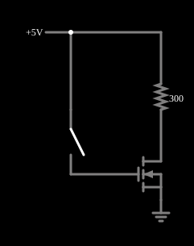

# MOSFET como chave

<!-- navegacao:inicio -->
[Índice](README.md) · [Anterior: p-MOSFET](pmosfet.md) · [Próximo: Source Follower](mosfollower.md)
<!-- navegacao:fim -->

## Objetivo

Mostrar o MOSFET de canal n usado como **chave**: com a porta em nível baixo ele está cortado e a carga não recebe corrente; com a porta em nível alto ele opera na região de triodo, como um resistor de resistência pequena, e quase toda a tensão da alimentação cai na carga.

## O circuito

<!-- esquema:inicio -->

<!-- esquema:fim -->

Uma carga de $300\ \Omega$ liga $+5\ \text{V}$ ao dreno de um NMOS (modelo padrão, sem diodo de corpo), com a fonte na terra. Uma chave (SPST) liga a porta a $+5\ \text{V}$; aberta, a porta fica em $0\ \text{V}$. O exemplo abre com a chave aberta.

<!-- componentes:inicio -->
| N.º | Tipo | Elemento | Valores |
|----:|------|----------|---------|
| 0 | `SwitchElm` | switch (SPST) | Momentary Switch = não; IEC Symbol = não; Label (for linking) = ; Keyboard Shortcut = ; On Resistance (ohms) = 0 |
| 2 | `ResistorElm` | resistor | Resistance (ohms) = 300 |
| 4 | `NMosfetElm` | MOSFET | Model = default-nodiode; Swap D/S = não |
| 6 | `RailElm` | voltage source | Voltage = 5; Waveform = D/C; DC Offset (V) = 0; Internal Resistance (ohms) = 0 |
| 7 | `GroundElm` | ground | Symbol = Earth |
<!-- componentes:fim -->

## Teoria

Com a porta em $0\ \text{V}$, $V_{GS} = 0 < V_t = 1{,}5\ \text{V}$: o transistor está cortado e a corrente é a de fuga, $I_D = 10^{-8}\ \text{S} \cdot V_{DS} \approx 50\ \text{nA}$. Com a chave fechada, $V_{GS} = 5\ \text{V}$ e $V_{ov} = 3{,}5\ \text{V}$; a corrente é limitada pela carga e não pelo transistor, de modo que $V_{DS}$ fica pequeno e a região é a de **triodo**, onde

$$I_D = \beta\left(V_{ov}V_{DS} - \tfrac12 V_{DS}^2\right) \approx \beta V_{ov}\,V_{DS} \ \Rightarrow \ R_{on} \approx \frac{1}{\beta V_{ov}} = \frac{1}{0{,}02 \cdot 3{,}5} \approx 14{,}3\ \Omega,$$

para $V_{DS}$ pequeno. A resistência de ligado é a do canal.

## Resultados esperados

Chave aberta: $I_D = 50\ \text{nA}$ ($5\ \text{V}$ em $300\ \Omega$ dá $16{,}7\ \text{mA}$ se o transistor fosse um curto; a fuga é $3 \cdot 10^{-6}$ disso) e a tensão do dreno fica em $5{,}000\ \text{V}$. Chave fechada: a corrente é $15{,}88\ \text{mA}$ e a tensão do dreno, $0{,}2348\ \text{V}$; a resolução exata da equação de triodo, $(5 - V_{DS})/300 = 0{,}02\,[3{,}5\,V_{DS} - V_{DS}^2/2]$, dá $V_{DS} = 0{,}2348\ \text{V}$, e a resistência efetiva $R = 0{,}2348/0{,}01588 = 14{,}8\ \Omega$, um pouco acima da estimativa de $14{,}3\ \Omega$ porque $V_{DS}$ não é desprezível. As verificações conferem a corrente com a chave aberta e, com a chave fechada, a corrente e a tensão do dreno (tolerância de $1\%$).

## O que observar

Clique na chave: a corrente na carga passa de quase nada a $\approx 16\ \text{mA}$ e o dreno cai de $5\ \text{V}$ para $0{,}23\ \text{V}$. Para testar: troque o resistor de carga por $30\ \Omega$ e veja a corrente subir a $100\ \text{mA}$ com $2\ \text{V}$ no transistor (ainda no triodo, com $R \approx 20\ \Omega$); com $10\ \Omega$ o transistor passa à saturação, com corrente de $122{,}5\ \text{mA}$ ($\tfrac12\beta V_{ov}^2$) e $3{,}775\ \text{V}$ nele: deixa de ser uma boa chave (valores medidos no simulador com a chave fechada); reduza a tensão de porta para algo próximo de $1{,}5\ \text{V}$ e veja a resistência de ligado crescer muito, pois $R_{on} \propto 1/(V_{GS} - V_t)$.

## Limites do modelo

- A fuga de $50\ \text{nA}$ é a do modelo; num MOSFET real a corrente de corte é muito menor (picoampères) ou maior conforme a temperatura.
- Não há capacitâncias de porta nem tempo de chaveamento: a transição é instantânea. Num circuito real, a porta precisa carregar e descarregar $C_{gs}$ e $C_{gd}$.
- A fórmula de $R_{on}$ vale para $V_{DS}$ pequeno e despreza efeitos de canal curto.

## Referências

Sedra e Smith, *Microelectronic Circuits*, capítulo sobre o MOSFET (características $i$–$v$ e modelo de lei quadrática); Razavi, *Fundamentals of Microelectronics*, capítulo sobre o MOSFET.

O circuito deste exemplo faz parte da coleção do simulador original de Paul Falstad e Iain Sharp (CircuitJS1); a explicação é deste projeto.
