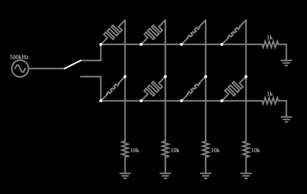

# Memória crossbar de memristores

<!-- navegacao:inicio -->
[Índice](README.md) · [Anterior: Hard-Switching 2](mr-sine3.md)
<!-- navegacao:fim -->

## Objetivo

Mostrar uma **memória de barras cruzadas** (*crossbar*): os memristores ficam nos cruzamentos de linhas e colunas e cada um guarda um bit na sua resistência (baixa para $1$, alta para $0$). Lê-se um bit aplicando uma tensão à linha e olhando a tensão na coluna.

## O circuito

<!-- esquema:inicio -->

<!-- esquema:fim -->

Oito memristores ($R_{on} = 100\ \Omega$, $R_{off} = 250\ \text{k}\Omega$, $D = 10\ \text{nm}$) formam uma matriz de **2 linhas por 4 colunas**. Cada coluna termina num resistor de $10\ \text{k}\Omega$ para a terra, e cada linha, num resistor de $1\ \text{k}\Omega$ para a terra. Uma chave de duas posições aplica a fonte de leitura ($1\ \text{V}$, $500\ \text{kHz}$, tão curta que não altera os memristores) a uma ou à outra linha.

Os bits guardados (largura dopada de $10\ \text{nm}$ vale $1$, de $0$ vale $0$) são:

| | Coluna 1 | Coluna 2 | Coluna 3 | Coluna 4 |
|---|:---:|:---:|:---:|:---:|
| Linha 1 | $0$ | $0$ | $1$ | $1$ |
| Linha 2 | $1$ | $0$ | $1$ | $0$ |

<!-- componentes:inicio -->
| N.º | Tipo | Elemento | Valores |
|----:|------|----------|---------|
| 0 | `MemristorElm` | memristor | Min Resistance (ohms) = 100; Max Resistance (ohms) = 250k; Width of Doped Region (nm) = 0; Total Width (nm) = 10; Mobility (um^2/(s*V)) = 100 |
| 1 | `MemristorElm` | memristor | Min Resistance (ohms) = 100; Max Resistance (ohms) = 250k; Width of Doped Region (nm) = 0; Total Width (nm) = 10; Mobility (um^2/(s*V)) = 100 |
| 2 | `MemristorElm` | memristor | Min Resistance (ohms) = 100; Max Resistance (ohms) = 250k; Width of Doped Region (nm) = 10; Total Width (nm) = 10; Mobility (um^2/(s*V)) = 100 |
| 3 | `MemristorElm` | memristor | Min Resistance (ohms) = 100; Max Resistance (ohms) = 250k; Width of Doped Region (nm) = 0; Total Width (nm) = 10; Mobility (um^2/(s*V)) = 100 |
| 14 | `MemristorElm` | memristor | Min Resistance (ohms) = 100; Max Resistance (ohms) = 250k; Width of Doped Region (nm) = 10; Total Width (nm) = 10; Mobility (um^2/(s*V)) = 100 |
| 15 | `MemristorElm` | memristor | Min Resistance (ohms) = 100; Max Resistance (ohms) = 250k; Width of Doped Region (nm) = 10; Total Width (nm) = 10; Mobility (um^2/(s*V)) = 100 |
| 16 | `MemristorElm` | memristor | Min Resistance (ohms) = 100; Max Resistance (ohms) = 250k; Width of Doped Region (nm) = 10; Total Width (nm) = 10; Mobility (um^2/(s*V)) = 100 |
| 17 | `MemristorElm` | memristor | Min Resistance (ohms) = 100; Max Resistance (ohms) = 250k; Width of Doped Region (nm) = 0; Total Width (nm) = 10; Mobility (um^2/(s*V)) = 100 |
| 22 | `Switch2Elm` | switch (SPDT) | Momentary Switch = não; Group Number (for linking) = 0; # of Throws = 2; Keyboard Shortcut = ; On Resistance (ohms) = 0 |
| 25 | `RailElm` | A/C source | Max Voltage = 1; Waveform = A/C; DC Offset (V) = 0; Internal Resistance (ohms) = 0; Show Voltage = não; Frequency (Hz) = 500k; Phase Offset (degrees) = 0 |
| 26 | `ResistorElm` | resistor | Resistance (ohms) = 10k |
| 27 | `ResistorElm` | resistor | Resistance (ohms) = 10k |
| 28 | `ResistorElm` | resistor | Resistance (ohms) = 10k |
| 29 | `ResistorElm` | resistor | Resistance (ohms) = 10k |
| 30 | `GroundElm` | ground | Symbol = Earth |
| 31 | `GroundElm` | ground | Symbol = Earth |
| 32 | `GroundElm` | ground | Symbol = Earth |
| 33 | `GroundElm` | ground | Symbol = Earth |
| 36 | `ResistorElm` | resistor | Resistance (ohms) = 1k |
| 37 | `ResistorElm` | resistor | Resistance (ohms) = 1k |
| 38 | `GroundElm` | ground | Symbol = Earth |
| 39 | `GroundElm` | ground | Symbol = Earth |
<!-- componentes:fim -->

## Símbolos e parâmetros

Os símbolos usados neste documento (definições completas no [glossário](../glossario-simbolos.md)):

| Símbolo | Nome | Significado | Unidade |
|---------|------|-------------|---------|
| $x$ | estado x do memristor | $w/D$: fração da espessura que está dopada (de $0$ a $1$) | — |
| $t$ | tempo | instante, contado a partir do início da simulação | s |
| $i$ | corrente instantânea | valor da corrente em cada instante, que pode variar no tempo | A |
| $D$ | espessura total do filme | espessura $D$ do filme fino do memristor | m |
| $v$ | tensão instantânea | valor da tensão em cada instante, que pode variar no tempo | V |
| $R$ | resistência | oposição de um resistor à passagem da corrente ($V = R I$) | Ω |
| $w$ | largura da região dopada | largura da região dopada do memristor | m |
| $R_{\text{on}}$ | resistência de condução | resistência de uma chave ou de um transistor quando conduz | Ω |
| $R_{\text{off}}$ | resistência de corte | resistência de uma chave ou de um transistor quando não conduz | Ω |
| $k$ | constante de deriva do memristor | constante que relaciona a velocidade da fronteira dopada à corrente, $dx/dt = k\thinspace i$ | 1/(A·s) |
| $\mu$ | mobilidade | mobilidade dos íons no memristor | m²/(s·V) |
| $\varphi$ | fase | ângulo de defasagem de um sinal em relação a uma referência | rad |
| $\varphi_0$ | fluxo inicial | valor inicial do fluxo magnético do memristor | Wb |

## Teoria

O memristor do simulador é o modelo de deriva linear da HP: um filme de espessura total $D$, com uma região dopada de largura $w$, tem resistência

$$R(w) = R_{on}\thinspace\frac{w}{D} + R_{off}\left(1 - \frac wD\right),$$

e a região dopada se desloca com a corrente: $dw/dt = \mu\thinspace R_{on}\thinspace i/D$, limitada a $0 \le w \le D$. Com a fração $x = w/D$, $dx/dt = k\thinspace i$, onde $k = \mu R_{on}/D^2$ vale, para $\mu = 100\ \mu\text{m}^2/(\text{V·s})$, $R_{on} = 100\ \Omega$ e $D = 10\ \text{nm}$, $k = 10^{8}\ \text{A}^{-1}\text{s}^{-1}$. Como $i = v/R$ e $R$ é linear em $x$, a equação se integra em função do *fluxo* $\varphi(t) = \int v\thinspace dt$:

$$R(t) = \sqrt{R_{off}^2 - 2\thinspace(R_{off} - R_{on})\thinspace k\thinspace\bigl[\varphi(t) + \varphi_0\bigr]}\quad(R_{on} \le R \le R_{off}),$$

e a corrente é $i = v/R$. A resistência depende do histórico da tensão: é por isso que o dispositivo tem **memória** e a curva $v$–$i$ é uma **histerese cintada** (passa sempre pela origem).

A leitura é um divisor de tensão: a linha acionada, com $1\ \text{V}$, alimenta cada coluna pelo memristor do cruzamento em série com o resistor de $10\ \text{k}\Omega$ da coluna. Para um bit $1$ ($100\ \Omega$) a tensão da coluna é quase a da linha ($10/10{,}1 \approx 0{,}99$ se não houvesse outros caminhos); para um bit $0$ ($250\ \text{k}\Omega$) é quase zero ($10/260 = 0{,}04$). Os outros memristores da coluna, ligados à linha não acionada, formam caminhos parasitas (*sneak paths*) que alteram as tensões, por isso os valores medidos se afastam dos ideais.

## Resultados esperados

O simulador dá, para a amplitude da tensão em cada coluna:

| Linha acionada | Col. 1 | Col. 2 | Col. 3 | Col. 4 |
|---|---:|---:|---:|---:|
| Linha 1 | $0{,}128\ \text{V}$ | $0{,}042\ \text{V}$ | $0{,}639\ \text{V}$ | $0{,}915\ \text{V}$ |
| Linha 2 | $0{,}915\ \text{V}$ | $0{,}042\ \text{V}$ | $0{,}639\ \text{V}$ | $0{,}128\ \text{V}$ |

Nos dois casos as colunas com bit $1$ têm tensão alta ($0{,}64$ a $0{,}92\ \text{V}$) e as com bit $0$, baixa ($0{,}04$ a $0{,}13\ \text{V}$): os bits lidos são exatamente os guardados. A linha acionada mostra $1{,}000\ \text{V}$ no seu resistor de $1\ \text{k}\Omega$ e a outra, $0{,}130\ \text{V}$.

## O que observar

Acione a chave e leia a outra linha: as colunas 1 e 4 trocam de nível, as colunas 2 e 3 não. O contraste entre $1$ e $0$ é de mais de $5$ vezes, mesmo com os caminhos parasitas.

## Limites do modelo

- A leitura de uma matriz maior sofreria mais com os caminhos parasitas; as memórias *crossbar* reais usam seletores (diodos, transistores) em cada célula.
- A escrita (mudar os bits) não está demonstrada: o exemplo só lê, com tensão de leitura baixa e frequência alta demais para alterar os estados.
- Modelo de deriva linear.

## Referências

Strukov, Snider, Stewart e Williams, *The missing memristor found*, Nature 453 (2008); Chua, *Memristor, the missing circuit element*, IEEE Transactions on Circuit Theory 18 (1971).

O circuito deste exemplo faz parte da coleção do simulador original de Paul Falstad e Iain Sharp (CircuitJS1); a explicação é deste projeto.
