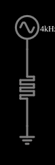

# Memristor com tensão senoidal

<!-- navegacao:inicio -->
[Índice](README.md) · [Anterior: Memristor](mr.md) · [Próximo: Square Wave](mr-square.md)
<!-- navegacao:fim -->

## Objetivo

Mostrar a **curva de histerese cintada** do memristor: com uma tensão senoidal, a curva corrente–tensão é uma figura em 8 que passa pela origem. A cintura da figura é a assinatura do memristor.

## O circuito

<!-- esquema:inicio -->

<!-- esquema:fim -->

O memristor ($R_{on} = 100\ \Omega$, $R_{off} = 16\ \text{k}\Omega$, $D = 10\ \text{nm}$, começando em $R_{off}$) recebe uma tensão senoidal de $1\ \text{V}$ de pico e $4\ \text{kHz}$. Os osciloscópios mostram a tensão, a corrente e a curva corrente–tensão.

<!-- componentes:inicio -->
| N.º | Tipo | Elemento | Valores |
|----:|------|----------|---------|
| 0 | `GroundElm` | ground | Symbol = Earth |
| 1 | `MemristorElm` | memristor | Min Resistance (ohms) = 100; Max Resistance (ohms) = 16k; Width of Doped Region (nm) = 0; Total Width (nm) = 10; Mobility (um^2/(s*V)) = 100 |
| 2 | `RailElm` | A/C source | Max Voltage = 1; Waveform = A/C; DC Offset (V) = 0; Internal Resistance (ohms) = 0; Show Voltage = não; Frequency (Hz) = 4k; Phase Offset (degrees) = 0 |
<!-- componentes:fim -->

## Teoria

O memristor do simulador é o modelo de deriva linear da HP: um filme de espessura total $D$, com uma região dopada de largura $w$, tem resistência

$$R(w) = R_{on}\thinspace\frac{w}{D} + R_{off}\left(1 - \frac wD\right),$$

e a região dopada se desloca com a corrente: $dw/dt = \mu\thinspace R_{on}\thinspace i/D$, limitada a $0 \le w \le D$. Com a fração $x = w/D$, $dx/dt = k\thinspace i$, onde $k = \mu R_{on}/D^2$ vale, para $\mu = 100\ \mu\text{m}^2/(\text{V·s})$, $R_{on} = 100\ \Omega$ e $D = 10\ \text{nm}$, $k = 10^{8}\ \text{A}^{-1}\text{s}^{-1}$. Como $i = v/R$ e $R$ é linear em $x$, a equação se integra em função do *fluxo* $\varphi(t) = \int v\thinspace dt$:

$$R(t) = \sqrt{R_{off}^2 - 2\thinspace(R_{off} - R_{on})\thinspace k\thinspace\bigl[\varphi(t) + \varphi_0\bigr]}\quad(R_{on} \le R \le R_{off}),$$

e a corrente é $i = v/R$. A resistência depende do histórico da tensão: é por isso que o dispositivo tem **memória** e a curva $v$–$i$ é uma **histerese cintada** (passa sempre pela origem).

Com $v = V_p\sin\omega t$, $\varphi(t) = V_p(1 - \cos\omega t)/\omega$. Para $V_p = 1\ \text{V}$ e $f = 4\ \text{kHz}$, o termo $2(R_{off} - R_{on})kV_p/\omega = 1{,}265\cdot 10^{8}\ \Omega^2$ dá:

- em $t = T/4$ ($v = 1\ \text{V}$): $R = \sqrt{2{,}56\cdot 10^8 - 1{,}265\cdot 10^8} = 11{,}4\ \text{k}\Omega$ e $i = 87{,}9\ \mu\text{A}$;
- em $t = T/2$ ($v = 0$): $R = 1{,}72\ \text{k}\Omega$, a menor, mas $i = 0$: é o ponto em que a curva passa pela origem;
- em $t = 3T/4$ ($v = -1\ \text{V}$): $R = 11{,}4\ \text{k}\Omega$ de novo e $i = -87{,}9\ \mu\text{A}$, curva simétrica.

## Resultados esperados

O simulador dá:

| $t$ | $v$ | $i$ (simulada) | $i$ (teoria) |
|---:|---:|---:|---:|
| $31{,}25\ \mu\text{s}$ | $0{,}707\ \text{V}$ | $48\ \mu\text{A}$ | $47{,}8\ \mu\text{A}$ |
| $62{,}5\ \mu\text{s}$ | $1\ \text{V}$ | $88\ \mu\text{A}$ | $87{,}9\ \mu\text{A}$ |
| $93{,}75\ \mu\text{s}$ | $0{,}707\ \text{V}$ | $111\ \mu\text{A}$ | $111{,}8\ \mu\text{A}$ |
| $125\ \mu\text{s}$ | $0$ | $\approx 0$ | $0$ |
| $187{,}5\ \mu\text{s}$ | $-1\ \text{V}$ | $-88\ \mu\text{A}$ | $-87{,}9\ \mu\text{A}$ |

A corrente é maior na descida da tensão ($111\ \mu\text{A}$ em $0{,}707\ \text{V}$) que na subida ($48\ \mu\text{A}$ na mesma tensão): é a histerese. Ao fim do ciclo ($T = 250\ \mu\text{s}$) o fluxo volta a zero e a resistência a $16\ \text{k}\Omega$, e o ciclo seguinte repete o primeiro.

## O que observar

Observe o osciloscópio da curva: os dois lóbulos da figura em 8 são simétricos e se encontram na origem. Aumente a frequência e as duas metades se fecham sobre uma só curva (o memristor passa a ser, na prática, um resistor): a histerese depende da frequência.

## Limites do modelo

- O modelo é o de deriva linear, sem janela; num memristor real a deriva é mais lenta perto das bordas.
- A teoria acima supõe que a região dopada não atinge $0$ nem $D$ durante o ciclo; isso vale aqui porque a resistência varia de $16\ \text{k}\Omega$ a $1{,}72\ \text{k}\Omega$.

## Referências

Strukov, Snider, Stewart e Williams, *The missing memristor found*, Nature 453 (2008); Chua, *Memristor, the missing circuit element*, IEEE Transactions on Circuit Theory 18 (1971).

O circuito deste exemplo faz parte da coleção do simulador original de Paul Falstad e Iain Sharp (CircuitJS1); a explicação é deste projeto.
