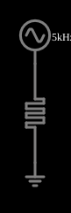

# Memristor com comutação dura (1)

<!-- navegacao:inicio -->
[Índice](README.md) · [Anterior: Triangle Wave](mr-triangle.md) · [Próximo: Hard-Switching 2](mr-sine3.md)
<!-- navegacao:fim -->

## Objetivo

Mostrar o memristor **chegando ao limite** de sua faixa: com $R_{off}$ menor e frequência maior, a resistência bate em $R_{on}$ e fica saturada por um instante antes de voltar a subir, e a histerese cintada se torna mais pronunciada.

## O circuito

<!-- esquema:inicio -->

<!-- esquema:fim -->

O memristor tem $R_{on} = 100\ \Omega$, $R_{off} = 12{,}5\ \text{k}\Omega$ e começa em $R_{off}$; a tensão é senoidal de $1\ \text{V}$ de pico e $5\ \text{kHz}$ (período de $200\ \mu\text{s}$).

<!-- componentes:inicio -->
| N.º | Tipo | Elemento | Valores |
|----:|------|----------|---------|
| 0 | `GroundElm` | ground | Symbol = Earth |
| 1 | `MemristorElm` | memristor | Min Resistance (ohms) = 100; Max Resistance (ohms) = 12.5k; Width of Doped Region (nm) = 0; Total Width (nm) = 10; Mobility (um^2/(s*V)) = 100 |
| 2 | `RailElm` | A/C source | Max Voltage = 1; Waveform = A/C; DC Offset (V) = 0; Internal Resistance (ohms) = 0; Show Voltage = não; Frequency (Hz) = 5k; Phase Offset (degrees) = 0 |
<!-- componentes:fim -->

## Teoria

O memristor do simulador é o modelo de deriva linear da HP: um filme de espessura total $D$, com uma região dopada de largura $w$, tem resistência

$$R(w) = R_{on}\,\frac{w}{D} + R_{off}\left(1 - \frac wD\right),$$

e a região dopada se desloca com a corrente: $dw/dt = \mu\,R_{on}\,i/D$, limitada a $0 \le w \le D$. Com a fração $x = w/D$, $dx/dt = k\,i$, onde $k = \mu R_{on}/D^2$ vale, para $\mu = 100\ \mu\text{m}^2/(\text{V·s})$, $R_{on} = 100\ \Omega$ e $D = 10\ \text{nm}$, $k = 10^{8}\ \text{A}^{-1}\text{s}^{-1}$. Como $i = v/R$ e $R$ é linear em $x$, a equação se integra em função do *fluxo* $\varphi(t) = \int v\,dt$:

$$R(t) = \sqrt{R_{off}^2 - 2\,(R_{off} - R_{on})\,k\,\bigl[\varphi(t) + \varphi_0\bigr]}\quad(R_{on} \le R \le R_{off}),$$

e a corrente é $i = v/R$. A resistência depende do histórico da tensão: é por isso que o dispositivo tem **memória** e a curva $v$–$i$ é uma **histerese cintada** (passa sempre pela origem).

Com $\varphi = V_p(1 - \cos\omega t)/\omega$ e $V_p = 1\ \text{V}$, $\omega = 31\,416\ \text{rad/s}$, o fluxo máximo em $T/2 = 100\ \mu\text{s}$ é $63{,}7\ \mu\text{V·s}$, e o limite em que $R$ chega a $R_{on}$ é $\varphi_{max} = (R_{off} + R_{on})/(2k) = 63{,}0\ \mu\text{V·s}$: o fluxo passa um pouco desse valor, e a resistência fica saturada em $R_{on}$ ($100\ \Omega$) por um instante em torno de $t = 100\ \mu\text{s}$. É a comutação *dura*: o dispositivo vai de uma extremidade da faixa à outra.

## Resultados esperados

O simulador dá:

| $t$ | $v$ | $i$ (simulada) | $i$ (teoria) |
|---:|---:|---:|---:|
| $25\ \mu\text{s}$ | $0{,}707\ \text{V}$ | $61\ \mu\text{A}$ | $61{,}3\ \mu\text{A}$ |
| $50\ \mu\text{s}$ | $1\ \text{V}$ | $113\ \mu\text{A}$ | $113{,}7\ \mu\text{A}$ |
| $75\ \mu\text{s}$ | $0{,}707\ \text{V}$ | $151\ \mu\text{A}$ | $152{,}5\ \mu\text{A}$ |
| $125\ \mu\text{s}$ | $-0{,}707\ \text{V}$ | $-147\ \mu\text{A}$ | $-147{,}0\ \mu\text{A}$ |
| $150\ \mu\text{s}$ | $-1\ \text{V}$ | $-113\ \mu\text{A}$ | $-112{,}5\ \mu\text{A}$ |

A resistência chega a $100\ \Omega$ no instante $t = 100\ \mu\text{s}$, quando a tensão é zero: a curva passa pela origem em ambos os extremos.

## O que observar

Observe a curva corrente–tensão: os lóbulos são bem assimétricos, a corrente de descida passa de $150\ \mu\text{A}$, e o laço se fecha ao fim de cada ciclo.

## Limites do modelo

- A saturação ocorre onde a corrente é nula, por isso o efeito sobre as formas de onda é pequeno; o exemplo seguinte leva o memristor à saturação com corrente alta.
- Modelo de deriva linear.

## Referências

Strukov, Snider, Stewart e Williams, *The missing memristor found*, Nature 453 (2008); Chua, *Memristor, the missing circuit element*, IEEE Transactions on Circuit Theory 18 (1971).

O circuito deste exemplo faz parte da coleção do simulador original de Paul Falstad e Iain Sharp (CircuitJS1); a explicação é deste projeto.
