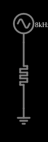

# Memristor com comutação dura (2)

<!-- navegacao:inicio -->
[Índice](README.md) · [Anterior: Hard-Switching 1](mr-sine2.md) · [Próximo: Crossbar Memory](mr-crossbar.md)
<!-- navegacao:fim -->

## Objetivo

Mostrar o memristor **saturando nos dois extremos**: com uma tensão alta e uma faixa estreita, ele fica preso em $R_{on}$ durante o semiciclo positivo e em $R_{off}$ durante o negativo, e passa a se comportar como um **diodo** com memória.

## O circuito

<!-- esquema:inicio -->

<!-- esquema:fim -->

O memristor tem $R_{on} = 100\ \Omega$, $R_{off} = 5\ \text{k}\Omega$, largura inicial dopada de $3{,}87\ \text{nm}$ de um total de $10\ \text{nm}$; a tensão é senoidal de $2\ \text{V}$ de pico e $8\ \text{kHz}$ (período de $125\ \mu\text{s}$).

<!-- componentes:inicio -->
| N.º | Tipo | Elemento | Valores |
|----:|------|----------|---------|
| 0 | `GroundElm` | ground | Symbol = Earth |
| 1 | `MemristorElm` | memristor | Min Resistance (ohms) = 100; Max Resistance (ohms) = 5k; Width of Doped Region (nm) = 3.9; Total Width (nm) = 10; Mobility (um^2/(s*V)) = 100 |
| 2 | `RailElm` | A/C source | Max Voltage = 2; Waveform = A/C; DC Offset (V) = 0; Internal Resistance (ohms) = 0; Show Voltage = não; Frequency (Hz) = 8k; Phase Offset (degrees) = 0 |
<!-- componentes:fim -->

## Teoria

O memristor do simulador é o modelo de deriva linear da HP: um filme de espessura total $D$, com uma região dopada de largura $w$, tem resistência

$$R(w) = R_{on}\,\frac{w}{D} + R_{off}\left(1 - \frac wD\right),$$

e a região dopada se desloca com a corrente: $dw/dt = \mu\,R_{on}\,i/D$, limitada a $0 \le w \le D$. Com a fração $x = w/D$, $dx/dt = k\,i$, onde $k = \mu R_{on}/D^2$ vale, para $\mu = 100\ \mu\text{m}^2/(\text{V·s})$, $R_{on} = 100\ \Omega$ e $D = 10\ \text{nm}$, $k = 10^{8}\ \text{A}^{-1}\text{s}^{-1}$. Como $i = v/R$ e $R$ é linear em $x$, a equação se integra em função do *fluxo* $\varphi(t) = \int v\,dt$:

$$R(t) = \sqrt{R_{off}^2 - 2\,(R_{off} - R_{on})\,k\,\bigl[\varphi(t) + \varphi_0\bigr]}\quad(R_{on} \le R \le R_{off}),$$

e a corrente é $i = v/R$. A resistência depende do histórico da tensão: é por isso que o dispositivo tem **memória** e a curva $v$–$i$ é uma **histerese cintada** (passa sempre pela origem).

Com $2\ \text{V}$ e uma faixa estreita ($R_{off} = 5\ \text{k}\Omega$), o fluxo de um semiciclo basta para levar a fração dopada de $0{,}39$ ao limite superior em poucos microssegundos, e no semiciclo negativo, ao inferior: o dispositivo opera quase sempre *saturado*, em $R_{on}$ (positivo) ou $R_{off}$ (negativo), como uma chave que se fecha com tensão positiva e se abre com tensão negativa, o que é um diodo (de resistência $100\ \Omega$ no sentido direto e $5\ \text{k}\Omega$ no inverso).

## Resultados esperados

O simulador dá:

- **Semiciclo positivo:** a corrente chega a $14{,}1\ \text{mA}$ em $15{,}6\ \mu\text{s}$ ($v = 1{,}41\ \text{V}$) e a $20{,}0\ \text{mA}$ em $31{,}25\ \mu\text{s}$ ($v = 2\ \text{V}$): $v/R_{on}$, memristor saturado em $100\ \Omega$.
- **Semiciclo negativo:** a corrente é de apenas $-0{,}418\ \text{mA}$ em $78\ \mu\text{s}$ e $-0{,}400\ \text{mA}$ em $93{,}75\ \mu\text{s}$ ($v = -2\ \text{V}$, $R = 5\ \text{k}\Omega$): $-2/5000$.
- **Ciclo seguinte:** de novo $20{,}0\ \text{mA}$ em $156\ \mu\text{s}$ e em $281\ \mu\text{s}$: o ciclo se repete.

A razão entre as correntes de pico, $20/0{,}4 = 50$, é a razão $R_{off}/R_{on}$: um retificador.

## O que observar

Veja a curva corrente–tensão: é quase a de um diodo, uma reta de inclinação $1/100\ \Omega$ para tensões positivas e outra de $1/5\ \text{k}\Omega$ para as negativas, com uma transição curta.

## Limites do modelo

- A resistência é limitada a $[R_{on}, R_{off}]$ pelo modelo, sem outras não linearidades; um memristor físico não tem esse comportamento ideal de chave.
- Modelo de deriva linear.

## Referências

Strukov, Snider, Stewart e Williams, *The missing memristor found*, Nature 453 (2008); Chua, *Memristor, the missing circuit element*, IEEE Transactions on Circuit Theory 18 (1971).

O circuito deste exemplo faz parte da coleção do simulador original de Paul Falstad e Iain Sharp (CircuitJS1); a explicação é deste projeto.
