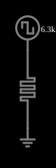

# Memristor com onda quadrada

<!-- navegacao:inicio -->
[Índice](README.md) · [Anterior: Sine Wave](mr-sine.md) · [Próximo: Triangle Wave](mr-triangle.md)
<!-- navegacao:fim -->

## Objetivo

Mostrar a resposta do memristor a uma **onda quadrada**: a resistência diminui enquanto a tensão é positiva e aumenta enquanto é negativa, sempre mais depressa quanto menor ela é.

## O circuito

<!-- esquema:inicio -->

<!-- esquema:fim -->

O mesmo memristor ($R_{on} = 100\ \Omega$, $R_{off} = 16\ \text{k}\Omega$, começando em $R_{off}$) recebe uma onda quadrada de $\pm 1\ \text{V}$ e $6{,}3\ \text{kHz}$ (meio período de $79{,}4\ \mu\text{s}$).

<!-- componentes:inicio -->
| N.º | Tipo | Elemento | Valores |
|----:|------|----------|---------|
| 0 | `GroundElm` | ground | Symbol = Earth |
| 1 | `MemristorElm` | memristor | Min Resistance (ohms) = 100; Max Resistance (ohms) = 16k; Width of Doped Region (nm) = 0; Total Width (nm) = 10; Mobility (um^2/(s*V)) = 100 |
| 2 | `RailElm` | square wave gen | Max Voltage = 1; Waveform = Square Wave; DC Offset (V) = 0; Internal Resistance (ohms) = 0; Show Voltage = não; Specify As = Frequency/Duty Cycle; Frequency (Hz) = 6.3k; Phase Offset (degrees) = 0; Duty Cycle = 50; Rise/Fall Time (s) = 0 |
<!-- componentes:fim -->

## Teoria

O memristor do simulador é o modelo de deriva linear da HP: um filme de espessura total $D$, com uma região dopada de largura $w$, tem resistência

$$R(w) = R_{on}\thinspace\frac{w}{D} + R_{off}\left(1 - \frac wD\right),$$

e a região dopada se desloca com a corrente: $dw/dt = \mu\thinspace R_{on}\thinspace i/D$, limitada a $0 \le w \le D$. Com a fração $x = w/D$, $dx/dt = k\thinspace i$, onde $k = \mu R_{on}/D^2$ vale, para $\mu = 100\ \mu\text{m}^2/(\text{V·s})$, $R_{on} = 100\ \Omega$ e $D = 10\ \text{nm}$, $k = 10^{8}\ \text{A}^{-1}\text{s}^{-1}$. Como $i = v/R$ e $R$ é linear em $x$, a equação se integra em função do *fluxo* $\varphi(t) = \int v\thinspace dt$:

$$R(t) = \sqrt{R_{off}^2 - 2\thinspace(R_{off} - R_{on})\thinspace k\thinspace\bigl[\varphi(t) + \varphi_0\bigr]}\quad(R_{on} \le R \le R_{off}),$$

e a corrente é $i = v/R$. A resistência depende do histórico da tensão: é por isso que o dispositivo tem **memória** e a curva $v$–$i$ é uma **histerese cintada** (passa sempre pela origem).

Com $v = \pm 1\ \text{V}$, $\varphi$ cresce (ou decresce) linearmente em cada meio período; a resistência cai como $\sqrt{R_{off}^2 - 2\Delta R\thinspace k\thinspace V t}$ na parte positiva e sobe pelo mesmo caminho, ao contrário, na negativa. Em $t = 59{,}5\ \mu\text{s}$ (perto do fim do semiciclo positivo, com $\varphi = 59{,}5\ \mu\text{V·s}$) a resistência é $8{,}17\ \text{k}\Omega$ e a corrente é de $122\ \mu\text{A}$.

## Resultados esperados

O simulador dá, durante o semiciclo positivo, correntes de $72\ \mu\text{A}$ em $19{,}8\ \mu\text{s}$, $88\ \mu\text{A}$ em $39{,}7\ \mu\text{s}$ e $122\ \mu\text{A}$ em $59{,}5\ \mu\text{s}$ (a teoria dá $72{,}0$, $87{,}8$ e $122{,}4\ \mu\text{A}$): a corrente cresce a uma taxa que aumenta, porque a resistência cai e a corrente sobe. No semiciclo negativo, a corrente é de $-122\ \mu\text{A}$ em $99{,}2\ \mu\text{s}$ e $-88\ \mu\text{A}$ em $119\ \mu\text{s}$.

## O que observar

Compare o formato da corrente com o da tensão: a tensão é plana em cada semiciclo e a corrente é uma curva crescente (positiva) ou decrescente em módulo (negativa), com o memristor guardando o estado entre os semiciclos.

## Limites do modelo

- A onda quadrada ideal, com subida instantânea, pede um passo de $50\ \text{ns}$ para ser bem resolvida; os valores logo depois da transição dependem desse passo.
- Modelo de deriva linear, como nos outros memristores.

## Referências

Strukov, Snider, Stewart e Williams, *The missing memristor found*, Nature 453 (2008); Chua, *Memristor, the missing circuit element*, IEEE Transactions on Circuit Theory 18 (1971).

O circuito deste exemplo faz parte da coleção do simulador original de Paul Falstad e Iain Sharp (CircuitJS1); a explicação é deste projeto.
