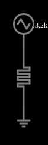

# Memristor com onda triangular

<!-- navegacao:inicio -->
[Índice](README.md) · [Anterior: Square Wave](mr-square.md) · [Próximo: Hard-Switching 1](mr-sine2.md)
<!-- navegacao:fim -->

## Objetivo

Mostrar a resposta do memristor a uma **onda triangular**, que varre a tensão linearmente e deixa a histerese mais fácil de ler: a tensão é uma rampa e a corrente mostra o estado do dispositivo.

## O circuito

<!-- esquema:inicio -->

<!-- esquema:fim -->

O mesmo memristor ($R_{on} = 100\ \Omega$, $R_{off} = 16\ \text{k}\Omega$, começando em $R_{off}$) recebe uma onda triangular de $\pm 1\ \text{V}$ e $3{,}2\ \text{kHz}$ (período de $312{,}5\ \mu\text{s}$).

<!-- componentes:inicio -->
| N.º | Tipo | Elemento | Valores |
|----:|------|----------|---------|
| 0 | `GroundElm` | ground | Symbol = Earth |
| 1 | `MemristorElm` | memristor | Min Resistance (ohms) = 100; Max Resistance (ohms) = 16k; Width of Doped Region (nm) = 0; Total Width (nm) = 10; Mobility (um^2/(s*V)) = 100 |
| 2 | `RailElm` | triangle gen | Max Voltage = 1; Waveform = Triangle; DC Offset (V) = 0; Internal Resistance (ohms) = 0; Show Voltage = não; Frequency (Hz) = 3.2k; Phase Offset (degrees) = 0 |
<!-- componentes:fim -->

## Teoria

O memristor do simulador é o modelo de deriva linear da HP: um filme de espessura total $D$, com uma região dopada de largura $w$, tem resistência

$$R(w) = R_{on}\thinspace\frac{w}{D} + R_{off}\left(1 - \frac wD\right),$$

e a região dopada se desloca com a corrente: $dw/dt = \mu\thinspace R_{on}\thinspace i/D$, limitada a $0 \le w \le D$. Com a fração $x = w/D$, $dx/dt = k\thinspace i$, onde $k = \mu R_{on}/D^2$ vale, para $\mu = 100\ \mu\text{m}^2/(\text{V·s})$, $R_{on} = 100\ \Omega$ e $D = 10\ \text{nm}$, $k = 10^{8}\ \text{A}^{-1}\text{s}^{-1}$. Como $i = v/R$ e $R$ é linear em $x$, a equação se integra em função do *fluxo* $\varphi(t) = \int v\thinspace dt$:

$$R(t) = \sqrt{R_{off}^2 - 2\thinspace(R_{off} - R_{on})\thinspace k\thinspace\bigl[\varphi(t) + \varphi_0\bigr]}\quad(R_{on} \le R \le R_{off}),$$

e a corrente é $i = v/R$. A resistência depende do histórico da tensão: é por isso que o dispositivo tem **memória** e a curva $v$–$i$ é uma **histerese cintada** (passa sempre pela origem).

A integral de uma triangular é uma parábola em cada trecho: $\varphi$ cresce nos trechos de tensão positiva e decresce nos de tensão negativa, e $R = \sqrt{R_{off}^2 - 2\Delta R k\varphi}$ segue essa curva. Em $T/2 = 156{,}3\ \mu\text{s}$ ($v = 1\ \text{V}$, o pico) a resistência é $11{,}5\ \text{k}\Omega$ e a corrente é de $87\ \mu\text{A}$.

## Resultados esperados

O simulador dá:

| $t$ | $i$ (simulada) | $i$ (teoria) |
|---:|---:|---:|
| $117{,}2\ \mu\text{s}$ | $33\ \mu\text{A}$ | $33{,}3\ \mu\text{A}$ |
| $156{,}3\ \mu\text{s}$ (pico de $+1\ \text{V}$) | $87\ \mu\text{A}$ | $87{,}1\ \mu\text{A}$ |
| $195{,}3\ \mu\text{s}$ | $80\ \mu\text{A}$ | $80{,}4\ \mu\text{A}$ |
| $273{,}4\ \mu\text{s}$ | $-80\ \mu\text{A}$ | $-80{,}4\ \mu\text{A}$ |
| $312{,}5\ \mu\text{s}$ (pico de $-1\ \text{V}$) | $-87\ \mu\text{A}$ | $-87{,}1\ \mu\text{A}$ |

Em $t \approx 78\ \mu\text{s}$ e $t \approx 703\ \mu\text{s}$ ($v = 0$) a corrente é zero.

## O que observar

Compare com o exemplo da senoide: a histerese tem a mesma forma de 8, mas com a triangular a corrente é quase proporcional à tensão no primeiro trecho da subida e se afasta dela depois.

## Limites do modelo

- A teoria usa a forma de onda triangular ideal; o simulador tem um passo de $50\ \text{ns}$, e a diferença dos valores numéricos é de menos de $1\ \%$.
- Modelo de deriva linear.

## Referências

Strukov, Snider, Stewart e Williams, *The missing memristor found*, Nature 453 (2008); Chua, *Memristor, the missing circuit element*, IEEE Transactions on Circuit Theory 18 (1971).

O circuito deste exemplo faz parte da coleção do simulador original de Paul Falstad e Iain Sharp (CircuitJS1); a explicação é deste projeto.
