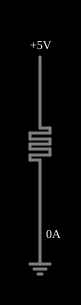

# Memristor com tensão contínua

<!-- navegacao:inicio -->
[Índice](README.md) · [Próximo: Sine Wave](mr-sine.md)
<!-- navegacao:fim -->

## Objetivo

Mostrar o **memristor**, o quarto elemento passivo: sua resistência depende da carga que já passou por ele. Com uma tensão contínua, a resistência cai depressa de $R_{off}$ a $R_{on}$ e fica lá.

## O circuito

<!-- esquema:inicio -->

<!-- esquema:fim -->

Um memristor ($R_{on} = 100\ \Omega$, $R_{off} = 16\ \text{k}\Omega$, $D = 10\ \text{nm}$, largura inicial dopada de $0$) é ligado a uma fonte de tensão contínua ajustável por um cursor de $-5\ \text{V}$ a $5\ \text{V}$ (inicialmente em $5\ \text{V}$). O passo de simulação é de $20\ \text{ns}$.

<!-- componentes:inicio -->
| N.º | Tipo | Elemento | Valores |
|----:|------|----------|---------|
| 0 | `MemristorElm` | memristor | Min Resistance (ohms) = 100; Max Resistance (ohms) = 16k; Width of Doped Region (nm) = 0; Total Width (nm) = 10; Mobility (um^2/(s*V)) = 100 |
| 1 | `GroundElm` | ground | Symbol = Earth |
| 3 | `VarRailElm` | voltage source | Min Voltage = -5; Max Voltage = 5; Slider Text = Voltage |
<!-- componentes:fim -->

## Símbolos e parâmetros

Os símbolos usados neste documento (definições completas no [glossário](../glossario-simbolos.md)):

| Símbolo | Nome | Significado | Unidade |
|---------|------|-------------|---------|
| $x$ | estado x do memristor | $w/D$: fração da espessura que está dopada (de $0$ a $1$) | — |
| $t$ | tempo | instante, contado a partir do início da simulação | s |
| $i$ | corrente instantânea | valor da corrente em cada instante, que pode variar no tempo | A |
| $D$ | espessura total do filme | espessura $D$ do filme fino do memristor | m |
| $v$ | tensão instantânea | valor da tensão em cada instante, que pode variar no tempo | V |
| $R$ | resistência | oposição de um resistor à passagem da corrente ($V = R I$) | Ω |
| $R_{\text{off}}$ | resistência de corte | resistência de uma chave ou de um transistor quando não conduz | Ω |
| $R_{\text{on}}$ | resistência de condução | resistência de uma chave ou de um transistor quando conduz | Ω |
| $k$ | constante de deriva do memristor | constante que relaciona a velocidade da fronteira dopada à corrente, $dx/dt = k\thinspace i$ | 1/(A·s) |
| $V$ | tensão | diferença de potencial elétrico entre dois pontos do circuito | V |
| $w$ | largura da região dopada | largura da região dopada do memristor | m |
| $\mu$ | mobilidade | mobilidade dos íons no memristor | m²/(s·V) |
| $\varphi$ | fase | ângulo de defasagem de um sinal em relação a uma referência | rad |
| $\varphi_0$ | fluxo inicial | valor inicial do fluxo magnético do memristor | Wb |
| $t_c$ | tempo crítico | tempo em que a resistência chega ao limite | s |

## Teoria

O memristor do simulador é o modelo de deriva linear da HP: um filme de espessura total $D$, com uma região dopada de largura $w$, tem resistência

$$R(w) = R_{on}\thinspace\frac{w}{D} + R_{off}\left(1 - \frac wD\right),$$

e a região dopada se desloca com a corrente: $dw/dt = \mu\thinspace R_{on}\thinspace i/D$, limitada a $0 \le w \le D$. Com a fração $x = w/D$, $dx/dt = k\thinspace i$, onde $k = \mu R_{on}/D^2$ vale, para $\mu = 100\ \mu\text{m}^2/(\text{V·s})$, $R_{on} = 100\ \Omega$ e $D = 10\ \text{nm}$, $k = 10^{8}\ \text{A}^{-1}\text{s}^{-1}$. Como $i = v/R$ e $R$ é linear em $x$, a equação se integra em função do *fluxo* $\varphi(t) = \int v\thinspace dt$:

$$R(t) = \sqrt{R_{off}^2 - 2\thinspace(R_{off} - R_{on})\thinspace k\thinspace\bigl[\varphi(t) + \varphi_0\bigr]}\quad(R_{on} \le R \le R_{off}),$$

e a corrente é $i = v/R$. A resistência depende do histórico da tensão: é por isso que o dispositivo tem **memória** e a curva $v$–$i$ é uma **histerese cintada** (passa sempre pela origem).

Com tensão constante $V$, $\varphi = Vt$ e a resistência cai de $R_{off}$ a $R_{on}$ no instante

$$t_c = \frac{R_{off}^2 - R_{on}^2}{2\thinspace(R_{off} - R_{on})\thinspace k\thinspace V} = \frac{R_{off} + R_{on}}{2kV} = \frac{16\thinspace100}{2\cdot 10^8\cdot 5} = 16{,}1\ \mu\text{s}.$$

## Resultados esperados

O simulador dá, com $5\ \text{V}$:

- **Em $10\ \mu\text{s}$:** corrente de $0{,}505\ \text{mA}$ (resistência de $9{,}9\ \text{k}\Omega$); a fórmula dá $R = 9{,}85\ \text{k}\Omega$ e $0{,}508\ \text{mA}$.
- **Depois de $16{,}1\ \mu\text{s}$** (aqui, em $50\ \mu\text{s}$, $100\ \mu\text{s}$ e $1\ \text{ms}$): a corrente é de $50\ \text{mA}$ ($5\ \text{V}/100\ \Omega$), o memristor está saturado em $R_{on}$.

## O que observar

Mude o cursor para $-5\ \text{V}$: a corrente inverte e a resistência volta a subir, na mesma escala de tempo, até $R_{off}$. Com $0\ \text{V}$ o estado é mantido (a memória).

## Limites do modelo

- O modelo de deriva linear é o mais simples; não tem função de janela, e por isso a região dopada vai direto a $0$ ou $D$.
- Os valores usados ($\mu = 100\ \mu\text{m}^2/(\text{V·s})$, $D = 10\ \text{nm}$) dão tempos de comutação de microssegundos; memristores físicos são mais lentos e mais variáveis.

## Referências

Strukov, Snider, Stewart e Williams, *The missing memristor found*, Nature 453 (2008); Chua, *Memristor, the missing circuit element*, IEEE Transactions on Circuit Theory 18 (1971).

O circuito deste exemplo faz parte da coleção do simulador original de Paul Falstad e Iain Sharp (CircuitJS1); a explicação é deste projeto.
