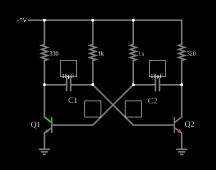

# Multivibrador astável

<!-- navegacao:inicio -->
[Índice](README.md) · [Próximo: Bistable Multivib (Flip-Flop)](multivib-bi.md)
<!-- navegacao:fim -->

## Objetivo

Mostrar um multivibrador astável: dois transistores ligados em realimentação positiva por capacitores, que se ligam e desligam alternadamente sem nenhum sinal de entrada, gerando uma onda quadrada.

## O circuito

<!-- esquema:inicio -->

<!-- esquema:fim -->

Dois transistores NPN, Q1 e Q2, têm os coletores ligados a $5\ \text{V}$ por resistores de $330\ \Omega$ e $320\ \Omega$ e as bases ligadas a $5\ \text{V}$ por resistores de $1{,}02\ \text{k}\Omega$. O coletor de cada um se liga à base do outro por um capacitor de $18\ \mu\text{F}$. Um osciloscópio mostra as tensões dos dois coletores.

<!-- componentes:inicio -->
| N.º | Tipo | Elemento | Valores |
|----:|------|----------|---------|
| 3 | `ResistorElm` | resistor | Resistance (ohms) = 330 |
| 4 | `ResistorElm` | resistor | Resistance (ohms) = 1k |
| 5 | `ResistorElm` | resistor | Resistance (ohms) = 1k |
| 6 | `ResistorElm` | resistor | Resistance (ohms) = 320 |
| 7 | `CapacitorElm` | capacitor | Capacitance (F) = 18μ; Trapezoidal Approximation = sim; Initial Voltage (on Reset) = 1m; Series Resistance = 0 |
| 8 | `CapacitorElm` | capacitor | Capacitance (F) = 18μ; Trapezoidal Approximation = sim; Initial Voltage (on Reset) = 1m; Series Resistance = 0 |
| 10 | `NTransistorElm` | transistor | Beta/hFE = 100; Swap E/C = não; Draw Circle = não; Model = default |
| 13 | `NTransistorElm` | transistor | Beta/hFE = 100; Swap E/C = não; Draw Circle = não; Model = default |
| 15 | `RailElm` | voltage source | Voltage = 5; Waveform = D/C; DC Offset (V) = 0; Internal Resistance (ohms) = 0 |
| 16 | `GroundElm` | ground | Symbol = Earth |
| 17 | `GroundElm` | ground | Symbol = Earth |
| 18 | `TextElm` | text | Text = C1; Size = 16; Draw Bar On Top = não; Color = #c0c0c0 |
| 19 | `TextElm` | text | Text = C2; Size = 16; Draw Bar On Top = não; Color = #c0c0c0 |
| 20 | `TextElm` | text | Text = Q1; Size = 16; Draw Bar On Top = não; Color = #c0c0c0 |
| 21 | `TextElm` | text | Text = Q2; Size = 16; Draw Bar On Top = não; Color = #c0c0c0 |
| 22 | `ScopeElm` |  |  |
| 23 | `ScopeElm` |  |  |
| 24 | `ScopeElm` |  |  |
| 25 | `ScopeElm` |  |  |
<!-- componentes:fim -->

## Teoria

O transistor bipolar do simulador (modelo "default") segue o modelo de Ebers–Moll, com $V_{BE}$ e $V_{BC}$ as tensões base-emissor e base-coletor (para um NPN):

$$I_C = I_s\left(e^{V_{BE}/V_T} - e^{V_{BC}/V_T}\right) - \frac{I_s}{\beta_R}\left(e^{V_{BC}/V_T} - 1\right),\qquad I_B = \frac{I_s}{\beta}\left(e^{V_{BE}/V_T} - 1\right) + \frac{I_s}{\beta_R}\left(e^{V_{BC}/V_T} - 1\right),$$

com $I_s = 10^{-13}\ \text{A}$, $\beta = 100$, $\beta_R = 1$ e $V_T = 25{,}865\ \text{mV}$; sem efeito Early, sem capacitâncias e sem resistências série. Na **região ativa** ($V_{BE} \approx 0{,}65$ a $0{,}75\ \text{V}$, junção base-coletor com polarização inversa) isso se reduz a $I_C = \beta I_B = I_s\,e^{V_{BE}/V_T}$, com transcondutância $g_m = I_C/V_T$ e resistência de emissor $r_e = V_T/I_E$. O PNP é o complementar, com todas as tensões e correntes invertidas.

## Resultados esperados

Em cada instante um transistor conduz (saturado) e o outro está cortado. O capacitor ligado ao coletor do que acabou de ligar tem sua placa na base do outro empurrada para uma tensão negativa, mantendo-o cortado. Essa base sobe então, por seu resistor de $R_B$, em direção à alimentação, com constante de tempo $R_B C$; quando chega a $V_{BE} \approx 0{,}65\ \text{V}$, o transistor liga, e o ciclo se inverte. O tempo de cada meio ciclo, partindo de uma tensão $-V_{CC}$ na base e subindo para $0$ (se $V_{BE}$ for desprezado), é

$$t = R_B C\,\ln 2 = 0{,}693\,R_B C,\qquad T = 0{,}693\,(R_{B1}C_1 + R_{B2}C_2),\quad f = \frac{1}{T}.$$

## O que observar

Com $R_B = 1{,}02\ \text{k}\Omega$ e $C = 18\ \mu\text{F}$ (ambos os lados iguais): $T = 0{,}693\cdot 2\cdot 18{,}4\ \text{ms} = 25{,}4\ \text{ms}$, $f = 39{,}3\ \text{Hz}$ (pelo cálculo ideal, com $R_B = 1\ \text{k}\Omega$ nominal: $40{,}1\ \text{Hz}$). A integração numérica independente do circuito dá $f = 39{,}94\ \text{Hz}$ e o simulador, $40{,}01\ \text{Hz}$: o desvio de $0{,}17\%$ vem da sensibilidade das transições ao passo de integração. As tensões médias dos capacitores são $1{,}80$ e $1{,}83\ \text{V}$ e a do coletor de Q1, $1{,}50\ \text{V}$ (nível alto de $\approx 4{,}4\ \text{V}$ por metade do tempo e baixo de $\approx 0{,}04\ \text{V}$ na outra metade). As verificações conferem a frequência, as médias dos dois capacitores e a média do coletor de Q1 (tolerância de 2%, de $0{,}2$ a $0{,}6\ \text{s}$); os picos e vales das tensões nas transições não são conferidos, porque dependem muito do passo de simulação.

## Limites do modelo

- Os dois coletores alternam entre cerca de $0$ e $4{,}4\ \text{V}$, em oposição de fase: uma onda quadrada de $\approx 40\ \text{Hz}$.
- Mude um dos capacitores: o semiciclo correspondente muda de duração, e a onda deixa de ser simétrica.
- É um oscilador de relaxação: as transições são rápidas (regeneração) e o tempo entre elas vem da carga dos capacitores.

## Referências

A frequência prevista, $1/(0{,}693\cdot 2R_BC)$, ignora $V_{BE}$ e a corrente de base; os valores reais diferem alguns por cento. As tensões nas bases e nos coletores têm picos de transição que dependem do modelo (o transistor, $\beta_R = 1$, conduz no sentido inverso por instantes) e da simulação.

O circuito deste exemplo faz parte da coleção do simulador original de Paul Falstad e Iain Sharp (CircuitJS1); a explicação é deste projeto.
