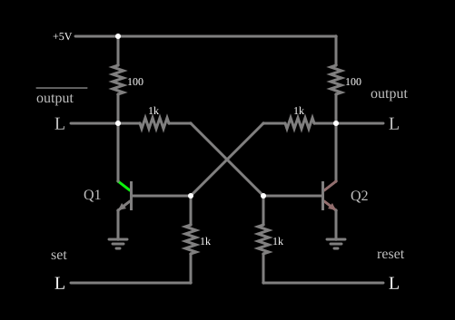

# Multivibrador biestável (flip-flop)

<!-- navegacao:inicio -->
[Índice](README.md) · [Anterior: Astable Multivib](multivib-a.md) · [Próximo: Monostable Multivib (One-Shot)](multivib-mono.md)
<!-- navegacao:fim -->

## Objetivo

Mostrar um multivibrador biestável, isto é, um flip-flop a transistores: dois estados estáveis, escolhidos por pulsos nos botões "set" e "reset", que guardam um bit.

## O circuito

<!-- esquema:inicio -->

<!-- esquema:fim -->

Dois transistores NPN têm os coletores ligados a $5\ \text{V}$ por resistores de $100\ \Omega$ e ligados à base um do outro por resistores de $1{,}02\ \text{k}\Omega$ (acoplamento direto, sem capacitores). As bases também recebem, por resistores de $1\ \text{k}\Omega$, duas entradas lógicas de botão (momentâneas), "set" (à esquerda) e "reset" (à direita). Dois indicadores lógicos mostram os coletores.

<!-- componentes:inicio -->
| N.º | Tipo | Elemento | Valores |
|----:|------|----------|---------|
| 0 | `ResistorElm` | resistor | Resistance (ohms) = 100 |
| 1 | `ResistorElm` | resistor | Resistance (ohms) = 100 |
| 3 | `NTransistorElm` | transistor | Beta/hFE = 100; Swap E/C = não; Draw Circle = não; Model = default |
| 6 | `NTransistorElm` | transistor | Beta/hFE = 100; Swap E/C = não; Draw Circle = não; Model = default |
| 8 | `ResistorElm` | resistor | Resistance (ohms) = 1k |
| 9 | `ResistorElm` | resistor | Resistance (ohms) = 1k |
| 10 | `LogicOutputElm` | logic output | Threshold = 2.5; Current Required = não; Numeric = não; Ternary = não |
| 12 | `LogicOutputElm` | logic output | Threshold = 2.5; Current Required = não; Numeric = não; Ternary = não |
| 13 | `RailElm` | voltage source | Voltage = 5; Waveform = D/C; DC Offset (V) = 0; Internal Resistance (ohms) = 0 |
| 14 | `ResistorElm` | resistor | Resistance (ohms) = 1k |
| 15 | `ResistorElm` | resistor | Resistance (ohms) = 1k |
| 16 | `LogicInputElm` | logic input | Momentary Switch = sim; High Logic Voltage = 5; Low Voltage = 0; Numeric = não; Ternary = não; Keyboard Shortcut =  |
| 17 | `LogicInputElm` | logic input | Momentary Switch = sim; High Logic Voltage = 5; Low Voltage = 0; Numeric = não; Ternary = não; Keyboard Shortcut =  |
| 18 | `TextElm` | text | Text = output; Size = 16; Draw Bar On Top = sim; Color = #c0c0c0 |
| 19 | `TextElm` | text | Text = output; Size = 16; Draw Bar On Top = não; Color = #c0c0c0 |
| 20 | `TextElm` | text | Text = set; Size = 16; Draw Bar On Top = não; Color = #c0c0c0 |
| 21 | `TextElm` | text | Text = reset; Size = 16; Draw Bar On Top = não; Color = #c0c0c0 |
| 22 | `GroundElm` | ground | Symbol = Earth |
| 23 | `GroundElm` | ground | Symbol = Earth |
| 24 | `TextElm` | text | Text = Q1; Size = 16; Draw Bar On Top = não; Color = #c0c0c0 |
| 25 | `TextElm` | text | Text = Q2; Size = 16; Draw Bar On Top = não; Color = #c0c0c0 |
<!-- componentes:fim -->

## Teoria

O transistor bipolar do simulador (modelo "default") segue o modelo de Ebers–Moll, com $V_{BE}$ e $V_{BC}$ as tensões base-emissor e base-coletor (para um NPN):

$$I_C = I_s\left(e^{V_{BE}/V_T} - e^{V_{BC}/V_T}\right) - \frac{I_s}{\beta_R}\left(e^{V_{BC}/V_T} - 1\right),\qquad I_B = \frac{I_s}{\beta}\left(e^{V_{BE}/V_T} - 1\right) + \frac{I_s}{\beta_R}\left(e^{V_{BC}/V_T} - 1\right),$$

com $I_s = 10^{-13}\ \text{A}$, $\beta = 100$, $\beta_R = 1$ e $V_T = 25{,}865\ \text{mV}$; sem efeito Early, sem capacitâncias e sem resistências série. Na **região ativa** ($V_{BE} \approx 0{,}65$ a $0{,}75\ \text{V}$, junção base-coletor com polarização inversa) isso se reduz a $I_C = \beta I_B = I_s\,e^{V_{BE}/V_T}$, com transcondutância $g_m = I_C/V_T$ e resistência de emissor $r_e = V_T/I_E$. O PNP é o complementar, com todas as tensões e correntes invertidas.

## Resultados esperados

No acoplamento cruzado, se um transistor conduz, seu coletor fica perto de $0$ e mantém o outro cortado (base abaixo de $V_{BE}$); este, cortado, tem o coletor alto, o que mantém o primeiro conduzindo. Os dois estados são estáveis (a realimentação é positiva, de ganho maior que 1). Um pulso positivo na base do transistor cortado o liga, e a regeneração inverte o circuito para o outro estado, onde ele permanece depois de o pulso terminar. Uma entrada que não muda o estado (o botão do transistor que já conduz) não tem efeito.

É a célula de memória básica de um bit: $Q$ guarda o último comando.

## O que observar

No estado inicial, o coletor da direita está baixo ($0{,}079\ \text{V}$) e o da esquerda, alto ($4{,}616\ \text{V}$). Apertar e soltar "set" (em $0{,}05$–$0{,}15\ \text{s}$) inverte os dois níveis; apertar e soltar "reset" (aqui, em $0{,}05$–$0{,}15\ \text{s}$, a partir do estado inicial) não muda nada, porque o estado já é o de reset; e "set" seguido de "reset" ($0{,}25$–$0{,}35\ \text{s}$) leva de volta ao estado inicial.

| sequência de botões | coletor direito | coletor esquerdo |
|:--------------------|---------------:|-----------------:|
| nenhuma (inicial) | $0{,}079\ \text{V}$ | $4{,}616\ \text{V}$ |
| "set" | $4{,}616\ \text{V}$ | $0{,}079\ \text{V}$ |
| "reset" | $0{,}079\ \text{V}$ | $4{,}616\ \text{V}$ |
| "set", depois "reset" | $0{,}079\ \text{V}$ | $4{,}616\ \text{V}$ |

As verificações conferem os dois coletores nas quatro sequências, em $t = 0{,}5\ \text{s}$, com tolerância de 1% (os valores são do simulador).

## Limites do modelo

- Aperte "set": os níveis trocam e permanecem trocados depois de soltar o botão. Aperte "reset": voltam.
- Aperte duas vezes o mesmo botão: a segunda não faz nada.
- Compare com o flip-flop de relés: a mesma ideia, com transistores e sem contatos mecânicos.

## Referências

O estado inicial ao ligar o circuito não é determinado (depende de pequenas assimetrias, e é o motivo de muitos circuitos reais terem uma entrada de reset); aqui ele é o gravado no arquivo. Não há circuito de eliminação de repique para os botões, e os valores acima são os de saída do simulador, sem cálculo independente da comutação.

O circuito deste exemplo faz parte da coleção do simulador original de Paul Falstad e Iain Sharp (CircuitJS1); a explicação é deste projeto.
