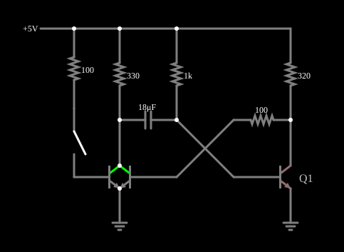

# Multivibrador monoestável (one-shot)

<!-- navegacao:inicio -->
[Índice](README.md) · [Anterior: Bistable Multivib (Flip-Flop)](multivib-bi.md)
<!-- navegacao:fim -->

## Objetivo

Mostrar um multivibrador monoestável ("one-shot"): um pulso de gatilho curto produz, na saída, um pulso de duração fixa, determinada pelos componentes, depois do qual o circuito volta ao estado estável.

## O circuito

<!-- esquema:inicio -->

<!-- esquema:fim -->

É o multivibrador de dois transistores com um só capacitor de acoplamento ($18\ \mu\text{F}$): o acoplamento do segundo transistor para o primeiro é direto (por um resistor). Um terceiro transistor, comandado por um botão (momentâneo) de $5\ \text{V}$ através de um resistor de $100\ \Omega$, serve de gatilho. O estado estável é aquele em que o transistor da direita conduz e o coletor do outro está alto.

<!-- componentes:inicio -->
| N.º | Tipo | Elemento | Valores |
|----:|------|----------|---------|
| 1 | `ResistorElm` | resistor | Resistance (ohms) = 330 |
| 2 | `ResistorElm` | resistor | Resistance (ohms) = 1k |
| 3 | `ResistorElm` | resistor | Resistance (ohms) = 320 |
| 4 | `CapacitorElm` | capacitor | Capacitance (F) = 18μ; Trapezoidal Approximation = sim; Initial Voltage (on Reset) = 1m; Series Resistance = 0 |
| 6 | `NTransistorElm` | transistor | Beta/hFE = 100; Swap E/C = não; Draw Circle = não; Model = default |
| 9 | `NTransistorElm` | transistor | Beta/hFE = 100; Swap E/C = não; Draw Circle = não; Model = default |
| 11 | `ResistorElm` | resistor | Resistance (ohms) = 100 |
| 12 | `NTransistorElm` | transistor | Beta/hFE = 100; Swap E/C = não; Draw Circle = não; Model = default |
| 14 | `ResistorElm` | resistor | Resistance (ohms) = 100 |
| 15 | `SwitchElm` | switch (SPST) | Momentary Switch = sim; IEC Symbol = não; Label (for linking) = ; Keyboard Shortcut = ; On Resistance (ohms) = 0 |
| 17 | `RailElm` | voltage source | Voltage = 5; Waveform = D/C; DC Offset (V) = 0; Internal Resistance (ohms) = 0 |
| 18 | `GroundElm` | ground | Symbol = Earth |
| 19 | `GroundElm` | ground | Symbol = Earth |
| 20 | `TextElm` | text | Text = Q1; Size = 16; Draw Bar On Top = não; Color = #c0c0c0 |
<!-- componentes:fim -->

## Teoria

O transistor bipolar do simulador (modelo "default") segue o modelo de Ebers–Moll, com $V_{BE}$ e $V_{BC}$ as tensões base-emissor e base-coletor (para um NPN):

$$I_C = I_s\left(e^{V_{BE}/V_T} - e^{V_{BC}/V_T}\right) - \frac{I_s}{\beta_R}\left(e^{V_{BC}/V_T} - 1\right),\qquad I_B = \frac{I_s}{\beta}\left(e^{V_{BE}/V_T} - 1\right) + \frac{I_s}{\beta_R}\left(e^{V_{BC}/V_T} - 1\right),$$

com $I_s = 10^{-13}\ \text{A}$, $\beta = 100$, $\beta_R = 1$ e $V_T = 25{,}865\ \text{mV}$; sem efeito Early, sem capacitâncias e sem resistências série. Na **região ativa** ($V_{BE} \approx 0{,}65$ a $0{,}75\ \text{V}$, junção base-coletor com polarização inversa) isso se reduz a $I_C = \beta I_B = I_s\,e^{V_{BE}/V_T}$, com transcondutância $g_m = I_C/V_T$ e resistência de emissor $r_e = V_T/I_E$. O PNP é o complementar, com todas as tensões e correntes invertidas.

## Resultados esperados

No estado estável o transistor da direita (Q2) conduz, mantido pela corrente de base que recebe por um resistor de $1{,}02\ \text{k}\Omega$. Quando o gatilho liga o outro transistor, seu coletor cai a $\approx 0$, e o capacitor, até então carregado, leva a base de Q2 a uma tensão negativa ($\approx -4\ \text{V}$): Q2 desliga. A base de Q2 sobe então, em direção à alimentação, com constante de tempo $RC$; quando passa de $V_{BE}$, Q2 volta a conduzir e o circuito volta ao estado estável. O tempo no estado instável é

$$T = RC\,\ln\frac{V_{CC} + |V_{B0}|}{V_{CC} - V_{BE}} \approx 0{,}693\,RC\quad (|V_{B0}| \approx V_{CC},\ V_{BE}\approx 0).$$

## O que observar

Com $R = 1{,}02\ \text{k}\Omega$ e $C = 18\ \mu\text{F}$, $RC = 18{,}4\ \text{ms}$; para $|V_{B0}| = 4{,}05\ \text{V}$ e $V_{BE} = 0{,}65\ \text{V}$, $T = 18{,}4\ \text{ms}\cdot\ln(9{,}05/4{,}35) = 13{,}5\ \text{ms}$ (contra $12{,}7\ \text{ms}$ do cálculo ideal $0{,}693\,RC$). O coletor do transistor da esquerda, a saída, cai de $4{,}99\ \text{V}$ a $0{,}036\ \text{V}$ quando o botão é apertado (em $t = 0{,}1\ \text{s}$) e volta a subir depois do pulso: ele cruza $2{,}5\ \text{V}$ para cima $17{,}9\ \text{ms}$ depois do gatilho (a subida é lenta, pelo resistor de coletor), tanto no simulador quanto na integração independente. As verificações conferem a saída antes do gatilho ($4{,}988\ \text{V}$), durante o pulso ($0{,}036\ \text{V}$ em $t = 0{,}108\ \text{s}$), depois do pulso ($5{,}0\ \text{V}$ em $0{,}2\ \text{s}$) e o máximo da saída, com um gatilho de $2\ \text{ms}$ aplicado em $0{,}1\ \text{s}$.

## Limites do modelo

- Aperte o botão de gatilho: a saída cai por uns $15$ a $18\ \text{ms}$ e volta sozinha.
- Aumente o capacitor: o pulso fica mais longo na mesma proporção.
- Um gatilho mais longo que o pulso não o estende: o pulso depende só de $RC$.

## Referências

A estimativa $0{,}693\,RC$ ignora $V_{BE}$ e a recuperação do coletor; o valor medido de $17{,}9\ \text{ms}$ depende do nível ($2{,}5\ \text{V}$) em que a largura é lida. Sem circuito de proteção, um novo gatilho durante o pulso pode perturbar a temporização.

O circuito deste exemplo faz parte da coleção do simulador original de Paul Falstad e Iain Sharp (CircuitJS1); a explicação é deste projeto.
