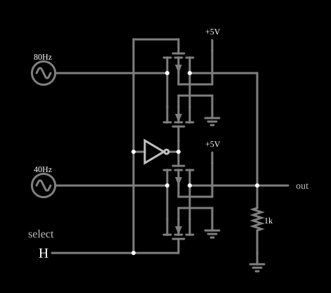

# Multiplexador CMOS de duas entradas

<!-- navegacao:inicio -->
[Índice](README.md) · [Anterior: CMOS Transmission Gate](cmostransgate.md) · [Próximo: Sample-and-Hold](samplenhold.md)
<!-- navegacao:fim -->

## Objetivo

Mostrar um **multiplexador analógico** de duas entradas feito com duas [portas de transmissão CMOS](cmostransgate.md): um sinal de seleção escolhe qual das duas entradas aparece na saída.

## O circuito

<!-- esquema:inicio -->

<!-- esquema:fim -->

Duas portas de transmissão (NMOS e PMOS em paralelo, com diodos de corpo) ligam, cada uma, uma fonte senoidal de $0$ a $5\ \text{V}$ a um nó de saída comum, com uma carga de $1\ \text{k}\Omega$ à terra. As fontes têm $80\ \text{Hz}$ e $40\ \text{Hz}$. Uma entrada lógica de seleção, com um inversor para o sinal complementar, liga uma porta e desliga a outra.

<!-- componentes:inicio -->
| N.º | Tipo | Elemento | Valores |
|----:|------|----------|---------|
| 0 | `NMosfetElm` | MOSFET | Model = default-body; Swap D/S = não |
| 1 | `PMosfetElm` | MOSFET | Model = default-body; Swap D/S = não |
| 4 | `RailElm` | A/C source | Max Voltage = 2.5; Waveform = A/C; DC Offset (V) = 2.5; Internal Resistance (ohms) = 0; Show Voltage = não; Frequency (Hz) = 80; Phase Offset (degrees) = 0 |
| 5 | `RailElm` | A/C source | Max Voltage = 2.5; Waveform = A/C; DC Offset (V) = 2.5; Internal Resistance (ohms) = 0; Show Voltage = não; Frequency (Hz) = 40; Phase Offset (degrees) = 0 |
| 8 | `ResistorElm` | resistor | Resistance (ohms) = 1k |
| 9 | `GroundElm` | ground | Symbol = Earth |
| 10 | `OutputElm` | output | Show Voltage = não |
| 14 | `InverterElm` | inverter | Slew Rate (V/ns) = 500m; High Logic Voltage = 5; DeMorgan's Symbol = não |
| 15 | `LogicInputElm` | logic input | Momentary Switch = não; High Logic Voltage = 5; Low Voltage = 0; Numeric = não; Ternary = não; Keyboard Shortcut =  |
| 16 | `TextElm` | text | Text = select; Size = 16; Draw Bar On Top = não; Color = #c0c0c0 |
| 21 | `GroundElm` | ground | Symbol = Earth |
| 23 | `RailElm` | voltage source | Voltage = 5; Waveform = D/C; DC Offset (V) = 0; Internal Resistance (ohms) = 0 |
| 28 | `RailElm` | voltage source | Voltage = 5; Waveform = D/C; DC Offset (V) = 0; Internal Resistance (ohms) = 0 |
| 30 | `GroundElm` | ground | Symbol = Earth |
| 36 | `PMosfetElm` | MOSFET | Model = default-body; Swap D/S = não |
| 37 | `NMosfetElm` | MOSFET | Model = default-body; Swap D/S = não |
<!-- componentes:fim -->

## Teoria

Cada porta de transmissão funciona como em [Porta de transmissão CMOS](cmostransgate.md): ligada, tem resistência $R_{on} \approx 25\ \Omega$ (entre $14$ e $25\ \Omega$); desligada, tem só a fuga. A seleção $S$ liga uma porta e, pelo inversor, a complementar $\bar S$ liga a outra: a saída é $v_{out} = S\,v_1 + \bar S\,v_2$ com um divisor de tensão com a carga, $v_{out} = v\,R_L/(R_L + R_{on})$, de modo que o ganho é $1000/1025 = 0{,}976$ no pior caso.

## Resultados esperados

No estado inicial, a saída acompanha a fonte de $40\ \text{Hz}$ (correlação de $1{,}0000$ com ela e nula com a de $80\ \text{Hz}$); em $t = 6{,}25\ \text{ms}$ a entrada está em $5\ \text{V}$ e a saída, em $4{,}929\ \text{V}$ (queda de $71\ \text{mV}$, $R_{on} = 14{,}4\ \Omega$ para uma corrente de $4{,}93\ \text{mA}$), enquanto a outra fonte (em $2{,}506\ \text{V}$) está isolada, com apenas $48\ \text{nA}$ de fuga. Trocando a seleção, a saída passa a acompanhar a de $80\ \text{Hz}$ (correlação de $1{,}0000$) e, no mesmo instante, vale $2{,}445\ \text{V}$. Em todo o ciclo, a diferença entre a saída e a entrada escolhida é de no máximo $0{,}086\ \text{V}$ e a saída vai de $0$ a $4{,}929\ \text{V}$. As verificações conferem a saída nos dois estados, o máximo, o mínimo e a frequência da saída nos dois estados (tolerância de $0{,}5\%$ a $1\%$).

## O que observar

No osciloscópio, a saída acompanha uma onda lenta (a de $40\ \text{Hz}$) ou uma rápida (a de $80\ \text{Hz}$), conforme a seleção; clique na entrada lógica para trocar. Quando a seleção muda no meio do ciclo, a saída salta de um valor para o outro. Para testar: aumente a carga para $100\ \Omega$ e veja o ganho diminuir ($100/125 = 0{,}8$ no pior caso); ligue as duas portas ao mesmo tempo (desligando o inversor) e veja a saída ser a média ponderada das duas fontes.

## Limites do modelo

- A seleção é instantânea e sem *overlap*: não há tempo morto entre desligar uma porta e ligar a outra, nem injeção de carga; num circuito real, os dois ocorrem.
- Os sinais vão de $0$ a $5\ \text{V}$, a faixa completa em que a porta de transmissão funciona bem; fora dela, os diodos de corpo conduziriam.
- A resistência de ligado, $14$ a $25\ \Omega$, é a do modelo de lei quadrática com $\beta = 0{,}02\ \text{A/V}^2$.

## Referências

Sedra e Smith, *Microelectronic Circuits*, capítulo sobre o inversor CMOS e a lógica CMOS; Weste e Harris, *CMOS VLSI Design*, capítulos sobre o inversor e sobre portas de transmissão.

O circuito deste exemplo faz parte da coleção do simulador original de Paul Falstad e Iain Sharp (CircuitJS1); a explicação é deste projeto.
