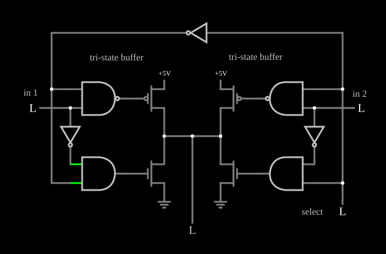

# Multiplexador 2 para 1 com buffers tri-state

<!-- navegacao:inicio -->
[Índice](README.md) · [Anterior: Priority Encoder](priencoder.md) · [Próximo: Majority Logic](majority.md)
<!-- navegacao:fim -->

## Objetivo

Mostrar um **multiplexador** que escolhe entre duas entradas ligando à mesma saída dois **buffers tri-state**: só um deles aciona a linha de cada vez, e o outro fica em alta impedância. É assim que vários dispositivos compartilham um barramento.

## O circuito

<!-- esquema:inicio -->

<!-- esquema:fim -->

Há duas entradas de dados, *in 1* (elemento 8) e *in 2* (elemento 29), e uma entrada de seleção, *select* (elemento 35). Cada buffer tri-state é um par PMOS/NMOS (modelo padrão digital) entre a sua alimentação de $5\ \text{V}$ e a terra, com a saída no meio, acionado por uma porta NAND (para o PMOS) e uma porta AND (para o NMOS):

- a NAND recebe o dado e o sinal de habilitação; a AND recebe o dado invertido e a habilitação;
- o buffer de *in 1* é habilitado por $\overline{select}$ (um inversor), e o de *in 2* por $select$.

As saídas dos dois buffers estão ligadas entre si e à saída lógica (elemento 27). O exemplo abre com as três entradas em $0$.

<!-- componentes:inicio -->
| N.º | Tipo | Elemento | Valores |
|----:|------|----------|---------|
| 0 | `NandGateElm` | NAND gate | # of Inputs = 2; High Logic Voltage = 5; Schmitt Inputs = não; Invert Inputs = não; Propagation Delay (s) = 0; DeMorgan's Symbol = não |
| 1 | `AndGateElm` | AND gate | # of Inputs = 2; High Logic Voltage = 5; Schmitt Inputs = não; Invert Inputs = não; Propagation Delay (s) = 0; DeMorgan's Symbol = não |
| 2 | `NMosfetElm` | MOSFET | Model = default-digital; Swap D/S = não |
| 3 | `PMosfetElm` | MOSFET | Model = default-digital; Swap D/S = não |
| 6 | `GroundElm` | ground | Symbol = Earth |
| 7 | `RailElm` | voltage source | Voltage = 5; Waveform = D/C; DC Offset (V) = 0; Internal Resistance (ohms) = 0 |
| 8 | `LogicInputElm` | logic input | Momentary Switch = não; High Logic Voltage = 5; Low Voltage = 0; Numeric = não; Ternary = não; Keyboard Shortcut =  |
| 16 | `NMosfetElm` | MOSFET | Model = default-digital; Swap D/S = não |
| 17 | `PMosfetElm` | MOSFET | Model = default-digital; Swap D/S = não |
| 18 | `RailElm` | voltage source | Voltage = 5; Waveform = D/C; DC Offset (V) = 0; Internal Resistance (ohms) = 0 |
| 19 | `GroundElm` | ground | Symbol = Earth |
| 20 | `AndGateElm` | AND gate | # of Inputs = 2; High Logic Voltage = 5; Schmitt Inputs = não; Invert Inputs = não; Propagation Delay (s) = 0; DeMorgan's Symbol = não |
| 21 | `NandGateElm` | NAND gate | # of Inputs = 2; High Logic Voltage = 5; Schmitt Inputs = não; Invert Inputs = não; Propagation Delay (s) = 0; DeMorgan's Symbol = não |
| 27 | `LogicOutputElm` | logic output | Threshold = 2.5; Current Required = não; Numeric = não; Ternary = não |
| 28 | `InverterElm` | inverter | Slew Rate (V/ns) = 500m; High Logic Voltage = 5; DeMorgan's Symbol = não |
| 29 | `LogicInputElm` | logic input | Momentary Switch = não; High Logic Voltage = 5; Low Voltage = 0; Numeric = não; Ternary = não; Keyboard Shortcut =  |
| 30 | `TextElm` | text | Text = in 1; Size = 16; Draw Bar On Top = não; Color = #c0c0c0 |
| 31 | `TextElm` | text | Text = select; Size = 16; Draw Bar On Top = não; Color = #c0c0c0 |
| 32 | `TextElm` | text | Text = in 2; Size = 16; Draw Bar On Top = não; Color = #c0c0c0 |
| 33 | `TextElm` | text | Text = tri-state buffer; Size = 16; Draw Bar On Top = não; Color = #c0c0c0 |
| 34 | `TextElm` | text | Text = tri-state buffer; Size = 16; Draw Bar On Top = não; Color = #c0c0c0 |
| 35 | `LogicInputElm` | logic input | Momentary Switch = não; High Logic Voltage = 5; Low Voltage = 0; Numeric = não; Ternary = não; Keyboard Shortcut =  |
| 36 | `InverterElm` | inverter | Slew Rate (V/ns) = 500m; High Logic Voltage = 5; DeMorgan's Symbol = não |
| 37 | `InverterElm` | inverter | Slew Rate (V/ns) = 500m; High Logic Voltage = 5; DeMorgan's Symbol = não |
<!-- componentes:fim -->

## Teoria

Com a habilitação $E = 1$, a NAND dá $\overline{D}$ e a AND dá $\overline{D}$: se $D = 1$ o PMOS liga (porta em $0$) e o NMOS corta, e a saída sobe; se $D = 0$ é o contrário. O buffer copia $D$. Com $E = 0$, a NAND dá $1$ e a AND dá $0$: **os dois transistores cortam** e o buffer não aciona a saída, que fica em **alta impedância** (o terceiro estado).

Como os dois buffers recebem habilitações complementares, sempre exatamente um aciona a linha:

$$Y = \overline{S}\,D_1 + S\,D_2.$$

Se os dois estivessem habilitados com dados diferentes, um PMOS e um NMOS ligariam a alimentação à terra através da linha: é a **contenção de barramento**, que um sistema com buffers tri-state tem de evitar.

## Resultados esperados

O simulador dá:

| *select* | *in 1* | *in 2* | Saída |
|----:|----:|----:|----:|
| 0 | 0 | qualquer | 0 |
| 0 | 1 | qualquer | 1 ($5\ \text{V}$) |
| 1 | qualquer | 0 | 0 |
| 1 | qualquer | 1 | 1 ($5\ \text{V}$) |

A corrente da alimentação do buffer desabilitado é só a fuga dos seus transistores cortados: por exemplo, $1{,}4 \times 10^{-14}\ \text{A}$ no buffer de *in 1* com *select* em $1$ e a linha em $5\ \text{V}$.

## O que observar

Mude o dado da entrada não selecionada e veja que a saída não se altera; mude *select* e a saída passa a seguir a outra entrada. O buffer desabilitado não tem nenhum transistor ligado.

## Limites do modelo

- As portas que acionam os transistores são ideais; um buffer real tem tempos de habilitação e desabilitação, e por um instante os dois buffers podem estar ligados juntos.
- Sem capacitâncias, a linha em alta impedância não "guarda" o último valor como guardaria um barramento real por um tempo.

## Referências

Wakerly, *Digital Design: Principles and Practices*, capítulos sobre saídas tri-state e multiplexadores; Weste e Harris, *CMOS VLSI Design*, sobre buffers tri-state.

O circuito deste exemplo faz parte da coleção do simulador original de Paul Falstad e Iain Sharp (CircuitJS1); a explicação é deste projeto.
