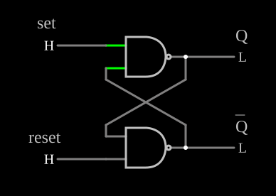

# Flip-flop SR com portas NAND

<!-- navegacao:inicio -->
[Índice](README.md) · [Próximo: Clocked SR Flip-Flop](clockedsrff.md)
<!-- navegacao:fim -->

## Objetivo

Mostrar o *latch* SR, a memória de um bit mais simples: duas portas NAND ligadas em realimentação cruzada guardam um estado enquanto as entradas estão em repouso.

## O circuito

<!-- esquema:inicio -->

<!-- esquema:fim -->

Duas portas NAND ideais de duas entradas: a saída de cada uma vai a uma entrada da outra. As outras entradas são dois botões momentâneos, *set* (elemento 9, em cima) e *reset* (elemento 8, embaixo), que ficam em $5\ \text{V}$ e vão a $0$ enquanto estão pressionados: as entradas são ativas em nível baixo, $\overline{S}$ e $\overline{R}$. As saídas são $Q$ (elemento 10) e $\overline{Q}$ (elemento 11). O exemplo abre com $Q = 0$.

<!-- componentes:inicio -->
| N.º | Tipo | Elemento | Valores |
|----:|------|----------|---------|
| 0 | `NandGateElm` | NAND gate | # of Inputs = 2; High Logic Voltage = 5; Schmitt Inputs = não; Invert Inputs = não; Propagation Delay (s) = 0; DeMorgan's Symbol = não |
| 1 | `NandGateElm` | NAND gate | # of Inputs = 2; High Logic Voltage = 5; Schmitt Inputs = não; Invert Inputs = não; Propagation Delay (s) = 0; DeMorgan's Symbol = não |
| 8 | `LogicInputElm` | logic input | Momentary Switch = sim; High Logic Voltage = 5; Low Voltage = 0; Numeric = não; Ternary = não; Keyboard Shortcut =  |
| 9 | `LogicInputElm` | logic input | Momentary Switch = sim; High Logic Voltage = 5; Low Voltage = 0; Numeric = não; Ternary = não; Keyboard Shortcut =  |
| 10 | `LogicOutputElm` | logic output | Threshold = 2.5; Current Required = não; Numeric = não; Ternary = não |
| 11 | `LogicOutputElm` | logic output | Threshold = 2.5; Current Required = não; Numeric = não; Ternary = não |
| 12 | `TextElm` | text | Text = set; Size = 24; Draw Bar On Top = não; Color = #c0c0c0 |
| 13 | `TextElm` | text | Text = Q; Size = 24; Draw Bar On Top = não; Color = #c0c0c0 |
| 14 | `TextElm` | text | Text = reset; Size = 24; Draw Bar On Top = não; Color = #c0c0c0 |
| 15 | `TextElm` | text | Text = Q; Size = 24; Draw Bar On Top = sim; Color = #c0c0c0 |
<!-- componentes:fim -->

## Teoria

Com os dois botões soltos, cada NAND tem uma entrada em $1$ e funciona como inversor da outra; dois inversores em anel têm dois estados estáveis e ficam no que estiverem. Um $0$ numa entrada força a saída daquela NAND a $1$:

| $\overline{S}$ | $\overline{R}$ | $Q$ | $\overline{Q}$ | |
|----:|----:|----:|----:|------|
| 1 | 1 | $Q$ | $\overline{Q}$ | guarda |
| 0 | 1 | 1 | 0 | *set* |
| 1 | 0 | 0 | 1 | *reset* |
| 0 | 0 | 1 | 1 | proibido |

Ao soltar o botão, a realimentação mantém o novo estado. Com os dois pressionados, as duas saídas vão a $1$ (deixam de ser complementares), e o estado depois de soltá-los ao mesmo tempo é indefinido. A versão com transistores está em [CMOS Flip-Flop](cmosff.md).

## Resultados esperados

O simulador dá, no início, $Q = 0$ e $\overline{Q} = 5\ \text{V}$. Pressionar *set* leva $Q$ a $5\ \text{V}$, e $Q$ continua em $5\ \text{V}$ depois de soltar o botão; pressionar e soltar *reset* em seguida volta $Q$ a $0$. Com os dois botões pressionados, $Q$ e $\overline{Q}$ ficam ambos em $5\ \text{V}$.

## O que observar

Pressione e solte os botões e veja que o estado permanece. Um uso clássico deste latch é eliminar o repique de uma chave mecânica: o primeiro contato fixa a saída, e os repiques seguintes não a alteram.

## Limites do modelo

- As portas não têm atraso; num latch real, soltar os dois botões ao mesmo tempo pode levar a uma oscilação ou a um estado metaestável.
- Os botões são ideais, sem repique.

## Referências

Mano e Ciletti, *Digital Design*, capítulo sobre latches e flip-flops; Wakerly, *Digital Design: Principles and Practices*, capítulo sobre circuitos sequenciais.

O circuito deste exemplo faz parte da coleção do simulador original de Paul Falstad e Iain Sharp (CircuitJS1); a explicação é deste projeto.
