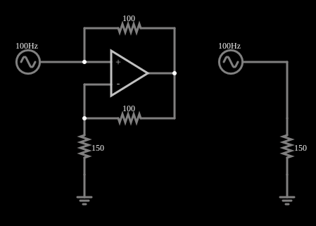

# Conversor de impedância negativa (resistência negativa)

<!-- navegacao:inicio -->
[Índice](README.md) · [Anterior: Schmitt Trigger](amp-schmitt.md) · [Próximo: Gyrator](gyrator.md)
<!-- navegacao:fim -->

## Objetivo

Mostrar um conversor de impedância negativa (NIC): um amplificador operacional com realimentação positiva que, visto de seus terminais, se comporta como uma **resistência negativa**. A fonte ligada a ele **recebe** corrente em vez de fornecê-la, em oposição à de um resistor comum ligado à mesma tensão.

## O circuito

<!-- esquema:inicio -->

<!-- esquema:fim -->

O circuito tem duas metades iguais, cada uma com a sua fonte senoidal de $100\ \text{Hz}$ e $5\ \text{V}$ de pico. À direita, a fonte alimenta um resistor comum de $150\ \Omega$. À esquerda, a fonte está ligada à entrada de um amplificador operacional: dois resistores de $100\ \Omega$ ligam a saída, um à própria entrada da fonte (realimentação positiva) e outro à outra entrada, que tem um resistor de $150\ \Omega$ para a terra (realimentação negativa). Quatro osciloscópios mostram a tensão de cada fonte e a característica corrente-tensão (I/V) de cada lado.

<!-- componentes:inicio -->
| N.º | Tipo | Elemento | Valores |
|----:|------|----------|---------|
| 0 | `OpAmpElm` | op-amp | Max Output (V) = 15; Min Output (V) = -15; Gain = 100k |
| 2 | `ResistorElm` | resistor | Resistance (ohms) = 100 |
| 5 | `ResistorElm` | resistor | Resistance (ohms) = 100 |
| 7 | `GroundElm` | ground | Symbol = Earth |
| 8 | `RailElm` | A/C source | Max Voltage = 5; Waveform = A/C; DC Offset (V) = 0; Internal Resistance (ohms) = 0; Show Voltage = não; Frequency (Hz) = 100; Phase Offset (degrees) = 0 |
| 9 | `RailElm` | A/C source | Max Voltage = 5; Waveform = A/C; DC Offset (V) = 0; Internal Resistance (ohms) = 0; Show Voltage = não; Frequency (Hz) = 100; Phase Offset (degrees) = 0 |
| 10 | `GroundElm` | ground | Symbol = Earth |
| 11 | `ResistorElm` | resistor | Resistance (ohms) = 150 |
| 12 | `ResistorElm` | resistor | Resistance (ohms) = 150 |
<!-- componentes:fim -->

## Teoria

Com a realimentação negativa, o operacional trabalha como amplificador não inversor de ganho $1 + R_5/R_{11} = 1 + 100/150 = 5/3$ em relação à tensão $V$ da fonte:

$$V_\text{out} = \left(1 + \frac{R_5}{R_{11}}\right) V = \frac{5}{3}\,V.$$

A corrente que a fonte fornece passa por $R_2$ (da fonte até a saída):

$$I = \frac{V - V_\text{out}}{R_2} = \frac{V\,(1 - 5/3)}{100\ \Omega} = -\frac{V}{150\ \Omega}.$$

A impedância vista pela fonte é

$$Z_\text{in} = \frac{V}{I} = -\frac{R_2\,R_{11}}{R_5} = -150\ \Omega.$$

A corrente tem o mesmo módulo que a de um resistor de $+150\ \Omega$, mas sinal oposto. Uma resistência negativa **fornece** potência ao circuito, e a energia vem da alimentação do operacional.

## Resultados esperados

Quando a fonte está no pico ($t = 2{,}5\ \text{ms}$, $V = 5\ \text{V}$):

| Grandeza | Valor |
|----------|------:|
| Saída do operacional | $\tfrac{5}{3}\cdot 5 = 8{,}333\ \text{V}$ |
| Corrente da fonte da direita (resistor $+150\ \Omega$) | $+33{,}3\ \text{mA}$ |
| Corrente da fonte da esquerda (NIC) | $-33{,}3\ \text{mA}$ |

As verificações conferem a saída do operacional e as duas correntes (tolerância de 2%).

## O que observar

- As duas correntes são senoides de mesma amplitude e fases **opostas**: quando um resistor aceita corrente, o NIC a devolve. Nos gráficos I/V, a reta do resistor tem inclinação positiva ($1/150\ \text{S}$) e a do NIC, negativa.
- A tensão em ambos os lados é a mesma; só a corrente muda de sinal.
- Mude $R_{11}$ e veja a resistência negativa mudar de valor na mesma proporção.

## Limites do modelo

A resistência negativa só vale enquanto o operacional não satura: a saída precisa ficar entre $-15$ e $+15\ \text{V}$, o que limita a tensão da fonte a $9\ \text{V}$ ($15/(5/3)$). O circuito é instável com certas cargas (por exemplo, com uma carga que seja maior que $|Z_\text{in}|$, a realimentação positiva domina). Num componente real, a banda e a impedância de saída finita limitam a frequência.

## Referências

- A. S. Sedra e K. C. Smith, *Microeletrônica*, Pearson.
- P. Horowitz e W. Hill, *The Art of Electronics*, Cambridge University Press.
- W. G. Jung, *Op Amp Applications Handbook*, Newnes.

O circuito deste exemplo faz parte da coleção do simulador original de Paul Falstad e Iain Sharp (CircuitJS1); a explicação é deste projeto.
