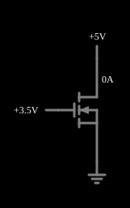

# Transistor MOSFET de canal n

<!-- navegacao:inicio -->
[Índice](README.md) · [Próximo: p-MOSFET](pmosfet.md)
<!-- navegacao:fim -->

## Objetivo

Mostrar o MOSFET de canal n (NMOS) como um dispositivo de **corrente controlada por tensão**: a tensão porta-fonte $V_{GS}$ cria um canal entre o dreno e a fonte, e a corrente de dreno $I_D$ depende de $V_{GS}$ e de $V_{DS}$ em três regiões de operação: corte, triodo e saturação.

## O circuito

<!-- esquema:inicio -->

<!-- esquema:fim -->

Duas fontes de tensão com *sliders* ligam-se diretamente ao transistor, com a fonte (*source*) na terra: a **tensão de porta** ($0$ a $5\ \text{V}$) e a **tensão de dreno** ($0$ a $5\ \text{V}$). A corrente é lida na própria fonte de dreno. O exemplo abre com $V_{GS} = 3{,}5\ \text{V}$ e $V_{DS} = 5\ \text{V}$.

<!-- componentes:inicio -->
| N.º | Tipo | Elemento | Valores |
|----:|------|----------|---------|
| 0 | `NMosfetElm` | MOSFET | Model = default; Swap D/S = não |
| 1 | `VarRailElm` | voltage source | Min Voltage = 0; Max Voltage = 5; Slider Text = Gate Voltage |
| 4 | `VarRailElm` | voltage source | Min Voltage = 0; Max Voltage = 5; Slider Text = Drain Voltage |
| 5 | `GroundElm` | ground | Symbol = Earth |
<!-- componentes:fim -->

## Teoria

O MOSFET do simulador segue o **modelo de lei quadrática** (nível 1), com tensão de limiar $V_t$ (padrão: $1{,}5\ \text{V}$), parâmetro de transcondutância $\beta$ (padrão: $0{,}02\ \text{A/V}^2$) e modulação do comprimento do canal $\lambda$ (padrão: $0$). Com $V_{ov} = V_{GS} - V_t$:

$$I_D = \begin{cases}
\approx 0 & V_{GS} < V_t \quad \text{(corte)}\\[4pt]
\beta\left(V_{ov}\,V_{DS} - \tfrac{1}{2}V_{DS}^2\right)(1 + \lambda V_{DS}) & V_{DS} < V_{ov} \quad \text{(triodo)}\\[4pt]
\tfrac{1}{2}\beta\,V_{ov}^2\,(1 + \lambda V_{DS}) & V_{DS} \ge V_{ov} \quad \text{(saturação)}
\end{cases}$$

No corte o simulador deixa só uma condutância de fuga de $10^{-8}\ \text{S}$ entre dreno e fonte. Na saturação, a transcondutância é $g_m = \beta V_{ov}(1 + \lambda V_{DS})$ e a condutância de saída, $g_{ds} = \tfrac{1}{2}\beta V_{ov}^2\lambda$ (com $\lambda = 0$ o simulador usa o piso de $10^{-8}\ \text{S}$). Os MOSFETs deste projeto são do tipo de enriquecimento: sem tensão de porta, não há canal.

## Resultados esperados

Com $V_{GS} = 3{,}5\ \text{V}$, $V_{ov} = 2\ \text{V}$ e, como $V_{DS} = 5\ \text{V} \ge V_{ov}$, o transistor está na saturação:

$$I_D = \tfrac{1}{2} \cdot 0{,}02 \cdot 2^2 = 40\ \text{mA},$$

e o simulador mostra $40{,}0\ \text{mA}$ no transistor e na fonte de dreno; a tensão de porta é $3{,}5\ \text{V}$ (as verificações conferem as três grandezas). Movendo os *sliders* no simulador (valores conferidos, fora das verificações automáticas), a corrente de dreno acompanha a fórmula:

| $V_{GS}$ (V) | $V_{DS}$ (V) | Região | $I_D$ |
|-------------:|-------------:|--------|------:|
| $1{,}0$ | $5{,}0$ | corte | $50\ \text{nA}$ (fuga) |
| $1{,}5$ | $5{,}0$ | limiar | $0$ |
| $2{,}5$ | $0{,}5$ | triodo | $7{,}5\ \text{mA}$ |
| $2{,}5$ | $1{,}0$ | borda | $10\ \text{mA}$ |
| $2{,}5$ | $5{,}0$ | saturação | $10\ \text{mA}$ |
| $3{,}5$ | $0{,}5$ | triodo | $17{,}5\ \text{mA}$ |
| $3{,}5$ | $1{,}0$ | triodo | $30\ \text{mA}$ |
| $3{,}5$ | $2{,}0$ | borda | $40\ \text{mA}$ |
| $3{,}5$ | $5{,}0$ | saturação | $40\ \text{mA}$ |

## O que observar

Com a tensão de dreno em $5\ \text{V}$, aumente a de porta devagar: a corrente é nula até $1{,}5\ \text{V}$ e depois cresce com o **quadrado** de $V_{GS} - V_t$ (dobrar $V_{ov}$ quadruplica a corrente), ao contrário do transistor bipolar, em que cresce exponencialmente ([Transistor NPN](npn.md)). Com a porta fixa, varie o dreno: a corrente sobe na região de triodo e se achata ao passar de $V_{DS} = V_{GS} - V_t$ (a saturação); como $\lambda = 0$, o patamar é perfeitamente horizontal. Compare com o [p-MOSFET](pmosfet.md), em que todas as tensões e correntes têm sinal oposto.

## Limites do modelo

- O modelo é de lei quadrática: ele não tem a corrente de sublimiar (abaixo de $V_t$ um MOSFET real conduz uma corrente que cai exponencialmente, em vez de $50\ \text{nA}$ de fuga), nem redução da mobilidade, nem saturação da velocidade dos portadores, que dominam transistores curtos.
- Com $\lambda = 0$ a resistência de saída na saturação é infinita; um MOSFET real tem $\lambda > 0$ (a corrente cresce um pouco com $V_{DS}$), que se pode ligar editando o modelo.
- Este exemplo usa o modelo padrão com diodo de corpo; o terminal de corpo não aparece e não há capacitâncias de porta.

## Referências

Sedra e Smith, *Microelectronic Circuits*, capítulo sobre o MOSFET (características $i$–$v$ e modelo de lei quadrática); Razavi, *Fundamentals of Microelectronics*, capítulo sobre o MOSFET.

O circuito deste exemplo faz parte da coleção do simulador original de Paul Falstad e Iain Sharp (CircuitJS1); a explicação é deste projeto.
