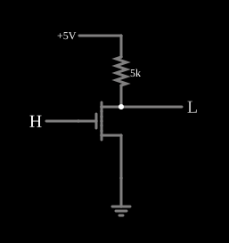

# Inversor NMOS com carga resistiva

<!-- navegacao:inicio -->
[Índice](README.md) · [Próximo: Inverter with only MOSFETs](nmosinverter2.md)
<!-- navegacao:fim -->

## Objetivo

Mostrar o inversor **NMOS** mais simples: um MOSFET de canal N como chave para a terra e um resistor como carga. É o ponto de partida das famílias NMOS, que dominaram os microprocessadores dos anos 1970.

## O circuito

<!-- esquema:inicio -->

<!-- esquema:fim -->

O dreno do NMOS (modelo padrão digital: $V_t = 1{,}5\ \text{V}$, $\beta = 0{,}02\ \text{A/V}^2$) é a saída e vai a $5\ \text{V}$ por um resistor de $5\ \text{k}\Omega$; a fonte está na terra e a porta na entrada lógica ($0$ ou $5\ \text{V}$). O exemplo abre com a entrada em $5\ \text{V}$.

<!-- componentes:inicio -->
| N.º | Tipo | Elemento | Valores |
|----:|------|----------|---------|
| 0 | `RailElm` | voltage source | Voltage = 5; Waveform = D/C; DC Offset (V) = 0; Internal Resistance (ohms) = 0 |
| 1 | `GroundElm` | ground | Symbol = Earth |
| 2 | `LogicInputElm` | logic input | Momentary Switch = não; High Logic Voltage = 5; Low Voltage = 0; Numeric = não; Ternary = não; Keyboard Shortcut =  |
| 3 | `ResistorElm` | resistor | Resistance (ohms) = 5k |
| 4 | `LogicOutputElm` | logic output | Threshold = 2.5; Current Required = não; Numeric = não; Ternary = não |
| 5 | `NMosfetElm` | MOSFET | Model = default-digital; Swap D/S = não |
<!-- componentes:fim -->

## Teoria

Com a entrada em $0$, $V_{GS} = 0 < V_t$ e o transistor corta: a saída vai a $5\ \text{V}$, menos a pequena queda da corrente de fuga no resistor. Com a entrada em $5\ \text{V}$, o transistor conduz no **triodo**; para $V_{DS}$ pequeno ele é um resistor

$$R_{on} \approx \frac{1}{\beta (V_{GS} - V_t)} = \frac{1}{0{,}02 \cdot 3{,}5} \approx 14{,}3\ \Omega,$$

e a saída é o divisor $V_{OL} \approx 5\ \text{V} \cdot \dfrac{R_{on}}{R_L + R_{on}} \approx 14{,}2\ \text{mV}$. A corrente é $\approx 5\ \text{V}/5\ \text{k}\Omega = 1\ \text{mA}$: a porta consome $5\ \text{mW}$ enquanto a saída está baixa. Este consumo estático é o principal defeito do NMOS em relação ao [CMOS](cmosinverter.md).

## Resultados esperados

O simulador dá, com a entrada em $5\ \text{V}$, a saída em $14{,}27\ \text{mV}$ e a corrente da alimentação em $0{,}997\ \text{mA}$, de acordo com o divisor acima. Com a entrada em $0$, a saída fica em $4{,}99975\ \text{V}$ e a corrente cai para $50\ \text{nA}$, a fuga do transistor cortado no modelo ($10^{-8}\ \text{S} \cdot 5\ \text{V}$).

## O que observar

Clique na entrada e compare a corrente da alimentação nos dois estados. Os inversores [só com MOSFETs](nmosinverter2.md) e [com carga de depleção](nmosinverter3.md) trocam o resistor por um transistor, que ocupa muito menos área num circuito integrado.

## Limites do modelo

- Num circuito integrado, um resistor de $5\ \text{k}\Omega$ ocuparia muito mais área que o transistor; por isso a carga NMOS é sempre um transistor.
- Sem capacitâncias, a subida da saída (limitada pela constante $R_L C$ da carga) é instantânea.

## Referências

Sedra e Smith, *Microelectronic Circuits*, capítulo sobre inversores MOS; Hodges, Jackson e Saleh, *Analysis and Design of Digital Integrated Circuits*, capítulo sobre inversores NMOS.

O circuito deste exemplo faz parte da coleção do simulador original de Paul Falstad e Iain Sharp (CircuitJS1); a explicação é deste projeto.
