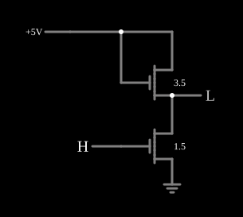

# Inversor só com MOSFETs (carga de enriquecimento)

<!-- navegacao:inicio -->
[Índice](README.md) · [Anterior: NMOS Inverter](nmosinverter.md) · [Próximo: Depletion-load NMOS Inverter](nmosinverter3.md)
<!-- navegacao:fim -->

## Objetivo

Mostrar o inversor NMOS com **carga de enriquecimento**: o resistor de carga é trocado por um segundo NMOS com a porta ligada ao dreno. Ocupa pouca área, mas tem um nível alto fraco, um defeito que o exemplo deixa visível.

## O circuito

<!-- esquema:inicio -->

<!-- esquema:fim -->

O transistor de baixo (o *acionador*, $V_t = 1{,}5\ \text{V}$, $\beta = 0{,}02\ \text{A/V}^2$) tem a fonte na terra, a porta na entrada lógica ($0$ ou $5\ \text{V}$) e o dreno na saída. O transistor de cima (a *carga*, $V_t = 3{,}5\ \text{V}$, $\beta = 0{,}02\ \text{A/V}^2$) tem a porta e o dreno ligados a $5\ \text{V}$ e a fonte na saída. O exemplo abre com a entrada em $5\ \text{V}$.

<!-- componentes:inicio -->
| N.º | Tipo | Elemento | Valores |
|----:|------|----------|---------|
| 0 | `NMosfetElm` | MOSFET | Model = old-mosfet-4; Swap D/S = não |
| 1 | `NMosfetElm` | MOSFET | Model = default-digital; Swap D/S = não |
| 2 | `RailElm` | voltage source | Voltage = 5; Waveform = D/C; DC Offset (V) = 0; Internal Resistance (ohms) = 0 |
| 8 | `GroundElm` | ground | Symbol = Earth |
| 9 | `LogicInputElm` | logic input | Momentary Switch = não; High Logic Voltage = 5; Low Voltage = 0; Numeric = não; Ternary = não; Keyboard Shortcut =  |
| 10 | `LogicOutputElm` | logic output | Threshold = 2.5; Current Required = não; Numeric = não; Ternary = não |
<!-- componentes:fim -->

## Teoria

Como $V_{GS} = V_{DS}$, a carga está sempre na **saturação** (ou cortada), e conduz

$$I = \tfrac{\beta}{2} (5 - V_{out} - V_{t,L})^2 .$$

- **Entrada alta:** o acionador está no triodo, $I = \beta[(5 - V_t)V_{out} - V_{out}^2/2]$. Igualando as duas correntes obtém-se $V_{out} \approx 0{,}236\ \text{V}$ e $I \approx 16\ \text{mA}$: o nível baixo depende da **razão** entre os dois transistores (lógica *ratioed*), e só fica baixo se o acionador for muito mais forte que a carga.
- **Entrada baixa:** o acionador corta, mas a carga também corta quando $V_{out}$ chega a $5 - V_{t,L} = 1{,}5\ \text{V}$. A saída não consegue subir até a alimentação; no modelo, acima desse ponto restam só as fugas dos dois transistores, iguais, e a saída se acomoda no meio: $2{,}5\ \text{V}$.

## Resultados esperados

O simulador dá, com a entrada em $5\ \text{V}$, a saída em $0{,}236\ \text{V}$ e a corrente da alimentação em $15{,}97\ \text{mA}$, de acordo com as duas equações acima ($0{,}01 \cdot 1{,}264^2 = 15{,}97\ \text{mA}$). Com a entrada em $0$, a saída fica em $2{,}50\ \text{V}$, exatamente no limiar da saída lógica.

## O que observar

Clique na entrada e veja o nível alto parado em $2{,}5\ \text{V}$: um inversor real com esta carga daria no máximo $V_{DD} - V_t$, insuficiente para acionar com segurança a porta seguinte. É por isso que a família NMOS adotou a carga de depleção, mostrada em [Depletion-load NMOS Inverter](nmosinverter3.md). Compare também com a carga resistiva de [NMOS Inverter](nmosinverter.md).

## Limites do modelo

- O valor de $2{,}5\ \text{V}$ no nível alto vem das condutâncias de fuga iguais dos dois transistores no modelo; num circuito real a saída ficaria perto de $V_{DD} - V_t$, que diminui ainda mais pelo efeito de corpo (que o modelo não tem).
- O $V_t = 3{,}5\ \text{V}$ da carga é alto para tornar o efeito evidente.
- A corrente estática de $16\ \text{mA}$ é muito alta; uma carga real seria muito mais fraca que o acionador.

## Referências

Hodges, Jackson e Saleh, *Analysis and Design of Digital Integrated Circuits*, capítulo sobre inversores NMOS (cargas de enriquecimento e de depleção); Sedra e Smith, *Microelectronic Circuits*.

O circuito deste exemplo faz parte da coleção do simulador original de Paul Falstad e Iain Sharp (CircuitJS1); a explicação é deste projeto.
