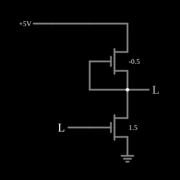

# Inversor NMOS com carga de depleção

<!-- navegacao:inicio -->
[Índice](README.md) · [Anterior: Inverter with only MOSFETs](nmosinverter2.md) · [Próximo: NMOS NAND](nmosnand.md)
<!-- navegacao:fim -->

## Objetivo

Mostrar o inversor que tornou a lógica NMOS prática: a carga é um MOSFET de **depleção** (que conduz com $V_{GS} = 0$) com a porta ligada à fonte. Ele funciona como uma fonte de corrente, e a saída sobe até a alimentação.

## O circuito

<!-- esquema:inicio -->

<!-- esquema:fim -->

O acionador (NMOS de enriquecimento, $V_t = 1{,}5\ \text{V}$, $\beta = 0{,}02\ \text{A/V}^2$) tem a fonte na terra, a porta na entrada lógica ($0$ ou $5\ \text{V}$) e o dreno na saída. A carga (NMOS de depleção, $V_t = -0{,}5\ \text{V}$, $\beta = 0{,}02\ \text{A/V}^2$) tem o dreno em $5\ \text{V}$ e a porta e a fonte ligadas à saída. O exemplo abre com a entrada em $0$.

<!-- componentes:inicio -->
| N.º | Tipo | Elemento | Valores |
|----:|------|----------|---------|
| 0 | `NMosfetElm` | MOSFET | Model = old-mosfet-5; Swap D/S = não |
| 1 | `NMosfetElm` | MOSFET | Model = default-digital; Swap D/S = não |
| 2 | `RailElm` | voltage source | Voltage = 5; Waveform = D/C; DC Offset (V) = 0; Internal Resistance (ohms) = 0 |
| 7 | `GroundElm` | ground | Symbol = Earth |
| 8 | `LogicInputElm` | logic input | Momentary Switch = não; High Logic Voltage = 5; Low Voltage = 0; Numeric = não; Ternary = não; Keyboard Shortcut =  |
| 9 | `LogicOutputElm` | logic output | Threshold = 2.5; Current Required = não; Numeric = não; Ternary = não |
<!-- componentes:fim -->

## Teoria

Com $V_{GS} = 0 > V_t$, a carga conduz sempre. Enquanto estiver saturada ($V_{DS} > -V_t = 0{,}5\ \text{V}$), a sua corrente é constante:

$$I_L = \tfrac{\beta}{2} (0 - V_t)^2 = 0{,}01 \cdot 0{,}5^2 = 2{,}5\ \text{mA}.$$

- **Entrada alta:** o acionador, no triodo, absorve os $2{,}5\ \text{mA}$ com uma queda pequena: $\beta[(5 - 1{,}5)V_{out} - V_{out}^2/2] = 2{,}5\ \text{mA}$ dá $V_{out} \approx 36\ \text{mV}$.
- **Entrada baixa:** o acionador corta. A carga continua a conduzir até não haver mais tensão sobre ela, e a saída sobe **até $5\ \text{V}$**, ao contrário da [carga de enriquecimento](nmosinverter2.md), que para em $V_{DD} - V_t$.

A carga em fonte de corrente também carrega a capacitância da saída com corrente quase constante, mais depressa que um resistor do mesmo consumo.

## Resultados esperados

O simulador dá, com a entrada em $0$, a saída em $4{,}999995\ \text{V}$; com a entrada em $5\ \text{V}$, a saída em $35{,}9\ \text{mV}$ e a corrente da alimentação em $2{,}50\ \text{mA}$, exatamente a corrente de saturação da carga calculada acima.

## O que observar

Clique na entrada: os dois níveis lógicos agora são bons, e a corrente com a saída baixa é fixada pela carga. Compare com [NMOS Inverter](nmosinverter.md) (resistor) e com [Inverter with only MOSFETs](nmosinverter2.md) (carga de enriquecimento). A [NMOS NAND](nmosnand.md) põe dois acionadores em série.

## Limites do modelo

- O modelo não tem efeito de corpo; num circuito real a fonte da carga está acima do substrato, o que torna o seu $V_t$ menos negativo e reduz a corrente quando a saída sobe.
- Sem $\lambda$ (modulação do canal), a corrente da carga é exatamente constante na saturação.
- Ainda há consumo estático ($12{,}5\ \text{mW}$ com a saída baixa), o defeito que o CMOS eliminou.

## Referências

Hodges, Jackson e Saleh, *Analysis and Design of Digital Integrated Circuits*, capítulo sobre inversores NMOS; Mead e Conway, *Introduction to VLSI Systems*, capítulo 1.

O circuito deste exemplo faz parte da coleção do simulador original de Paul Falstad e Iain Sharp (CircuitJS1); a explicação é deste projeto.
