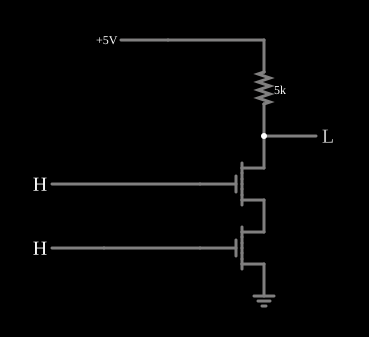

# Porta NAND NMOS

<!-- navegacao:inicio -->
[Índice](README.md) · [Anterior: Depletion-load NMOS Inverter](nmosinverter3.md)
<!-- navegacao:fim -->

## Objetivo

Mostrar a porta **NAND** em NMOS: dois transistores de canal N **em série** entre a saída e a terra, com um resistor de carga.

## O circuito

<!-- esquema:inicio -->

<!-- esquema:fim -->

A saída vai a $5\ \text{V}$ por um resistor de $5\ \text{k}\Omega$. Dois NMOS (modelo padrão digital: $V_t = 1{,}5\ \text{V}$, $\beta = 0{,}02\ \text{A/V}^2$) estão empilhados entre a saída e a terra, cada porta numa entrada lógica ($0$ ou $5\ \text{V}$). O exemplo abre com as duas entradas em $5\ \text{V}$.

<!-- componentes:inicio -->
| N.º | Tipo | Elemento | Valores |
|----:|------|----------|---------|
| 0 | `NMosfetElm` | MOSFET | Model = default-digital; Swap D/S = não |
| 3 | `LogicOutputElm` | logic output | Threshold = 2.5; Current Required = não; Numeric = não; Ternary = não |
| 4 | `NMosfetElm` | MOSFET | Model = default-digital; Swap D/S = não |
| 6 | `GroundElm` | ground | Symbol = Earth |
| 9 | `RailElm` | voltage source | Voltage = 5; Waveform = D/C; DC Offset (V) = 0; Internal Resistance (ohms) = 0 |
| 11 | `LogicInputElm` | logic input | Momentary Switch = não; High Logic Voltage = 5; Low Voltage = 0; Numeric = não; Ternary = não; Keyboard Shortcut =  |
| 12 | `LogicInputElm` | logic input | Momentary Switch = não; High Logic Voltage = 5; Low Voltage = 0; Numeric = não; Ternary = não; Keyboard Shortcut =  |
| 13 | `ResistorElm` | resistor | Resistance (ohms) = 5k |
<!-- componentes:fim -->

## Teoria

O caminho para a terra só existe com os **dois** transistores ligados; basta uma entrada baixa para abri-lo e o resistor puxar a saída para cima:

$$Y = \overline{A \cdot B}.$$

Com as duas entradas altas, os dois transistores no triodo valem cada um $R_{on} \approx 1/[\beta(V_{GS} - V_t)] \approx 14{,}3\ \Omega$ (como em [NMOS Inverter](nmosinverter.md)), e a pilha tem o dobro: $V_{OL} \approx 5\ \text{V} \cdot 28{,}6/5028{,}6 \approx 28\ \text{mV}$. Para manter o mesmo $V_{OL}$ de um inversor, os transistores de uma NAND de $n$ entradas teriam de ser $n$ vezes mais largos; por isso as NANDs NMOS de muitas entradas eram evitadas.

## Resultados esperados

O simulador dá:

| $A$ (elemento 11) | $B$ (elemento 12) | Saída |
|----:|----:|------:|
| 1 | 1 | $28{,}5\ \text{mV}$ |
| 0 | 1 | $4{,}99975\ \text{V}$ |
| 1 | 0 | $4{,}99983\ \text{V}$ |
| 0 | 0 | $4{,}99988\ \text{V}$ |

Com a saída baixa a alimentação fornece $0{,}994\ \text{mA}$; com a saída alta só a fuga dos transistores cortados (dezenas de nanoampères), que muda um pouco o nível alto conforme quais transistores estão cortados.

## O que observar

Clique nas entradas: a saída só desce com as duas altas, e o nível baixo é o dobro do de um inversor. Compare com a [CMOS NAND](cmosnand.md), que acrescenta dois PMOS em paralelo no lugar do resistor.

## Limites do modelo

- O modelo não tem efeito de corpo: na pilha real, o transistor de cima tem a fonte acima do substrato e um $V_t$ maior.
- O resistor de carga ocuparia muita área num circuito integrado; as portas NMOS reais usavam a [carga de depleção](nmosinverter3.md).
- Sem capacitâncias, a comutação é instantânea.

## Referências

Hodges, Jackson e Saleh, *Analysis and Design of Digital Integrated Circuits*, capítulo sobre portas NMOS; Mead e Conway, *Introduction to VLSI Systems*.

O circuito deste exemplo faz parte da coleção do simulador original de Paul Falstad e Iain Sharp (CircuitJS1); a explicação é deste projeto.
