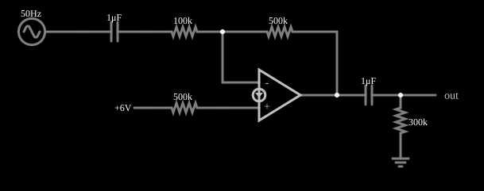

# Amplificador de Norton inversor

<!-- navegacao:inicio -->
[Índice](README.md) · [Próximo: Norton Noninverting Amplifier](norton-noninvert.md)
<!-- navegacao:fim -->

## Objetivo

Mostrar o amplificador de Norton na configuração **inversora**: uma corrente de entrada proporcional à tensão de sinal sai invertida e multiplicada por $R_f/R_{in}$.

## O circuito

<!-- esquema:inicio -->

<!-- esquema:fim -->

Um sinal de $1\ \text{V}$ de pico e $50\ \text{Hz}$ passa por um capacitor de acoplamento de $1\ \mu\text{F}$ e um resistor de $100\ \text{k}\Omega$ até a entrada inversora; a realimentação é um resistor de $500\ \text{k}\Omega$ da saída à entrada. A entrada de espelho recebe $6\ \text{V}$ por um resistor de $500\ \text{k}\Omega$ (a polarização de $\approx 11\ \mu\text{A}$ que fixa a saída em torno de $5{,}8\ \text{V}$). A saída é acoplada por outro capacitor de $1\ \mu\text{F}$ a uma carga de $300\ \text{k}\Omega$.

<!-- componentes:inicio -->
| N.º | Tipo | Elemento | Valores |
|----:|------|----------|---------|
| 1 | `ResistorElm` | resistor | Resistance (ohms) = 500k |
| 3 | `OutputElm` | output | Show Voltage = não |
| 4 | `NortonAmpElm` | norton amp |  |
| 5 | `RailElm` | A/C source | Max Voltage = 1; Waveform = A/C; DC Offset (V) = 0; Internal Resistance (ohms) = 0; Show Voltage = não; Frequency (Hz) = 50; Phase Offset (degrees) = 0 |
| 6 | `CapacitorElm` | capacitor | Capacitance (F) = 1μ; Trapezoidal Approximation = sim; Initial Voltage (on Reset) = 1m; Series Resistance = 0 |
| 7 | `ResistorElm` | resistor | Resistance (ohms) = 100k |
| 8 | `ResistorElm` | resistor | Resistance (ohms) = 500k |
| 9 | `RailElm` | voltage source | Voltage = 6; Waveform = D/C; DC Offset (V) = 0; Internal Resistance (ohms) = 0 |
| 10 | `CapacitorElm` | capacitor | Capacitance (F) = 1μ; Trapezoidal Approximation = sim; Initial Voltage (on Reset) = 1m; Series Resistance = 0 |
| 11 | `ResistorElm` | resistor | Resistance (ohms) = 300k |
| 12 | `GroundElm` | ground | Symbol = Earth |
<!-- componentes:fim -->

## Símbolos e parâmetros

Os símbolos usados neste documento (definições completas no [glossário](../glossario-simbolos.md)):

| Símbolo | Nome | Significado | Unidade |
|---------|------|-------------|---------|
| $R_f$ | resistência de realimentação | resistor que liga a saída à entrada inversora | Ω |
| $R_{\text{in}}$ | resistência de entrada | resistência vista pela fonte olhando para a entrada do circuito | Ω |
| $i_{\text{in}}$ | corrente de entrada | corrente que entra no circuito pela entrada | A |
| $v_{\text{in}}$ | tensão instantânea de entrada | sinal aplicado à entrada do circuito | V |
| $v_{\text{out}}$ | tensão instantânea de saída | sinal que o circuito entrega à saída | V |
| $A_v$ | ganho de tensão | razão entre a tensão de saída e a de entrada | — |

## Teoria

O amplificador de Norton (como o LM3900) é um **amplificador de diferença de corrente**: a saída responde à diferença entre as correntes que entram nas duas entradas, uma das quais é um espelho de corrente. Com um resistor de realimentação $R_f$ e um de entrada $R_{in}$, o ganho de tensão ideal é $\mp R_f/R_{in}$. A polarização usa uma corrente de referência no espelho (aqui, por um resistor de $500\ \text{k}\Omega$ ligado a $6\ \text{V}$).

No inversor, $i_{in} = v_{in}/R_{in}$ e, como a entrada inversora é um ponto de baixa impedância (tensão quase fixa), $v_{out} = -i_{in}R_f$:

$$A_v = -\frac{R_f}{R_{in}} = -\frac{500\ \text{k}\Omega}{100\ \text{k}\Omega} = -5.$$

## Resultados esperados

O simulador dá, na saída acoplada:

- **Excursão:** de $+4{,}996\ \text{V}$ a $-4{,}998\ \text{V}$, amplitude de $5{,}0\ \text{V}$ para a entrada de $1\ \text{V}$: ganho de $-5{,}0$.
- **Valor médio da saída acoplada:** $-1\ \text{mV}$ (o acoplamento remove a componente contínua de $5{,}8\ \text{V}$).

## O que observar

Compare entrada e saída no osciloscópio: a saída é cinco vezes maior e em oposição de fase. Mude o resistor de realimentação e o ganho muda na mesma proporção.

## Limites do modelo

- O modelo do amplificador de Norton é idealizado (ganho de corrente unitário no espelho e resistência de entrada de baixa impedância); num LM3900 real a corrente de entrada da polarização, a banda e o ruído impõem limites.
- O ganho é independente da tensão de alimentação enquanto a saída não satura.

## Referências

Texas Instruments (National Semiconductor), *LM3900 Quad Norton Amplifier* (folha de dados) e nota de aplicação AN-72, *LM3900: A New Current-Differencing Quad of ±Input Amplifiers*.

O circuito deste exemplo faz parte da coleção do simulador original de Paul Falstad e Iain Sharp (CircuitJS1); a explicação é deste projeto.
