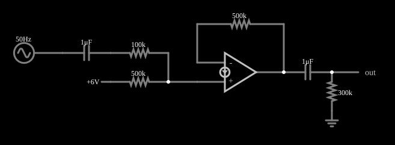

# Amplificador de Norton não inversor

<!-- navegacao:inicio -->
[Índice](README.md) · [Anterior: Norton Inverting Amplifier](norton-invert.md) · [Próximo: Norton Sawtooth Oscillator](norton-saw.md)
<!-- navegacao:fim -->

## Objetivo

Mostrar o amplificador de Norton na configuração **não inversora**: o sinal entra pela entrada de espelho e a saída acompanha a entrada, sem inversão.

## O circuito

<!-- esquema:inicio -->

<!-- esquema:fim -->

Os mesmos componentes do exemplo inversor ($500\ \text{k}\Omega$ e $100\ \text{k}\Omega$, capacitores de $1\ \mu\text{F}$, carga de $300\ \text{k}\Omega$), mas com o sinal de $1\ \text{V}$ e $50\ \text{Hz}$, passando pelo capacitor de acoplamento e pelo resistor de $100\ \text{k}\Omega$, ligado ao mesmo nó que a polarização de $6\ \text{V}$ por $500\ \text{k}\Omega$ (a entrada de espelho, não inversora).

<!-- componentes:inicio -->
| N.º | Tipo | Elemento | Valores |
|----:|------|----------|---------|
| 1 | `ResistorElm` | resistor | Resistance (ohms) = 500k |
| 3 | `OutputElm` | output | Show Voltage = não |
| 4 | `NortonAmpElm` | norton amp |  |
| 5 | `RailElm` | A/C source | Max Voltage = 1; Waveform = A/C; DC Offset (V) = 0; Internal Resistance (ohms) = 0; Show Voltage = não; Frequency (Hz) = 50; Phase Offset (degrees) = 0 |
| 6 | `CapacitorElm` | capacitor | Capacitance (F) = 1μ; Trapezoidal Approximation = sim; Initial Voltage (on Reset) = 1m; Series Resistance = 0 |
| 7 | `ResistorElm` | resistor | Resistance (ohms) = 100k |
| 8 | `ResistorElm` | resistor | Resistance (ohms) = 500k |
| 9 | `RailElm` | voltage source | Voltage = 6; Waveform = D/C; DC Offset (V) = 0; Internal Resistance (ohms) = 0 |
| 10 | `CapacitorElm` | capacitor | Capacitance (F) = 1μ; Trapezoidal Approximation = sim; Initial Voltage (on Reset) = 1m; Series Resistance = 0 |
| 11 | `ResistorElm` | resistor | Resistance (ohms) = 300k |
| 12 | `GroundElm` | ground | Symbol = Earth |
<!-- componentes:fim -->

## Teoria

O amplificador de Norton (como o LM3900) é um **amplificador de diferença de corrente**: a saída responde à diferença entre as correntes que entram nas duas entradas, uma das quais é um espelho de corrente. Com um resistor de realimentação $R_f$ e um de entrada $R_{in}$, o ganho de tensão ideal é $\mp R_f/R_{in}$. A polarização usa uma corrente de referência no espelho (aqui, por um resistor de $500\ \text{k}\Omega$ ligado a $6\ \text{V}$).

Na configuração não inversora, o sinal e a polarização são somados no espelho de corrente; a saída acompanha a entrada com o ganho

$$A_v = +\frac{R_f}{R_{in}} = +\frac{500\ \text{k}\Omega}{100\ \text{k}\Omega} = +5.$$

Como o espelho se comporta como um diodo ($\approx 0{,}6\ \text{V}$ com resistência dinâmica de poucos $\text{k}\Omega$), há uma pequena não linearidade na transferência.

## Resultados esperados

O simulador dá, na saída acoplada:

- **Excursão:** de $+4{,}813\ \text{V}$ a $-4{,}554\ \text{V}$, amplitude média de $4{,}68\ \text{V}$ para a entrada de $1\ \text{V}$: ganho de $+4{,}7$ (teoria: $5$, $6\ \%$ acima).
- **Assimetria:** o pico positivo é maior que o negativo em $0{,}26\ \text{V}$ e o valor médio é de $+0{,}052\ \text{V}$, sinais da não linearidade do espelho.

## O que observar

Compare com o inversor: o ganho tem o mesmo valor, mas o sinal na saída está em fase com a entrada, e a forma de onda fica ligeiramente deformada.

## Limites do modelo

- A diferença de $6\ \%$ entre o ganho medido e o teórico, e a assimetria, não foram derivadas do modelo do espelho; a explicação acima (não linearidade de um espelho que se comporta como diodo) é qualitativa.
- Num LM3900 real a não linearidade do espelho com o nível do sinal é uma das limitações conhecidas da configuração.

## Referências

Texas Instruments (National Semiconductor), *LM3900 Quad Norton Amplifier* (folha de dados) e nota de aplicação AN-72, *LM3900: A New Current-Differencing Quad of ±Input Amplifiers*.

O circuito deste exemplo faz parte da coleção do simulador original de Paul Falstad e Iain Sharp (CircuitJS1); a explicação é deste projeto.
