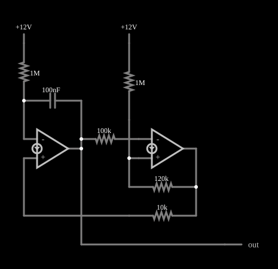

# Oscilador dente de serra com amplificadores de Norton

<!-- navegacao:inicio -->
[Índice](README.md) · [Anterior: Norton Noninverting Amplifier](norton-noninvert.md)
<!-- navegacao:fim -->

## Objetivo

Mostrar um **oscilador dente de serra** com dois amplificadores de Norton: um integra uma corrente constante num capacitor (a rampa) e o outro comuta e a reinicia.

## O circuito

<!-- esquema:inicio -->

<!-- esquema:fim -->

Dois amplificadores de Norton, um capacitor de $100\ \text{nF}$, resistores de $1\ \text{M}\Omega$ (duas alimentações de $12\ \text{V}$), $100\ \text{k}\Omega$, $120\ \text{k}\Omega$ e $10\ \text{k}\Omega$. Um dos amplificadores, com o capacitor de $100\ \text{nF}$, integra a corrente de $\approx 12\ \mu\text{A}$ que vem de $12\ \text{V}$ por $1\ \text{M}\Omega$ e produz a rampa; o outro tem saída que comuta entre $0$ e $12\ \text{V}$ e define quando a rampa recomeça. Este projeto não fez o traçado completo do circuito além disso.

<!-- componentes:inicio -->
| N.º | Tipo | Elemento | Valores |
|----:|------|----------|---------|
| 0 | `ResistorElm` | resistor | Resistance (ohms) = 1M |
| 1 | `CapacitorElm` | capacitor | Capacitance (F) = 100n; Trapezoidal Approximation = sim; Initial Voltage (on Reset) = 1m; Series Resistance = 0 |
| 4 | `RailElm` | voltage source | Voltage = 12; Waveform = D/C; DC Offset (V) = 0; Internal Resistance (ohms) = 0 |
| 5 | `ResistorElm` | resistor | Resistance (ohms) = 100k |
| 9 | `ResistorElm` | resistor | Resistance (ohms) = 1M |
| 10 | `RailElm` | voltage source | Voltage = 12; Waveform = D/C; DC Offset (V) = 0; Internal Resistance (ohms) = 0 |
| 11 | `ResistorElm` | resistor | Resistance (ohms) = 120k |
| 12 | `ResistorElm` | resistor | Resistance (ohms) = 10k |
| 19 | `OutputElm` | output | Show Voltage = não |
| 21 | `NortonAmpElm` | norton amp |  |
| 23 | `NortonAmpElm` | norton amp |  |
<!-- componentes:fim -->

## Teoria

O amplificador de Norton (como o LM3900) é um **amplificador de diferença de corrente**: a saída responde à diferença entre as correntes que entram nas duas entradas, uma das quais é um espelho de corrente. Com um resistor de realimentação $R_f$ e um de entrada $R_{in}$, o ganho de tensão ideal é $\mp R_f/R_{in}$. A polarização usa uma corrente de referência no espelho (aqui, por um resistor de $500\ \text{k}\Omega$ ligado a $6\ \text{V}$).

A rampa tem inclinação $dV/dt = I/C = (12\ \text{V}/1\ \text{M}\Omega)/100\ \text{nF} = 120\ \text{V/s}$ (a entrada inversora de Norton fica próxima de $0\ \text{V}$). Com a excursão de $10{,}0\ \text{V}$ (de $1{,}0\ \text{V}$ a $11{,}0\ \text{V}$), o tempo de subida é

$$t_{subida} = \frac{C\,\Delta V}{I} = \frac{100\ \text{nF}\cdot 9{,}97\ \text{V}}{12\ \mu\text{A}} = 83{,}1\ \text{ms}, $$

e a descarga ocupa só cerca de $1\ \text{ms}$ do período de $84{,}0\ \text{ms}$.

## Resultados esperados

O simulador dá, em regime permanente:

- **Frequência:** $11{,}91\ \text{Hz}$, período de $84{,}0\ \text{ms}$ (a subida de $83{,}1\ \text{ms}$ e a descarga rápida respondem por ele).
- **Saída da rampa:** de $1{,}00\ \text{V}$ a $10{,}97\ \text{V}$ (média de $5{,}55\ \text{V}$).
- **Saída do outro amplificador**: onda quadrada entre $0$ e $12{,}07\ \text{V}$.
- **Capacitor:** de $-10{,}97\ \text{V}$ a $-1{,}00\ \text{V}$.

## O que observar

No osciloscópio vê-se a dente de serra subindo devagar e caindo depressa, em cerca de $12\ \text{Hz}$. Aumente o capacitor e a frequência cai na proporção.

## Limites do modelo

- A teoria acima usa a corrente de carga de $12\ \mu\text{A}$ e o valor medido da excursão; ela não prevê, por si só, os limiares $1\ \text{V}$ e $11\ \text{V}$, que vêm do projeto do circuito e foram tomados do simulador.
- O modelo do amplificador de Norton é idealizado.

## Referências

Texas Instruments (National Semiconductor), *LM3900 Quad Norton Amplifier* (folha de dados) e nota de aplicação AN-72, *LM3900: A New Current-Differencing Quad of ±Input Amplifiers*.

O circuito deste exemplo faz parte da coleção do simulador original de Paul Falstad e Iain Sharp (CircuitJS1); a explicação é deste projeto.
