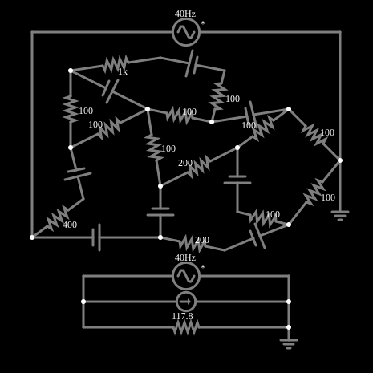

# Teorema de Norton

<!-- navegacao:inicio -->
[Índice](README.md) · [Anterior: Thevenin's Theorem](thevenin.md)
<!-- navegacao:fim -->

## Objetivo

Mostrar o equivalente de Norton: uma rede linear de dois terminais equivale a uma fonte de corrente $I_N$ em paralelo com uma resistência $R_N$. É o dual do equivalente de Thévenin.

## O circuito

<!-- esquema:inicio -->

<!-- esquema:fim -->

A mesma rede do exemplo de Thévenin (13 resistores e 8 fontes de tensão contínua) à esquerda, e à direita o equivalente de Norton: uma fonte de corrente de $23{,}84\ \text{mA}$ em paralelo com um resistor de $117{,}78\ \Omega$. Uma fonte alternada de teste (5 V, 40 Hz) é ligada a cada lado, e dois osciloscópios mostram as correntes.

<!-- componentes:inicio -->
| N.º | Tipo | Elemento | Valores |
|----:|------|----------|---------|
| 0 | `ResistorElm` | resistor | Resistance (ohms) = 100 |
| 1 | `ResistorElm` | resistor | Resistance (ohms) = 100 |
| 2 | `ResistorElm` | resistor | Resistance (ohms) = 200 |
| 3 | `ResistorElm` | resistor | Resistance (ohms) = 100 |
| 4 | `ResistorElm` | resistor | Resistance (ohms) = 100 |
| 5 | `VoltageElm` | voltage source | Voltage = 5; Waveform = D/C; DC Offset (V) = 0; Internal Resistance (ohms) = 0; Show Voltage = não; Circle Symbol = não |
| 6 | `VoltageElm` | voltage source | Voltage = 5; Waveform = D/C; DC Offset (V) = 0; Internal Resistance (ohms) = 0; Show Voltage = não; Circle Symbol = não |
| 7 | `VoltageElm` | voltage source | Voltage = 5; Waveform = D/C; DC Offset (V) = 0; Internal Resistance (ohms) = 0; Show Voltage = não; Circle Symbol = não |
| 8 | `VoltageElm` | voltage source | Voltage = 5; Waveform = D/C; DC Offset (V) = 0; Internal Resistance (ohms) = 0; Show Voltage = não; Circle Symbol = não |
| 9 | `VoltageElm` | voltage source | Voltage = 5; Waveform = D/C; DC Offset (V) = 0; Internal Resistance (ohms) = 0; Show Voltage = não; Circle Symbol = não |
| 10 | `ResistorElm` | resistor | Resistance (ohms) = 200 |
| 11 | `ResistorElm` | resistor | Resistance (ohms) = 400 |
| 12 | `ResistorElm` | resistor | Resistance (ohms) = 100 |
| 13 | `ResistorElm` | resistor | Resistance (ohms) = 100 |
| 14 | `ResistorElm` | resistor | Resistance (ohms) = 1k |
| 15 | `VoltageElm` | voltage source | Voltage = 5; Waveform = D/C; DC Offset (V) = 0; Internal Resistance (ohms) = 0; Show Voltage = não; Circle Symbol = não |
| 16 | `VoltageElm` | voltage source | Voltage = 2; Waveform = D/C; DC Offset (V) = 0; Internal Resistance (ohms) = 0; Show Voltage = não; Circle Symbol = não |
| 17 | `VoltageElm` | voltage source | Voltage = 5; Waveform = D/C; DC Offset (V) = 0; Internal Resistance (ohms) = 0; Show Voltage = não; Circle Symbol = não |
| 18 | `ResistorElm` | resistor | Resistance (ohms) = 100 |
| 19 | `ResistorElm` | resistor | Resistance (ohms) = 100 |
| 20 | `ResistorElm` | resistor | Resistance (ohms) = 100 |
| 23 | `GroundElm` | ground | Symbol = Earth |
| 24 | `GroundElm` | ground | Symbol = Earth |
| 25 | `ResistorElm` | resistor | Resistance (ohms) = 117.8 |
| 26 | `CurrentElm` | current source | Current (A) = 23.8m; Max Voltage (V, 0=unlimited) = 0 |
| 31 | `VoltageElm` | A/C source | Max Voltage = 5; Waveform = A/C; DC Offset (V) = 0; Internal Resistance (ohms) = 0; Show Voltage = não; Frequency (Hz) = 40; Phase Offset (degrees) = 0 |
| 32 | `VoltageElm` | A/C source | Max Voltage = 5; Waveform = A/C; DC Offset (V) = 0; Internal Resistance (ohms) = 0; Show Voltage = não; Frequency (Hz) = 40; Phase Offset (degrees) = 0 |
<!-- componentes:fim -->

## Teoria

**Teorema de Norton.** Uma rede linear de dois terminais é equivalente a uma fonte de corrente $I_N$ em paralelo com $R_N$, onde $I_N$ é a corrente de curto-circuito entre os terminais e $R_N = R_{th}$. A relação com o equivalente de Thévenin é

$$I_N = \frac{V_{th}}{R_{th}},\qquad R_N = R_{th}.$$

Uma carga $R_L$ recebe a corrente $I_L = I_N\,\dfrac{R_N}{R_N+R_L}$ (divisor de corrente).

## Resultados esperados

Com $V_{th}=2{,}8076\ \text{V}$ e $R_{th}=117{,}78\ \Omega$ vem $I_N=23{,}84\ \text{mA}$. Quando a fonte de teste passa por zero ($t=12{,}5\ \text{ms}$), ela quase curto-circuita os terminais e cada lado fornece $23{,}78\ \text{mA}$ em módulo. As verificações conferem que as duas fontes de teste fornecem a mesma corrente.

## O que observar

- Compare com o exemplo de Thévenin: as correntes de teste são as mesmas, pois os dois equivalentes representam a mesma rede.
- Os osciloscópios mostram as correntes coincidentes.

## Limites do modelo

Rede linear de elementos ideais; o equivalente vale apenas para os dois terminais escolhidos.

## Referências

- J. W. Nilsson e S. A. Riedel, *Circuitos Elétricos*, Pearson.
- C. K. Alexander e M. N. O. Sadiku, *Fundamentos de Circuitos Elétricos*, AMGH.

O circuito deste exemplo faz parte da coleção do simulador original de Paul Falstad e Iain Sharp (CircuitJS1); a explicação é deste projeto.
