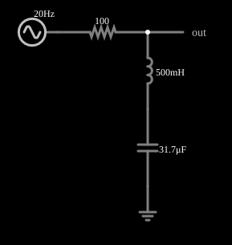

# Filtro rejeita-faixa (notch)

<!-- navegacao:inicio -->
[Índice](README.md) · [Anterior: Band-pass w/ Noise](bandnoise.md) · [Próximo: Twin-T Filter](twint.md)
<!-- navegacao:fim -->

## Objetivo

Mostrar um filtro rejeita-faixa: um circuito LC em série para a terra desvia para a terra a frequência de ressonância $f_0$ e deixa passar as outras.

## O circuito

<!-- esquema:inicio -->

<!-- esquema:fim -->

Um resistor de $100\ \Omega$ em série com a entrada e, para a terra, um indutor de $500\ \text{mH}$ em série com um capacitor de $31{,}7\ \mu\text{F}$; a saída é a tensão no nó entre o resistor e o ramo LC. O sinal de teste é uma fonte de **varredura de frequência**: uma senoide de 5 V de pico cuja frequência varia, de forma logarítmica, de 20 Hz a 60 Hz em 0,5 s e depois volta. Como a frequência é uma função conhecida do tempo, $f(t)=f_{min}(f_{max}/f_{min})^{t/T}$, a tensão de saída ao longo do tempo mostra a resposta em frequência do filtro. Quatro osciloscópios mostram a entrada, a saída e as tensões no indutor e no capacitor.

<!-- componentes:inicio -->
| N.º | Tipo | Elemento | Valores |
|----:|------|----------|---------|
| 0 | `InductorElm` | inductor | Inductance (H) = 500m; Trapezoidal Approximation = sim; Initial Current (on Reset) (A) = 0; Saturation Current (A) (0=none) = 0 |
| 1 | `CapacitorElm` | capacitor | Capacitance (F) = 31.7μ; Trapezoidal Approximation = sim; Initial Voltage (on Reset) = 1m; Series Resistance = 0 |
| 2 | `ResistorElm` | resistor | Resistance (ohms) = 100 |
| 3 | `OutputElm` | output | Show Voltage = não |
| 4 | `GroundElm` | ground | Symbol = Earth |
| 5 | `SweepElm` | sweep (log) | Min Frequency (Hz) = 20; Max Frequency (Hz) = 60; Sweep Time (s) = 500m; Logarithmic = sim; Max Voltage = 5; Bidirectional = sim |
<!-- componentes:fim -->

## Teoria

A impedância do ramo LC série é $Z = j\left(\omega L - \dfrac{1}{\omega C}\right)$, nula em $\omega_0 = 1/\sqrt{LC}$. A função de transferência é

$$H(j\omega) = \frac{Z}{R + Z} = \frac{jQ\left(\dfrac{\omega}{\omega_0}-\dfrac{\omega_0}{\omega}\right)}{1 + jQ\left(\dfrac{\omega}{\omega_0}-\dfrac{\omega_0}{\omega}\right)},\qquad f_0=\frac{1}{2\pi\sqrt{LC}},\quad Q = \frac{1}{R}\sqrt{\frac{L}{C}}.$$

Em $f_0$, $H=0$ (rejeição total, num circuito ideal); longe de $f_0$, $|H|\to 1$. Na ressonância a tensão no indutor e a no capacitor são grandes e em oposição, e se cancelam.

## Resultados esperados

$f_0 = 39{,}98\ \text{Hz}$ e $Q = 1{,}26$. A varredura passa por $f_0$ em $t = 315{,}2\ \text{ms}$.

| $f$ | instante | $\|H\|$ | $V_{out,pico}$ |
|----:|---------:|--------:|---------------:|
| 20 Hz | 0 ms | 0,883 | 4,42 V |
| 30 Hz | 184,5 ms | 0,590 | 2,95 V |
| **39,98 Hz** | **315,2 ms** | **0,000** | **≈ 0** |
| 45 Hz | 369,1 ms | 0,286 | 1,43 V |
| 55 Hz | 460,4 ms | 0,632 | 3,16 V |

As verificações conferem a saída em 55 Hz e que, em torno de $f_0$, a saída fica abaixo de $0{,}4\ \text{V}$ (mais de 22 dB de atenuação, numa janela de 20 ms em que a frequência varia ±2%).

## O que observar

- A curva de saída cai a quase zero no instante em que a frequência chega a 40 Hz.
- Veja nos osciloscópios das tensões do indutor e do capacitor: valem muito mais que a entrada, em oposição de fase.

## Limites do modelo

Como a frequência varia continuamente, a amplitude vista num instante aproxima a resposta em regime permanente daquela frequência (as verificações usam janelas curtas em torno do instante e uma tolerância que cobre esse efeito). Componentes ideais. Num circuito real a resistência do indutor impede que a rejeição seja total.

## Referências

- J. W. Nilsson e S. A. Riedel, *Circuitos Elétricos*, Pearson.
- P. Horowitz e W. Hill, *The Art of Electronics*, Cambridge University Press.

O circuito deste exemplo faz parte da coleção do simulador original de Paul Falstad e Iain Sharp (CircuitJS1); a explicação é deste projeto.
