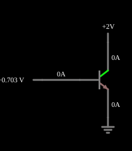

# Transistor NPN

<!-- navegacao:inicio -->
[Índice](README.md) · [Próximo: PNP Transistor](pnp.md)
<!-- navegacao:fim -->

## Objetivo

Mostrar o transistor bipolar NPN como um dispositivo de **corrente controlada por tensão**: a tensão base-emissor controla, de modo exponencial, a corrente do coletor.

## O circuito

<!-- esquema:inicio -->

<!-- esquema:fim -->

Duas fontes de tensão variáveis (com *sliders*) alimentam diretamente a base ($0{,}5$ a $0{,}75\ \text{V}$, "Base Voltage") e o coletor ($0$ a $2\ \text{V}$, "Collector Voltage") de um transistor NPN, com o emissor ligado à terra. As correntes são lidas nas próprias fontes. O exemplo abre com a base em $0{,}7025\ \text{V}$ e o coletor em $2\ \text{V}$.

<!-- componentes:inicio -->
| N.º | Tipo | Elemento | Valores |
|----:|------|----------|---------|
| 0 | `VarRailElm` | voltage source | Min Voltage = 500m; Max Voltage = 750m; Slider Text = Base Voltage |
| 3 | `VarRailElm` | voltage source | Min Voltage = 0; Max Voltage = 2; Slider Text = Collector Voltage |
| 4 | `GroundElm` | ground | Symbol = Earth |
| 5 | `NTransistorElm` | transistor | Beta/hFE = 100; Swap E/C = não; Draw Circle = não; Model = default |
<!-- componentes:fim -->

## Teoria

O transistor bipolar do simulador (modelo "default") segue o modelo de Ebers–Moll, com $V_{BE}$ e $V_{BC}$ as tensões base-emissor e base-coletor (para um NPN):

$$I_C = I_s\left(e^{V_{BE}/V_T} - e^{V_{BC}/V_T}\right) - \frac{I_s}{\beta_R}\left(e^{V_{BC}/V_T} - 1\right),\qquad I_B = \frac{I_s}{\beta}\left(e^{V_{BE}/V_T} - 1\right) + \frac{I_s}{\beta_R}\left(e^{V_{BC}/V_T} - 1\right),$$

com $I_s = 10^{-13}\ \text{A}$, $\beta = 100$, $\beta_R = 1$ e $V_T = 25{,}865\ \text{mV}$; sem efeito Early, sem capacitâncias e sem resistências série. Na **região ativa** ($V_{BE} \approx 0{,}65$ a $0{,}75\ \text{V}$, junção base-coletor com polarização inversa) isso se reduz a $I_C = \beta I_B = I_s\,e^{V_{BE}/V_T}$, com transcondutância $g_m = I_C/V_T$ e resistência de emissor $r_e = V_T/I_E$. O PNP é o complementar, com todas as tensões e correntes invertidas.

## Resultados esperados

Com $V_{BE} = 0{,}7025\ \text{V}$ e $V_{CE} = 2\ \text{V}$ (região ativa):

$$I_C = I_s\,e^{0{,}7025/0{,}025865} = 62{,}45\ \text{mA},\qquad I_B = \frac{I_C}{\beta} = 0{,}6245\ \text{mA}.$$

A tabela mostra a corrente de coletor para várias tensões de base (pela equação):

| $V_{BE}$ | $I_C$ |
|---------:|------:|
| $0{,}50\ \text{V}$ | $24{,}9\ \mu\text{A}$ |
| $0{,}60\ \text{V}$ | $1{,}19\ \text{mA}$ |
| $0{,}65\ \text{V}$ | $8{,}20\ \text{mA}$ |
| $0{,}70\ \text{V}$ | $56{,}7\ \text{mA}$ |
| $0{,}75\ \text{V}$ | $392\ \text{mA}$ |

Cada $60\ \text{mV}$ multiplicam a corrente por cerca de $10$ ($V_T\ln 10 = 59{,}6\ \text{mV}$). As verificações conferem a corrente de coletor (lida na fonte do coletor), a de base e a tensão de base (tolerâncias de 1% e 0,2%; a corrente do transistor é calculada por uma integração independente e concorda com o simulador a menos de $10^{-6}$).

## O que observar

- Arraste o *slider* da base: a corrente do coletor multiplica por 10 a cada $60\ \text{mV}$, e a de base acompanha, $1/100$ dela.
- Reduza a tensão do coletor para perto de $0{,}2\ \text{V}$: o transistor sai da região ativa (saturação) e a corrente cai.
- Compare a corrente de base, de décimos de mA, com a de coletor, de dezenas de mA: o transistor amplifica corrente de $\beta = 100$ vezes.

## Limites do modelo

Modelo sem efeito Early (a corrente do coletor não depende de $V_{CE}$ na região ativa; veja o exemplo "Efeito Early"), sem capacitâncias nem resistências, e ganho constante $\beta = 100$ (um transistor real tem $\beta$ que varia com a corrente e a temperatura). Sem resistor em série, um transistor real em $V_{BE} = 0{,}75\ \text{V}$ estaria dissipando bem mais que o permitido.

## Referências

- A. S. Sedra e K. C. Smith, *Microeletrônica*, Pearson.
- P. Horowitz e W. Hill, *The Art of Electronics*, Cambridge University Press.

O circuito deste exemplo faz parte da coleção do simulador original de Paul Falstad e Iain Sharp (CircuitJS1); a explicação é deste projeto.
