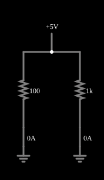

# Lei de Ohm

<!-- navegacao:inicio -->
[Índice](README.md) · [Próximo: Resistors](resistors.md)
<!-- navegacao:fim -->

## Objetivo

Mostrar que, num resistor, a corrente é proporcional à tensão aplicada e inversamente proporcional à resistência: $V = R\,I$. O exemplo põe a mesma tensão sobre dois resistores de valores diferentes para que a diferença de corrente fique visível.

## O circuito

<!-- esquema:inicio -->

<!-- esquema:fim -->

Uma fonte de tensão variável (de 0 a 5 V, com um *slider* chamado "Voltage") alimenta, em paralelo, um resistor de $100\ \Omega$ e outro de $1\ \text{k}\Omega$. O outro terminal de cada resistor está ligado à terra. Como os dois ramos estão ligados aos mesmos dois nós, os dois resistores têm exatamente a mesma tensão.

<!-- componentes:inicio -->
| N.º | Tipo | Elemento | Valores |
|----:|------|----------|---------|
| 0 | `ResistorElm` | resistor | Resistance (ohms) = 100 |
| 1 | `VarRailElm` | voltage source | Min Voltage = 0; Max Voltage = 5; Slider Text = Voltage |
| 2 | `GroundElm` | ground | Symbol = Earth |
| 4 | `ResistorElm` | resistor | Resistance (ohms) = 1k |
| 6 | `GroundElm` | ground | Symbol = Earth |
<!-- componentes:fim -->

## Teoria

A lei de Ohm relaciona a tensão $V$ entre os terminais de um resistor, a corrente $I$ que o atravessa e a resistência $R$:

$$V = R\,I \qquad\Longleftrightarrow\qquad I = \frac{V}{R} = G\,V,\qquad G=\frac{1}{R}.$$

O gráfico de $I$ contra $V$ é uma reta que passa pela origem, com inclinação igual à condutância $G$ (em siemens, S). A potência dissipada, que vira calor, é

$$P = V\,I = R\,I^2 = \frac{V^2}{R}.$$

Dois resistores ligados à mesma tensão (em paralelo) recebem a mesma $V$ e, portanto, correntes inversamente proporcionais às resistências: $I_1/I_2 = R_2/R_1$.

## Resultados esperados

Com o *slider* em 5 V:

| Resistor | $V$ | $I = V/R$ | $P = V I$ |
|---------:|----:|----------:|----------:|
| $100\ \Omega$ | $5\ \text{V}$ | $50\ \text{mA}$ | $250\ \text{mW}$ |
| $1\ \text{k}\Omega$ | $5\ \text{V}$ | $5\ \text{mA}$ | $25\ \text{mW}$ |

A fonte fornece $50 + 5 = 55\ \text{mA}$. As verificações deste documento conferem a tensão do primeiro resistor e as duas correntes (tolerância de 2%).

## O que observar

- Arraste o *slider* "Voltage": a corrente nos dois resistores muda na mesma proporção que a tensão, e a do resistor de $100\ \Omega$ é sempre 10 vezes a do de $1\ \text{k}\Omega$.
- Passe o ponteiro sobre um resistor para ver, no canto inferior direito, a corrente, a tensão e a potência dele.
- Os pontos amarelos andam mais depressa no ramo de maior corrente.

## Limites do modelo

Os resistores e a fonte são ideais: a resistência não varia com a temperatura nem com a tensão, e a fonte mantém a tensão ajustada qualquer que seja a corrente. Resistores reais têm tolerância (por exemplo, 5%), coeficiente de temperatura e limite de potência.

## Referências

- J. W. Nilsson e S. A. Riedel, *Circuitos Elétricos*, Pearson.
- C. K. Alexander e M. N. O. Sadiku, *Fundamentos de Circuitos Elétricos*, AMGH.

O circuito deste exemplo faz parte da coleção do simulador original de Paul Falstad e Iain Sharp (CircuitJS1); a explicação é deste projeto.
