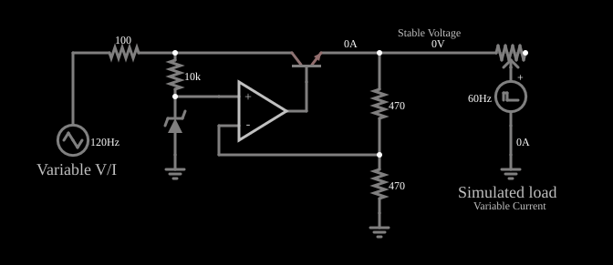

# Regulador de tensão com amplificador operacional

<!-- navegacao:inicio -->
[Índice](README.md) · [Anterior: Delta PWM Encoder](delta-pwm.md) · [Próximo: 741 Internals](opint.md)
<!-- navegacao:fim -->

## Objetivo

Mostrar um regulador de tensão linear série com amplificador operacional: uma tensão de referência (diodo Zener) e um divisor de realimentação fixam a saída, e um transistor passa a corrente da fonte não regulada. A entrada varia de $14$ a $18\ \text{V}$ e a carga varia, e a saída quase não muda.

## O circuito

<!-- esquema:inicio -->

<!-- esquema:fim -->

A entrada não regulada é uma onda triangular de $120\ \text{Hz}$ que vai de $14$ a $18\ \text{V}$ e chega por um resistor de $100\ \Omega$. Um resistor de $10\ \text{k}\Omega$ polariza um diodo Zener de $6{,}14\ \text{V}$ (nominal), que fornece a referência à entrada não inversora de um amplificador operacional. O operacional comanda a base de um transistor NPN que liga a fonte à saída; dois resistores de $470\ \Omega$ formam um divisor que leva metade da tensão de saída à entrada inversora. A carga é simulada por um potenciômetro de $1\ \text{k}\Omega$ ligado a uma fonte de pulsos de $60\ \text{Hz}$, de modo que a corrente de carga varia com o tempo. Três osciloscópios mostram a entrada, a saída e a carga.

<!-- componentes:inicio -->
| N.º | Tipo | Elemento | Valores |
|----:|------|----------|---------|
| 0 | `ResistorElm` | resistor | Resistance (ohms) = 10k |
| 1 | `GroundElm` | ground | Symbol = Earth |
| 2 | `OpAmpElm` | op-amp | Max Output (V) = 15; Min Output (V) = -15; Gain = 100k |
| 9 | `ResistorElm` | resistor | Resistance (ohms) = 470 |
| 10 | `ResistorElm` | resistor | Resistance (ohms) = 470 |
| 11 | `GroundElm` | ground | Symbol = Earth |
| 13 | `NTransistorElm` | transistor | Beta/hFE = 100; Swap E/C = sim; Draw Circle = não; Model = default |
| 14 | `VoltageElm` | pulse gen | Max Voltage = 6; Waveform = Pulse; DC Offset (V) = 2.5; Internal Resistance (ohms) = 0; Show Voltage = não; Specify As = Frequency/Duty Cycle; Frequency (Hz) = 60; Phase Offset (degrees) = 0; Duty Cycle = 15.9; Rise/Fall Time (s) = 0 |
| 16 | `GroundElm` | ground | Symbol = Earth |
| 17 | `ZenerElm` | Zener diode | Model = fwdrop=0.805904783 zvoltage=6.14 |
| 18 | `TextElm` | text | Text = Simulated load; Size = 18; Draw Bar On Top = não; Color = #c0c0c0 |
| 19 | `TextElm` | text | Text = Variable Current; Size = 12; Draw Bar On Top = não; Color = #c0c0c0 |
| 20 | `TextElm` | text | Text = Stable Voltage; Size = 12; Draw Bar On Top = não; Color = #c0c0c0 |
| 21 | `RailElm` | triangle gen | Max Voltage = 2; Waveform = Triangle; DC Offset (V) = 16; Internal Resistance (ohms) = 0; Show Voltage = não; Frequency (Hz) = 120; Phase Offset (degrees) = 0 |
| 22 | `TextElm` | text | Text = Variable V/I; Size = 18; Draw Bar On Top = não; Color = #c0c0c0 |
| 23 | `PotElm` | potentiometer | Resistance (ohms) = 1k; Slider Text = Load Current; Show Values = não; Group Number (for linking) = 0 |
| 24 | `ResistorElm` | resistor | Resistance (ohms) = 100 |
<!-- componentes:fim -->

## Teoria

A realimentação negativa leva as duas entradas do operacional ao mesmo potencial: a tensão do divisor, $V_\text{out}/2$, iguala a referência $V_Z$:

$$\frac{V_\text{out}}{2} = V_Z \quad\Longrightarrow\quad V_\text{out} = V_Z\left(1 + \frac{R_9}{R_{10}}\right) = 2\,V_Z.$$

Se a saída cai (por exemplo, porque a carga pediu mais corrente), a entrada inversora fica abaixo da referência, a saída do operacional sobe, o transistor conduz mais e a tensão de saída volta ao valor certo. Se a entrada não regulada sobe, o transistor conduz menos pela mesma razão. O diodo Zener é alimentado por uma corrente quase constante, de modo que $V_Z$ varia pouco.

O transistor trabalha como um resistor variável em série com a carga; o regulador só funciona enquanto $V_\text{in}$ ficar acima de $V_\text{out}$ mais a queda no transistor e no resistor de entrada (tensão de *dropout*).

## Resultados esperados

A tensão do Zener no ponto de operação é $V_Z \approx 6{,}0856\ \text{V}$ (o modelo dá um valor um pouco abaixo do nominal de $6{,}14\ \text{V}$ com a corrente de $0{,}6\ \text{mA}$), e a saída é $2V_Z = 12{,}171\ \text{V}$. Em uma janela de $50\ \text{ms}$ (seis ciclos da entrada):

| Grandeza | Mínimo | Máximo |
|----------|-------:|-------:|
| Entrada não regulada | $14\ \text{V}$ | $18\ \text{V}$ |
| Saída regulada | $12{,}171\ \text{V}$ | $12{,}189\ \text{V}$ |
| Corrente da carga (fonte de pulsos) | $7{,}3\ \text{mA}$ | $19{,}4\ \text{mA}$ |

Uma variação de $4\ \text{V}$ na entrada e de $12\ \text{mA}$ na carga resulta em apenas $18\ \text{mV}$ de variação na saída. As verificações conferem a queda de $6{,}0855\ \text{V}$ em cada resistor do divisor, os extremos da saída e os da entrada.

## O que observar

- No osciloscópio, a entrada é uma triangular grande e a saída é uma reta quase plana, com uma pequena ondulação.
- Mova o *slider* "Load Current" para mudar a carga e veja a saída praticamente inalterada.
- Perto do mínimo da triangular ($14\ \text{V}$), a queda do resistor de $100\ \Omega$ deixa o transistor quase saturado (tensão coletor-emissor de poucas dezenas de milivolts): o regulador está no limite do *dropout*.

## Limites do modelo

O Zener tem um modelo simples (tensão de joelho e resistência fixas) e o seu coeficiente de temperatura não é simulado, o que num regulador real é a principal fonte de deriva. O transistor não tem limite de dissipação nem proteção contra curto-circuito. A ondulação residual vem do ganho finito do operacional e da variação da corrente do Zener.

## Referências

- A. S. Sedra e K. C. Smith, *Microeletrônica*, Pearson.
- P. Horowitz e W. Hill, *The Art of Electronics*, Cambridge University Press.
- R. L. Boylestad e L. Nashelsky, *Dispositivos Eletrônicos e Teoria de Circuitos*, Pearson.

O circuito deste exemplo faz parte da coleção do simulador original de Paul Falstad e Iain Sharp (CircuitJS1); a explicação é deste projeto.
