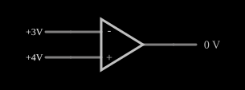

# Amplificador operacional (ganho de malha aberta)

<!-- navegacao:inicio -->
[Índice](README.md) · [Próximo: Op-Amp Feedback](opampfeedback.md)
<!-- navegacao:fim -->

## Objetivo

Mostrar o comportamento de um amplificador operacional **sem realimentação**: ele amplifica a diferença entre as duas entradas com um ganho enorme e, por isso, a saída quase sempre fica *saturada* em um dos dois limites da alimentação. É a base para entender o comparador e, mais adiante, todos os circuitos com realimentação.

## O circuito

<!-- esquema:inicio -->

<!-- esquema:fim -->

Um amplificador operacional de ganho $A = 100\,000$ e saída limitada a $\pm 15\ \text{V}$ tem a entrada inversora ($-$) ligada a uma fonte ajustável chamada "- Voltage" (3 V ao abrir o exemplo) e a entrada não inversora ($+$) ligada a outra fonte ajustável, "+ Voltage" (4 V ao abrir). Não há nenhum resistor nem ligação da saída de volta às entradas: o circuito está em *malha aberta*. Um elemento de saída (*output*) mostra a tensão na saída.

<!-- componentes:inicio -->
| N.º | Tipo | Elemento | Valores |
|----:|------|----------|---------|
| 0 | `OpAmpElm` | op-amp | Max Output (V) = 15; Min Output (V) = -15; Gain = 100k |
| 1 | `VarRailElm` | voltage source | Min Voltage = 0; Max Voltage = 5; Slider Text = - Voltage |
| 2 | `VarRailElm` | voltage source | Min Voltage = 0; Max Voltage = 5; Slider Text = + Voltage |
| 3 | `OutputElm` | output | Show Voltage = sim; Scale = Auto |
<!-- componentes:fim -->

## Teoria

O amplificador operacional é um amplificador diferencial de ganho muito alto. Na região linear,

$$V_\text{out} = A\,(V_+ - V_-),$$

mas a saída não pode ultrapassar os limites $V_\text{min}$ e $V_\text{max}$ (aqui $-15\ \text{V}$ e $+15\ \text{V}$, os parâmetros *Min Output* e *Max Output*). A saída só está na região linear quando

$$|V_+ - V_-| < \frac{V_\text{max}}{A} = \frac{15\ \text{V}}{10^5} = 150\ \mu\text{V}.$$

Fora dessa faixa estreita o amplificador *satura*: a saída vai para $V_\text{max}$ se $V_+ > V_-$ e para $V_\text{min}$ se $V_+ < V_-$. Em malha aberta o operacional funciona, portanto, como um **comparador** de tensão.

## Resultados esperados

Com as fontes nos valores iniciais, $V_+ - V_- = 4 - 3 = 1\ \text{V}$, que é cerca de $6\,700$ vezes maior que a faixa linear de $150\ \mu\text{V}$. O ganho teórico daria $A \cdot 1\ \text{V} = 100\ \text{kV}$, impossível, e a saída satura em $V_\text{max}$:

| Situação | Saída |
|----------|-------|
| $V_+ > V_-$ (valores iniciais) | cerca de $+15\ \text{V}$ (o simulador mostra $15{,}0001\ \text{V}$) |
| $V_+ < V_-$ | cerca de $-15\ \text{V}$ (limite *Min Output*) |
| $|V_+ - V_-| < 150\ \mu\text{V}$ | região linear, $A\,(V_+ - V_-)$ |

A verificação deste documento confere a saída no estado inicial (tolerância de 1%).

## O que observar

- Arraste "- Voltage" acima do valor de "+ Voltage": a saída pula de $+15\ \text{V}$ para $-15\ \text{V}$.
- Aproxime as duas fontes até quase se igualarem: a transição acontece num intervalo minúsculo, o que mostra o ganho enorme.
- Perceba que não existe valor intermediário estável: sem realimentação o amplificador operacional não serve como amplificador de tensão, e sim como comparador.

## Limites do modelo

O modelo é um amplificador ideal de ganho finito ($100\,000$) com limites de saída fixos. Não há tensão de *offset*, corrente de polarização das entradas, resistência de entrada ou de saída, largura de banda finita nem *slew rate*, e a saturação não depende da alimentação como em um amplificador real (cuja saída fica de 1 a 2 V abaixo dos trilhos).

## Referências

- A. S. Sedra e K. C. Smith, *Microeletrônica*, Pearson.
- P. Horowitz e W. Hill, *The Art of Electronics*, Cambridge University Press.
- R. L. Boylestad e L. Nashelsky, *Dispositivos Eletrônicos e Teoria de Circuitos*, Pearson.

O circuito deste exemplo faz parte da coleção do simulador original de Paul Falstad e Iain Sharp (CircuitJS1); a explicação é deste projeto.
