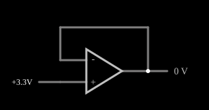

# Amplificador operacional com realimentação (seguidor)

<!-- navegacao:inicio -->
[Índice](README.md) · [Anterior: Op-Amp](opamp.md) · [Próximo: Half-Wave Rectifier (inverting)](amp-rect.md)
<!-- navegacao:fim -->

## Objetivo

Mostrar como a realimentação negativa transforma o amplificador operacional, de um comparador saturado, em um circuito estável e previsível: ao ligar a saída à entrada inversora, a saída passa a *seguir* a tensão da entrada não inversora.

## O circuito

<!-- esquema:inicio -->

<!-- esquema:fim -->

O mesmo amplificador operacional do exemplo anterior ($A = 100\,000$, saída entre $-15\ \text{V}$ e $+15\ \text{V}$) tem a entrada não inversora ligada a uma fonte ajustável "+ Voltage" (3,3 V ao abrir). Um fio liga a saída diretamente à entrada inversora: é a realimentação negativa. Um elemento de saída mostra a tensão de saída.

<!-- componentes:inicio -->
| N.º | Tipo | Elemento | Valores |
|----:|------|----------|---------|
| 0 | `OpAmpElm` | op-amp | Max Output (V) = 15; Min Output (V) = -15; Gain = 100k |
| 1 | `VarRailElm` | voltage source | Min Voltage = 0; Max Voltage = 5; Slider Text = + Voltage |
| 2 | `OutputElm` | output | Show Voltage = sim; Scale = Auto |
<!-- componentes:fim -->

## Teoria

Com a saída ligada à entrada inversora, $V_- = V_\text{out}$ e a equação do amplificador fica

$$V_\text{out} = A\,(V_+ - V_\text{out}) \quad\Longrightarrow\quad V_\text{out} = \frac{A}{1+A}\,V_+ .$$

Se $A$ é muito grande, $V_\text{out} \approx V_+$: o circuito é um **seguidor de tensão**. O erro relativo é $1/(1+A)$, da ordem de $10^{-5}$ aqui. A ideia por trás é o *curto-circuito virtual*: com realimentação negativa e ganho alto, a diferença entre as entradas é forçada a quase zero, $V_+ - V_- = V_\text{out}/A \approx 0$.

## Resultados esperados

Com $V_+ = 3{,}3\ \text{V}$:

$$V_\text{out} = \frac{10^5}{10^5 + 1}\,3{,}3\ \text{V} \approx 3{,}299967\ \text{V},$$

ou seja, $33\ \mu\text{V}$ abaixo da entrada, que é o que o simulador mostra ($3{,}299967\ \text{V}$). A verificação confere a saída contra $3{,}3\ \text{V}$ com tolerância absoluta de $0{,}1\ \text{mV}$.

## O que observar

- Arraste o *slider* "+ Voltage" de 0 a 5 V: a saída acompanha a entrada ponto a ponto, sem saturar.
- Compare com o exemplo "Op-Amp" (sem realimentação), onde a mesma diferença de entrada saturava a saída.
- A corrente que a saída fornece é a que a carga exigir; aqui não há carga, e o elemento de saída não drena corrente.

## Limites do modelo

O seguidor ideal tem impedância de entrada infinita e impedância de saída zero; o modelo também. Em um amplificador real o ganho cai com a frequência, a saída tem corrente máxima e a estabilidade com carga capacitiva pode exigir compensação.

## Referências

- A. S. Sedra e K. C. Smith, *Microeletrônica*, Pearson.
- P. Horowitz e W. Hill, *The Art of Electronics*, Cambridge University Press.
- R. L. Boylestad e L. Nashelsky, *Dispositivos Eletrônicos e Teoria de Circuitos*, Pearson.

O circuito deste exemplo faz parte da coleção do simulador original de Paul Falstad e Iain Sharp (CircuitJS1); a explicação é deste projeto.
