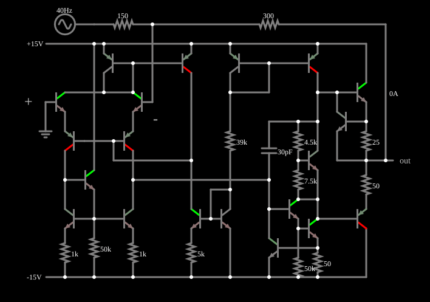

# Limite de corrente de saída do 741

<!-- navegacao:inicio -->
[Índice](README.md) · [Anterior: 741 Slew Rate](opint-slew.md)
<!-- navegacao:fim -->

## Objetivo

Mostrar o limite de corrente de saída do 741: o par de saída tem resistores que, com os transistores de proteção, impedem que a corrente passe de cerca de $25\ \text{mA}$. Com uma carga pesada, o semiciclo positivo da saída é cortado pelo limite de corrente, e não pela tensão.

## O circuito

<!-- esquema:inicio -->

<!-- esquema:fim -->

O circuito é o amplificador operacional clássico de $20$ transistores ($13$ NPN e $7$ PNP), $11$ resistores e um capacitor de compensação de $30\ \text{pF}$, alimentado por duas fontes de $\pm 15\ \text{V}$. Os valores dos resistores ($1\ \text{k}\Omega$, $5\ \text{k}\Omega$, $39\ \text{k}\Omega$, $50\ \text{k}\Omega$, $4{,}5\ \text{k}\Omega$, $7{,}5\ \text{k}\Omega$, $25\ \Omega$ e $50\ \Omega$) correspondem ao esquema conhecido do 741: um estágio de entrada diferencial com carga em espelho de corrente, um estágio de ganho com o capacitor de $30\ \text{pF}$ como compensação (efeito Miller) e uma saída em classe AB polarizada por um multiplicador de $V_{BE}$ (os resistores de $4{,}5$ e de $7{,}5\ \text{k}\Omega$), com resistores de $25$ e de $50\ \Omega$ que limitam a corrente de saída. O 741 está em configuração inversora com ganho $-2$, mas com resistores pequenos: $R_1 = 150\ \Omega$ e $R_f = 300\ \Omega$. A saída precisa, portanto, fornecer uma corrente elevada ($\approx 10\ \text{V}/450\ \Omega = 22\ \text{mA}$ ou mais). A entrada é uma senoide de $40\ \text{Hz}$ e $5\ \text{V}$ de pico. Um osciloscópio mostra a saída.

<!-- componentes:inicio -->
| N.º | Tipo | Elemento | Valores |
|----:|------|----------|---------|
| 0 | `NTransistorElm` | transistor | Beta/hFE = 100; Swap E/C = não; Draw Circle = não; Model = default |
| 1 | `PTransistorElm` | transistor | Beta/hFE = 100; Swap E/C = não; Draw Circle = não; Model = default |
| 2 | `NTransistorElm` | transistor | Beta/hFE = 100; Swap E/C = não; Draw Circle = não; Model = default |
| 3 | `NTransistorElm` | transistor | Beta/hFE = 100; Swap E/C = não; Draw Circle = não; Model = default |
| 4 | `ResistorElm` | resistor | Resistance (ohms) = 1k |
| 5 | `ResistorElm` | resistor | Resistance (ohms) = 50k |
| 10 | `NTransistorElm` | transistor | Beta/hFE = 100; Swap E/C = não; Draw Circle = não; Model = default |
| 11 | `PTransistorElm` | transistor | Beta/hFE = 100; Swap E/C = não; Draw Circle = não; Model = default |
| 16 | `NTransistorElm` | transistor | Beta/hFE = 100; Swap E/C = não; Draw Circle = não; Model = default |
| 18 | `ResistorElm` | resistor | Resistance (ohms) = 1k |
| 21 | `RailElm` | voltage source | Voltage = -15; Waveform = D/C; DC Offset (V) = 0; Internal Resistance (ohms) = 0 |
| 22 | `PTransistorElm` | transistor | Beta/hFE = 100; Swap E/C = não; Draw Circle = não; Model = default |
| 23 | `PTransistorElm` | transistor | Beta/hFE = 100; Swap E/C = não; Draw Circle = não; Model = default |
| 35 | `RailElm` | voltage source | Voltage = 15; Waveform = D/C; DC Offset (V) = 0; Internal Resistance (ohms) = 0 |
| 36 | `NTransistorElm` | transistor | Beta/hFE = 100; Swap E/C = não; Draw Circle = não; Model = default |
| 37 | `NTransistorElm` | transistor | Beta/hFE = 100; Swap E/C = não; Draw Circle = não; Model = default |
| 39 | `ResistorElm` | resistor | Resistance (ohms) = 5k |
| 46 | `ResistorElm` | resistor | Resistance (ohms) = 39k |
| 47 | `PTransistorElm` | transistor | Beta/hFE = 100; Swap E/C = não; Draw Circle = não; Model = default |
| 48 | `PTransistorElm` | transistor | Beta/hFE = 100; Swap E/C = não; Draw Circle = não; Model = default |
| 58 | `NTransistorElm` | transistor | Beta/hFE = 100; Swap E/C = não; Draw Circle = não; Model = default |
| 59 | `NTransistorElm` | transistor | Beta/hFE = 100; Swap E/C = não; Draw Circle = não; Model = default |
| 65 | `ResistorElm` | resistor | Resistance (ohms) = 25 |
| 67 | `ResistorElm` | resistor | Resistance (ohms) = 50 |
| 70 | `NTransistorElm` | transistor | Beta/hFE = 100; Swap E/C = não; Draw Circle = não; Model = default |
| 71 | `ResistorElm` | resistor | Resistance (ohms) = 4.5k |
| 72 | `ResistorElm` | resistor | Resistance (ohms) = 7.5k |
| 77 | `PTransistorElm` | transistor | Beta/hFE = 100; Swap E/C = não; Draw Circle = não; Model = default |
| 79 | `NTransistorElm` | transistor | Beta/hFE = 100; Swap E/C = não; Draw Circle = não; Model = default |
| 80 | `NTransistorElm` | transistor | Beta/hFE = 100; Swap E/C = não; Draw Circle = não; Model = default |
| 81 | `ResistorElm` | resistor | Resistance (ohms) = 50 |
| 83 | `ResistorElm` | resistor | Resistance (ohms) = 50k |
| 90 | `NTransistorElm` | transistor | Beta/hFE = 100; Swap E/C = não; Draw Circle = não; Model = default |
| 96 | `CapacitorElm` | capacitor | Capacitance (F) = 30p; Trapezoidal Approximation = sim; Initial Voltage (on Reset) = 1m; Series Resistance = 0 |
| 97 | `OutputElm` | output | Show Voltage = não |
| 98 | `GroundElm` | ground | Symbol = Earth |
| 100 | `ResistorElm` | resistor | Resistance (ohms) = 300 |
| 103 | `ResistorElm` | resistor | Resistance (ohms) = 150 |
| 104 | `RailElm` | A/C source | Max Voltage = 5; Waveform = A/C; DC Offset (V) = 0; Internal Resistance (ohms) = 0; Show Voltage = não; Frequency (Hz) = 40; Phase Offset (degrees) = 0 |
| 105 | `TextElm` | text | Text = +; Size = 24; Draw Bar On Top = não; Color = #c0c0c0 |
| 106 | `TextElm` | text | Text = -; Size = 24; Draw Bar On Top = não; Color = #c0c0c0 |
<!-- componentes:fim -->

## Teoria

A corrente que a saída fornece passa por $R_f$ e $R_1$ até a fonte de entrada:

$$I_\text{out} = \frac{V_\text{out} - V_\text{in}}{R_f + R_1} = \frac{V_\text{out} - V_\text{in}}{450\ \Omega}.$$

Com $V_\text{in} = -5\ \text{V}$ a saída ideal seria $+10\ \text{V}$ e a corrente, $15/450 = 33\ \text{mA}$. No 741, o resistor de $25\ \Omega$ em série com o transistor de saída (NPN) é também um sensor de corrente: quando a queda sobre ele chega a cerca de $V_{BE} \approx 0{,}6\ \text{V}$, um transistor de proteção entra em condução e rouba a corrente de base do transistor de saída. O limite é

$$I_\text{lim} \approx \frac{V_{BE}}{25\ \Omega} \approx 24\ \text{mA}.$$

Atingido o limite, a saída deixa de ser regida pela realimentação e a tensão cai a $V_\text{out} = V_\text{in} + I_\text{lim}\,(R_f + R_1)$.

## Resultados esperados

Em $t = 18{,}75\ \text{ms}$, no pico negativo da entrada ($-5\ \text{V}$), a saída ideal seria $+10\ \text{V}$, mas o simulador dá $+5{,}619\ \text{V}$, com corrente de $23{,}6\ \text{mA}$ (o limite). Em $t = 5\ \text{ms}$ (entrada $+4{,}75\ \text{V}$), a saída é $-9{,}490\ \text{V}$ (ideal: $-9{,}50\ \text{V}$), com $31{,}6\ \text{mA}$ no sentido contrário: o limite no semiciclo negativo é maior ou não foi atingido. Em um ciclo, os extremos da saída são $+7{,}089\ \text{V}$ e $-9{,}985\ \text{V}$. As verificações conferem a saída nos dois instantes e os extremos.

## O que observar

- A saída é uma senoide com o semiciclo positivo **achatado** e deformado, e o negativo quase intacto.
- Aumente $R_f$ e $R_1$ (menos corrente) e o achatamento desaparece.
- Passe o ponteiro sobre o resistor de realimentação no pico: ele mostra a corrente de $23{,}6\ \text{mA}$, o limite do estágio de saída.

## Limites do modelo

O limite de corrente do modelo vem do conjunto de resistores e transistores do circuito, com os parâmetros de transistor padrão do simulador; o valor de $\approx 24\ \text{mA}$ coincide com o previsto por $V_{BE}/25\ \Omega$ e com a ordem de grandeza do 741 real ($25\ \text{mA}$). Não há limitação térmica, que em um 741 real reduziria a corrente quando o componente aquece.

## Referências

- A. S. Sedra e K. C. Smith, *Microeletrônica*, Pearson.
- P. R. Gray, P. J. Hurst, S. H. Lewis e R. G. Meyer, *Analysis and Design of Analog Integrated Circuits*, Wiley.
- P. Horowitz e W. Hill, *The Art of Electronics*, Cambridge University Press.

O circuito deste exemplo faz parte da coleção do simulador original de Paul Falstad e Iain Sharp (CircuitJS1); a explicação é deste projeto.
