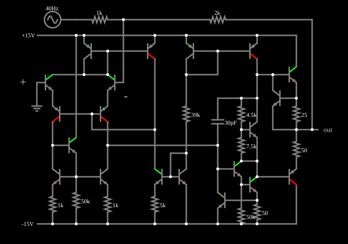

# 741 como amplificador inversor

<!-- navegacao:inicio -->
[Índice](README.md) · [Anterior: 741 Internals](opint.md) · [Próximo: 741 Slew Rate](opint-slew.md)
<!-- navegacao:fim -->

## Objetivo

Mostrar que, com realimentação negativa, o 741 construído com transistores se comporta como o operacional ideal dos exemplos anteriores: um amplificador inversor cujo ganho depende só da razão de dois resistores, e não dos parâmetros do circuito interno.

## O circuito

<!-- esquema:inicio -->

<!-- esquema:fim -->

O circuito é o amplificador operacional clássico de $20$ transistores ($13$ NPN e $7$ PNP), $11$ resistores e um capacitor de compensação de $30\ \text{pF}$, alimentado por duas fontes de $\pm 15\ \text{V}$. Os valores dos resistores ($1\ \text{k}\Omega$, $5\ \text{k}\Omega$, $39\ \text{k}\Omega$, $50\ \text{k}\Omega$, $4{,}5\ \text{k}\Omega$, $7{,}5\ \text{k}\Omega$, $25\ \Omega$ e $50\ \Omega$) correspondem ao esquema conhecido do 741: um estágio de entrada diferencial com carga em espelho de corrente, um estágio de ganho com o capacitor de $30\ \text{pF}$ como compensação (efeito Miller) e uma saída em classe AB polarizada por um multiplicador de $V_{BE}$ (os resistores de $4{,}5$ e de $7{,}5\ \text{k}\Omega$), com resistores de $25$ e de $50\ \Omega$ que limitam a corrente de saída. A entrada é uma senoide de $40\ \text{Hz}$ e $5\ \text{V}$ de pico ligada por um resistor de $1\ \text{k}\Omega$ à entrada inversora; um resistor de $2\ \text{k}\Omega$ liga a saída a essa entrada, e a entrada não inversora está no terra. Um osciloscópio mostra a saída.

<!-- componentes:inicio -->
| N.º | Tipo | Elemento | Valores |
|----:|------|----------|---------|
| 0 | `NTransistorElm` | transistor | Beta/hFE = 100; Swap E/C = não; Draw Circle = não; Model = default |
| 1 | `PTransistorElm` | transistor | Beta/hFE = 100; Swap E/C = não; Draw Circle = não; Model = default |
| 2 | `NTransistorElm` | transistor | Beta/hFE = 100; Swap E/C = não; Draw Circle = não; Model = default |
| 3 | `NTransistorElm` | transistor | Beta/hFE = 100; Swap E/C = não; Draw Circle = não; Model = default |
| 4 | `ResistorElm` | resistor | Resistance (ohms) = 1k |
| 5 | `ResistorElm` | resistor | Resistance (ohms) = 50k |
| 10 | `NTransistorElm` | transistor | Beta/hFE = 100; Swap E/C = não; Draw Circle = não; Model = default |
| 11 | `PTransistorElm` | transistor | Beta/hFE = 100; Swap E/C = não; Draw Circle = não; Model = default |
| 16 | `NTransistorElm` | transistor | Beta/hFE = 100; Swap E/C = não; Draw Circle = não; Model = default |
| 18 | `ResistorElm` | resistor | Resistance (ohms) = 1k |
| 21 | `RailElm` | voltage source | Voltage = -15; Waveform = D/C; DC Offset (V) = 0; Internal Resistance (ohms) = 0 |
| 22 | `PTransistorElm` | transistor | Beta/hFE = 100; Swap E/C = não; Draw Circle = não; Model = default |
| 23 | `PTransistorElm` | transistor | Beta/hFE = 100; Swap E/C = não; Draw Circle = não; Model = default |
| 35 | `RailElm` | voltage source | Voltage = 15; Waveform = D/C; DC Offset (V) = 0; Internal Resistance (ohms) = 0 |
| 36 | `NTransistorElm` | transistor | Beta/hFE = 100; Swap E/C = não; Draw Circle = não; Model = default |
| 37 | `NTransistorElm` | transistor | Beta/hFE = 100; Swap E/C = não; Draw Circle = não; Model = default |
| 39 | `ResistorElm` | resistor | Resistance (ohms) = 5k |
| 46 | `ResistorElm` | resistor | Resistance (ohms) = 39k |
| 47 | `PTransistorElm` | transistor | Beta/hFE = 100; Swap E/C = não; Draw Circle = não; Model = default |
| 48 | `PTransistorElm` | transistor | Beta/hFE = 100; Swap E/C = não; Draw Circle = não; Model = default |
| 58 | `NTransistorElm` | transistor | Beta/hFE = 100; Swap E/C = não; Draw Circle = não; Model = default |
| 59 | `NTransistorElm` | transistor | Beta/hFE = 100; Swap E/C = não; Draw Circle = não; Model = default |
| 65 | `ResistorElm` | resistor | Resistance (ohms) = 25 |
| 67 | `ResistorElm` | resistor | Resistance (ohms) = 50 |
| 70 | `NTransistorElm` | transistor | Beta/hFE = 100; Swap E/C = não; Draw Circle = não; Model = default |
| 71 | `ResistorElm` | resistor | Resistance (ohms) = 4.5k |
| 72 | `ResistorElm` | resistor | Resistance (ohms) = 7.5k |
| 77 | `PTransistorElm` | transistor | Beta/hFE = 100; Swap E/C = não; Draw Circle = não; Model = default |
| 79 | `NTransistorElm` | transistor | Beta/hFE = 100; Swap E/C = não; Draw Circle = não; Model = default |
| 80 | `NTransistorElm` | transistor | Beta/hFE = 100; Swap E/C = não; Draw Circle = não; Model = default |
| 81 | `ResistorElm` | resistor | Resistance (ohms) = 50 |
| 83 | `ResistorElm` | resistor | Resistance (ohms) = 50k |
| 90 | `NTransistorElm` | transistor | Beta/hFE = 100; Swap E/C = não; Draw Circle = não; Model = default |
| 96 | `CapacitorElm` | capacitor | Capacitance (F) = 30p; Trapezoidal Approximation = sim; Initial Voltage (on Reset) = 1m; Series Resistance = 0 |
| 97 | `OutputElm` | output | Show Voltage = não |
| 98 | `GroundElm` | ground | Symbol = Earth |
| 100 | `ResistorElm` | resistor | Resistance (ohms) = 2k |
| 103 | `ResistorElm` | resistor | Resistance (ohms) = 1k |
| 104 | `RailElm` | A/C source | Max Voltage = 5; Waveform = A/C; DC Offset (V) = 0; Internal Resistance (ohms) = 0; Show Voltage = não; Frequency (Hz) = 40; Phase Offset (degrees) = 0 |
| 105 | `TextElm` | text | Text = +; Size = 24; Draw Bar On Top = não; Color = #c0c0c0 |
| 106 | `TextElm` | text | Text = -; Size = 24; Draw Bar On Top = não; Color = #c0c0c0 |
<!-- componentes:fim -->

## Teoria

Como no amplificador inversor ideal, o terra virtual na entrada inversora dá

$$V_\text{out} = -\frac{R_f}{R_1}\,V_\text{in} = -\frac{2\ \text{k}\Omega}{1\ \text{k}\Omega}\,V_\text{in} = -2\,V_\text{in}.$$

Com o ganho de malha aberta de cerca de $10^5$, o erro de ganho é da ordem de $(1 + R_f/R_1)/A \approx 3\times 10^{-5}$, desprezível. A fabricação dos transistores, o espelho de corrente, o capacitor de compensação: tudo isso fica escondido pela realimentação.

## Resultados esperados

Em $t = 10\ \text{ms}$ a entrada é $2{,}949\ \text{V}$ e a saída é $-5{,}897\ \text{V}$, uma razão de $-1{,}9997$ (o erro de $0{,}015\%$ vem do ganho finito). Em um ciclo, a saída varia de $-9{,}998$ a $+10{,}002\ \text{V}$, bem dentro da faixa do operacional ($\pm 14\ \text{V}$). As verificações conferem a saída em $t = 10\ \text{ms}$ e os extremos em um ciclo.

## O que observar

- A saída é uma senoide de amplitude dupla e em oposição de fase à entrada.
- Aumente a amplitude da entrada para mais de $7\ \text{V}$ e a saída achata ao se aproximar da saturação ($\pm 14\ \text{V}$).
- Compare com o exemplo "Inverting Amplifier" feito com o operacional ideal: o resultado é praticamente o mesmo.

## Limites do modelo

O operacional é o modelo de $20$ transistores, sem tolerâncias de componentes nem efeitos térmicos; ele reproduz o ganho, a saturação e a limitação de corrente, mas não o ruído, a tensão de *offset* ou a deriva de um 741 real.

## Referências

- A. S. Sedra e K. C. Smith, *Microeletrônica*, Pearson.
- P. R. Gray, P. J. Hurst, S. H. Lewis e R. G. Meyer, *Analysis and Design of Analog Integrated Circuits*, Wiley.
- P. Horowitz e W. Hill, *The Art of Electronics*, Cambridge University Press.

O circuito deste exemplo faz parte da coleção do simulador original de Paul Falstad e Iain Sharp (CircuitJS1); a explicação é deste projeto.
