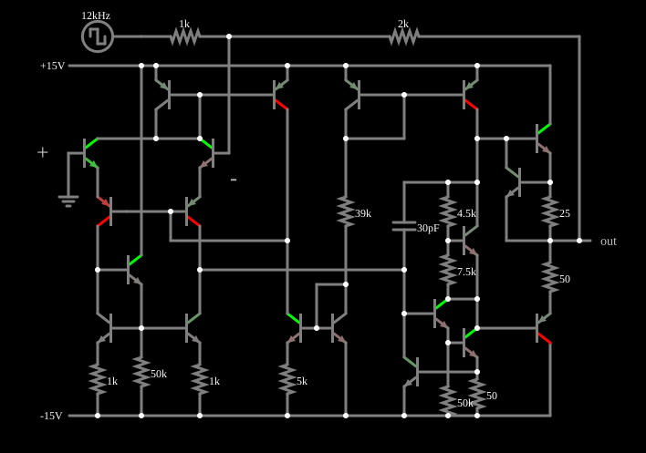

# Taxa de subida (slew rate) do 741

<!-- navegacao:inicio -->
[Índice](README.md) · [Anterior: 741 (inverting amplifier)](opint-invert-amp.md) · [Próximo: 741 Current Limits](opint-current.md)
<!-- navegacao:fim -->

## Objetivo

Mostrar a taxa de subida (*slew rate*) de um amplificador operacional real: a saída não consegue acompanhar uma variação instantânea da entrada, e muda a uma velocidade máxima, limitada pela corrente disponível para carregar o capacitor de compensação.

## O circuito

<!-- esquema:inicio -->

<!-- esquema:fim -->

O circuito é o amplificador operacional clássico de $20$ transistores ($13$ NPN e $7$ PNP), $11$ resistores e um capacitor de compensação de $30\ \text{pF}$, alimentado por duas fontes de $\pm 15\ \text{V}$. Os valores dos resistores ($1\ \text{k}\Omega$, $5\ \text{k}\Omega$, $39\ \text{k}\Omega$, $50\ \text{k}\Omega$, $4{,}5\ \text{k}\Omega$, $7{,}5\ \text{k}\Omega$, $25\ \Omega$ e $50\ \Omega$) correspondem ao esquema conhecido do 741: um estágio de entrada diferencial com carga em espelho de corrente, um estágio de ganho com o capacitor de $30\ \text{pF}$ como compensação (efeito Miller) e uma saída em classe AB polarizada por um multiplicador de $V_{BE}$ (os resistores de $4{,}5$ e de $7{,}5\ \text{k}\Omega$), com resistores de $25$ e de $50\ \Omega$ que limitam a corrente de saída. O 741 está em configuração inversora com ganho $-2$ ($R_1 = 1\ \text{k}\Omega$, $R_f = 2\ \text{k}\Omega$). A entrada é uma onda quadrada de $12\ \text{kHz}$ e $\pm 5\ \text{V}$, cujos degraus são instantâneos. Dois osciloscópios mostram a entrada e a saída.

<!-- componentes:inicio -->
| N.º | Tipo | Elemento | Valores |
|----:|------|----------|---------|
| 0 | `NTransistorElm` | transistor | Beta/hFE = 100; Swap E/C = não; Draw Circle = não; Model = default |
| 1 | `PTransistorElm` | transistor | Beta/hFE = 100; Swap E/C = não; Draw Circle = não; Model = default |
| 2 | `NTransistorElm` | transistor | Beta/hFE = 100; Swap E/C = não; Draw Circle = não; Model = default |
| 3 | `NTransistorElm` | transistor | Beta/hFE = 100; Swap E/C = não; Draw Circle = não; Model = default |
| 4 | `ResistorElm` | resistor | Resistance (ohms) = 1k |
| 5 | `ResistorElm` | resistor | Resistance (ohms) = 50k |
| 10 | `NTransistorElm` | transistor | Beta/hFE = 100; Swap E/C = não; Draw Circle = não; Model = default |
| 11 | `PTransistorElm` | transistor | Beta/hFE = 100; Swap E/C = não; Draw Circle = não; Model = default |
| 16 | `NTransistorElm` | transistor | Beta/hFE = 100; Swap E/C = não; Draw Circle = não; Model = default |
| 18 | `ResistorElm` | resistor | Resistance (ohms) = 1k |
| 21 | `RailElm` | voltage source | Voltage = -15; Waveform = D/C; DC Offset (V) = 0; Internal Resistance (ohms) = 0 |
| 22 | `PTransistorElm` | transistor | Beta/hFE = 100; Swap E/C = não; Draw Circle = não; Model = default |
| 23 | `PTransistorElm` | transistor | Beta/hFE = 100; Swap E/C = não; Draw Circle = não; Model = default |
| 35 | `RailElm` | voltage source | Voltage = 15; Waveform = D/C; DC Offset (V) = 0; Internal Resistance (ohms) = 0 |
| 36 | `NTransistorElm` | transistor | Beta/hFE = 100; Swap E/C = não; Draw Circle = não; Model = default |
| 37 | `NTransistorElm` | transistor | Beta/hFE = 100; Swap E/C = não; Draw Circle = não; Model = default |
| 39 | `ResistorElm` | resistor | Resistance (ohms) = 5k |
| 46 | `ResistorElm` | resistor | Resistance (ohms) = 39k |
| 47 | `PTransistorElm` | transistor | Beta/hFE = 100; Swap E/C = não; Draw Circle = não; Model = default |
| 48 | `PTransistorElm` | transistor | Beta/hFE = 100; Swap E/C = não; Draw Circle = não; Model = default |
| 58 | `NTransistorElm` | transistor | Beta/hFE = 100; Swap E/C = não; Draw Circle = não; Model = default |
| 59 | `NTransistorElm` | transistor | Beta/hFE = 100; Swap E/C = não; Draw Circle = não; Model = default |
| 65 | `ResistorElm` | resistor | Resistance (ohms) = 25 |
| 67 | `ResistorElm` | resistor | Resistance (ohms) = 50 |
| 70 | `NTransistorElm` | transistor | Beta/hFE = 100; Swap E/C = não; Draw Circle = não; Model = default |
| 71 | `ResistorElm` | resistor | Resistance (ohms) = 4.5k |
| 72 | `ResistorElm` | resistor | Resistance (ohms) = 7.5k |
| 77 | `PTransistorElm` | transistor | Beta/hFE = 100; Swap E/C = não; Draw Circle = não; Model = default |
| 79 | `NTransistorElm` | transistor | Beta/hFE = 100; Swap E/C = não; Draw Circle = não; Model = default |
| 80 | `NTransistorElm` | transistor | Beta/hFE = 100; Swap E/C = não; Draw Circle = não; Model = default |
| 81 | `ResistorElm` | resistor | Resistance (ohms) = 50 |
| 83 | `ResistorElm` | resistor | Resistance (ohms) = 50k |
| 90 | `NTransistorElm` | transistor | Beta/hFE = 100; Swap E/C = não; Draw Circle = não; Model = default |
| 96 | `CapacitorElm` | capacitor | Capacitance (F) = 30p; Trapezoidal Approximation = sim; Initial Voltage (on Reset) = 1m; Series Resistance = 0 |
| 97 | `OutputElm` | output | Show Voltage = não |
| 98 | `GroundElm` | ground | Symbol = Earth |
| 100 | `ResistorElm` | resistor | Resistance (ohms) = 2k |
| 103 | `ResistorElm` | resistor | Resistance (ohms) = 1k |
| 104 | `RailElm` | square wave gen | Max Voltage = 5; Waveform = Square Wave; DC Offset (V) = 0; Internal Resistance (ohms) = 0; Show Voltage = não; Specify As = Frequency/Duty Cycle; Frequency (Hz) = 12k; Phase Offset (degrees) = 0; Duty Cycle = 50; Rise/Fall Time (s) = 0 |
| 105 | `TextElm` | text | Text = +; Size = 24; Draw Bar On Top = não; Color = #c0c0c0 |
| 106 | `TextElm` | text | Text = -; Size = 24; Draw Bar On Top = não; Color = #c0c0c0 |
<!-- componentes:fim -->

## Teoria

Um operacional ideal produziria uma onda quadrada de $\pm 10\ \text{V}$, com bordas instantâneas. Num operacional real, a saída do estágio de ganho só pode variar tão rápido quanto o estágio de entrada consegue carregar ou descarregar o capacitor de compensação $C_c$ com a sua corrente máxima $I_\text{max}$:

$$\text{SR} = \left|\frac{dV_\text{out}}{dt}\right|_\text{máx} = \frac{I_\text{max}}{C_c}.$$

Para o 741, $I_\text{max} \approx 19\ \mu\text{A}$ e $C_c = 30\ \text{pF}$, o que dá cerca de $0{,}6\ \text{V}/\mu\text{s}$. Uma excursão de $20\ \text{V}$ demora, então, $20/0{,}6 \approx 33\ \mu\text{s}$, o que ainda cabe em um semiciclo de $12\ \text{kHz}$ ($41{,}7\ \mu\text{s}$): a saída completa a excursão, mas com bordas inclinadas (um trapézio).

## Resultados esperados

Logo depois do degrau da entrada (em $t = 41{,}7\ \mu\text{s}$) a saída sobe em rampa:

| $t$ | $V_\text{out}$ |
|-----|----------------:|
| $41\ \mu\text{s}$ | $-9{,}998\ \text{V}$ |
| $45\ \mu\text{s}$ | $-8{,}270\ \text{V}$ |
| $50\ \mu\text{s}$ | $-5{,}219\ \text{V}$ |
| $55\ \mu\text{s}$ | $-2{,}236\ \text{V}$ |
| $60\ \mu\text{s}$ | $+0{,}889\ \text{V}$ |
| $70\ \mu\text{s}$ | $+7{,}158\ \text{V}$ |
| $83\ \mu\text{s}$ | $+10{,}002\ \text{V}$ |

A inclinação é de $0{,}60$ a $0{,}63\ \text{V}/\mu\text{s}$ (por exemplo, $(0{,}889 + 5{,}219)/10\ \mu\text{s} = 0{,}61\ \text{V}/\mu\text{s}$ entre $50$ e $60\ \mu\text{s}$) e na borda de descida é de cerca de $0{,}55$ a $0{,}59\ \text{V}/\mu\text{s}$. Essa taxa corresponde a uma corrente de cerca de $18\ \mu\text{A}$ no capacitor de $30\ \text{pF}$. Os extremos da saída, em dois ciclos, têm um pequeno sobressinal ($+10{,}055$ e $-10{,}130\ \text{V}$). As verificações conferem dois pontos da rampa e os extremos.

## O que observar

- No osciloscópio de saída, as bordas são rampas, não degraus; o topo e a base são retos.
- Diminua a frequência da entrada e a rampa continua com a mesma inclinação, mas ocupa uma fração menor do ciclo.
- Aumente a frequência (ou a amplitude) e a saída deixa de completar a excursão, e vira uma triangular de amplitude menor.

## Limites do modelo

O passo de tempo da simulação é de $0{,}2\ \mu\text{s}$, o que basta para resolver as rampas de $\approx 33\ \mu\text{s}$. A taxa de subida do modelo vem só da corrente do estágio de entrada e do capacitor de compensação, sem os efeitos das capacitâncias parasitas das junções, que em um 741 real tornam a borda de descida um pouco diferente da de subida.

## Referências

- A. S. Sedra e K. C. Smith, *Microeletrônica*, Pearson.
- P. R. Gray, P. J. Hurst, S. H. Lewis e R. G. Meyer, *Analysis and Design of Analog Integrated Circuits*, Wiley.
- P. Horowitz e W. Hill, *The Art of Electronics*, Cambridge University Press.

O circuito deste exemplo faz parte da coleção do simulador original de Paul Falstad e Iain Sharp (CircuitJS1); a explicação é deste projeto.
