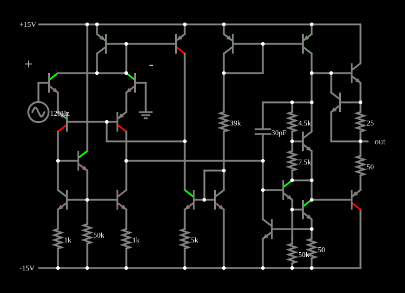

# Amplificador operacional 741 por dentro

<!-- navegacao:inicio -->
[Índice](README.md) · [Anterior: Voltage Regulator](opamp-regulator.md) · [Próximo: 741 (inverting amplifier)](opint-invert-amp.md)
<!-- navegacao:fim -->

## Objetivo

Mostrar o amplificador operacional 741 construído com transistores individuais, e o seu comportamento sem realimentação: com um sinal de apenas $0{,}1\ \text{V}$ na entrada, o ganho enorme leva a saída à saturação, em um valor próximo, mas inferior, à alimentação de $\pm 15\ \text{V}$.

## O circuito

<!-- esquema:inicio -->

<!-- esquema:fim -->

O circuito é o amplificador operacional clássico de $20$ transistores ($13$ NPN e $7$ PNP), $11$ resistores e um capacitor de compensação de $30\ \text{pF}$, alimentado por duas fontes de $\pm 15\ \text{V}$. Os valores dos resistores ($1\ \text{k}\Omega$, $5\ \text{k}\Omega$, $39\ \text{k}\Omega$, $50\ \text{k}\Omega$, $4{,}5\ \text{k}\Omega$, $7{,}5\ \text{k}\Omega$, $25\ \Omega$ e $50\ \Omega$) correspondem ao esquema conhecido do 741: um estágio de entrada diferencial com carga em espelho de corrente, um estágio de ganho com o capacitor de $30\ \text{pF}$ como compensação (efeito Miller) e uma saída em classe AB polarizada por um multiplicador de $V_{BE}$ (os resistores de $4{,}5$ e de $7{,}5\ \text{k}\Omega$), com resistores de $25$ e de $50\ \Omega$ que limitam a corrente de saída. A entrada não inversora ("+") recebe uma senoide de $120\ \text{Hz}$ e $0{,}1\ \text{V}$ de pico, e a entrada inversora ("-") está no terra, em malha aberta. Um elemento de saída e dois osciloscópios mostram a entrada e a saída.

<!-- componentes:inicio -->
| N.º | Tipo | Elemento | Valores |
|----:|------|----------|---------|
| 0 | `NTransistorElm` | transistor | Beta/hFE = 100; Swap E/C = não; Draw Circle = não; Model = default |
| 1 | `PTransistorElm` | transistor | Beta/hFE = 100; Swap E/C = não; Draw Circle = não; Model = default |
| 2 | `NTransistorElm` | transistor | Beta/hFE = 100; Swap E/C = não; Draw Circle = não; Model = default |
| 3 | `NTransistorElm` | transistor | Beta/hFE = 100; Swap E/C = não; Draw Circle = não; Model = default |
| 4 | `ResistorElm` | resistor | Resistance (ohms) = 1k |
| 5 | `ResistorElm` | resistor | Resistance (ohms) = 50k |
| 10 | `NTransistorElm` | transistor | Beta/hFE = 100; Swap E/C = não; Draw Circle = não; Model = default |
| 11 | `PTransistorElm` | transistor | Beta/hFE = 100; Swap E/C = não; Draw Circle = não; Model = default |
| 16 | `NTransistorElm` | transistor | Beta/hFE = 100; Swap E/C = não; Draw Circle = não; Model = default |
| 18 | `ResistorElm` | resistor | Resistance (ohms) = 1k |
| 21 | `RailElm` | voltage source | Voltage = -15; Waveform = D/C; DC Offset (V) = 0; Internal Resistance (ohms) = 0 |
| 22 | `PTransistorElm` | transistor | Beta/hFE = 100; Swap E/C = não; Draw Circle = não; Model = default |
| 23 | `PTransistorElm` | transistor | Beta/hFE = 100; Swap E/C = não; Draw Circle = não; Model = default |
| 35 | `RailElm` | voltage source | Voltage = 15; Waveform = D/C; DC Offset (V) = 0; Internal Resistance (ohms) = 0 |
| 36 | `NTransistorElm` | transistor | Beta/hFE = 100; Swap E/C = não; Draw Circle = não; Model = default |
| 37 | `NTransistorElm` | transistor | Beta/hFE = 100; Swap E/C = não; Draw Circle = não; Model = default |
| 39 | `ResistorElm` | resistor | Resistance (ohms) = 5k |
| 46 | `ResistorElm` | resistor | Resistance (ohms) = 39k |
| 47 | `PTransistorElm` | transistor | Beta/hFE = 100; Swap E/C = não; Draw Circle = não; Model = default |
| 48 | `PTransistorElm` | transistor | Beta/hFE = 100; Swap E/C = não; Draw Circle = não; Model = default |
| 58 | `NTransistorElm` | transistor | Beta/hFE = 100; Swap E/C = não; Draw Circle = não; Model = default |
| 59 | `NTransistorElm` | transistor | Beta/hFE = 100; Swap E/C = não; Draw Circle = não; Model = default |
| 65 | `ResistorElm` | resistor | Resistance (ohms) = 25 |
| 67 | `ResistorElm` | resistor | Resistance (ohms) = 50 |
| 70 | `NTransistorElm` | transistor | Beta/hFE = 100; Swap E/C = não; Draw Circle = não; Model = default |
| 71 | `ResistorElm` | resistor | Resistance (ohms) = 4.5k |
| 72 | `ResistorElm` | resistor | Resistance (ohms) = 7.5k |
| 77 | `PTransistorElm` | transistor | Beta/hFE = 100; Swap E/C = não; Draw Circle = não; Model = default |
| 79 | `NTransistorElm` | transistor | Beta/hFE = 100; Swap E/C = não; Draw Circle = não; Model = default |
| 80 | `NTransistorElm` | transistor | Beta/hFE = 100; Swap E/C = não; Draw Circle = não; Model = default |
| 81 | `ResistorElm` | resistor | Resistance (ohms) = 50 |
| 83 | `ResistorElm` | resistor | Resistance (ohms) = 50k |
| 90 | `NTransistorElm` | transistor | Beta/hFE = 100; Swap E/C = não; Draw Circle = não; Model = default |
| 96 | `CapacitorElm` | capacitor | Capacitance (F) = 30p; Trapezoidal Approximation = sim; Initial Voltage (on Reset) = 1m; Series Resistance = 0 |
| 97 | `OutputElm` | output | Show Voltage = não |
| 98 | `RailElm` | A/C source | Max Voltage = 100m; Waveform = A/C; DC Offset (V) = 0; Internal Resistance (ohms) = 0; Show Voltage = não; Frequency (Hz) = 120; Phase Offset (degrees) = 0 |
| 99 | `GroundElm` | ground | Symbol = Earth |
| 100 | `TextElm` | text | Text = -; Size = 24; Draw Bar On Top = não; Color = #c0c0c0 |
| 101 | `TextElm` | text | Text = +; Size = 24; Draw Bar On Top = não; Color = #c0c0c0 |
<!-- componentes:fim -->

## Teoria

O 741 é composto por três blocos:

1. **Estágio de entrada**: um par diferencial (com transistores de tipos complementares) amplifica a diferença entre as entradas e a converte em uma corrente única por uma carga ativa em espelho de corrente, que dobra o ganho.
2. **Estágio de ganho**: transistores em configuração Darlington e emissor comum fornecem a maior parte do ganho de tensão. O capacitor de $30\ \text{pF}$ ligado entre a saída e a entrada deste estágio (compensação por efeito Miller) coloca um polo dominante em baixa frequência (cerca de $5\ \text{Hz}$ no 741 real) e garante estabilidade para ganhos de malha fechada a partir de $1$.
3. **Saída em classe AB**: um par complementar polarizado por um multiplicador de $V_{BE}$ conduz com pouca distorção de cruzamento, e os resistores de $25$ e de $50\ \Omega$ limitam a corrente máxima.

O ganho de malha aberta é da ordem de $2\times 10^5$, então uma entrada de algumas dezenas de microvolts ($15\ \text{V}/2\times 10^5 \approx 75\ \mu\text{V}$) já satura a saída. Os transistores de saída precisam de tensão entre base e emissor e de queda nos resistores, e por isso a saída não alcança os trilhos de $\pm 15\ \text{V}$.

## Resultados esperados

Com a entrada no pico positivo ($+0{,}1\ \text{V}$, em $t = 2{,}083\ \text{ms}$) a saída vale $+14{,}835\ \text{V}$; com a entrada no pico negativo ($-0{,}1\ \text{V}$, em $t = 6{,}25\ \text{ms}$) a saída vale $-13{,}872\ \text{V}$. A saturação não é simétrica (cerca de $0{,}17\ \text{V}$ abaixo do trilho positivo e $1{,}13\ \text{V}$ acima do negativo), por causa da diferença entre os dois lados do estágio de saída. Em $t = 1\ \text{ms}$, com a entrada em apenas $0{,}068\ \text{V}$, a saída já está saturada em $14{,}835\ \text{V}$. As verificações conferem os dois níveis de saturação (tolerância de 0,1%).

## O que observar

- A saída é uma onda quase quadrada: o circuito funciona como comparador.
- Passa de um nível ao outro quando a entrada cruza zero (a diferença entre as entradas que satura a saída é da ordem de dezenas de microvolts).
- Compare com os exemplos seguintes, em que a realimentação resistiva dá um ganho definido e a saída deixa de saturar.

## Limites do modelo

O modelo de transistor é o mesmo para todos os 20 transistores e o capacitor de compensação é o único elemento reativo, sem capacitâncias parasitas das junções: a resposta em frequência é a de um polo dominante simplificado. A tensão de *offset*, a corrente de polarização e o ruído de um 741 real, que dependem do casamento dos transistores, não são simulados (os transistores são idênticos), e a saturação do modelo é um pouco diferente da do componente real (cerca de $\pm 13\ \text{V}$).

## Referências

- A. S. Sedra e K. C. Smith, *Microeletrônica*, Pearson.
- P. R. Gray, P. J. Hurst, S. H. Lewis e R. G. Meyer, *Analysis and Design of Analog Integrated Circuits*, Wiley.
- J. Millman e A. Grabel, *Microelectronics*, McGraw-Hill.

O circuito deste exemplo faz parte da coleção do simulador original de Paul Falstad e Iain Sharp (CircuitJS1); a explicação é deste projeto.
