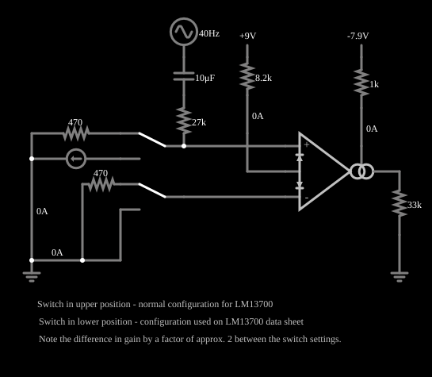

# A anomalia de ganho do LM13700

<!-- navegacao:inicio -->
[Índice](README.md) · [Anterior: OTA Ring Modulator](ota-ringmod.md)
<!-- navegacao:fim -->

## Objetivo

Mostrar que a **configuração das entradas** do OTA altera o ganho por um fator de cerca de $2$: o circuito tem duas chaves que passam de uma configuração (a usual) para outra (a da folha de dados do LM13700), e o ganho muda.

## O circuito

<!-- esquema:inicio -->

<!-- esquema:fim -->

O circuito é o do VCA (sinal de $1\ \text{V}$, $40\ \text{Hz}$, divisor de $27\ \text{k}\Omega$, tensão de controle de $I_{ABC}$ de $-9$ a $-6\ \text{V}$), com duas chaves de duas posições ligadas em grupo que escolhem como os resistores de $470\ \Omega$ e uma fonte de corrente de $500\ \mu\text{A}$ se ligam às entradas do OTA. O texto do circuito diz: *Switch in upper position – normal configuration for LM13700; switch in lower position – configuration used on LM13700 data sheet; note the difference in gain by a factor of approx. 2 between the switch settings*.

<!-- componentes:inicio -->
| N.º | Tipo | Elemento | Valores |
|----:|------|----------|---------|
| 0 | `OTAElm` | OTA (LM13700 style) | Positive Supply Voltage (5-20V) = 9; Negative Supply Voltage (V) = -9 |
| 2 | `GroundElm` | ground | Symbol = Earth |
| 3 | `RailElm` | A/C source | Max Voltage = 1; Waveform = A/C; DC Offset (V) = 0; Internal Resistance (ohms) = 0; Show Voltage = não; Frequency (Hz) = 40; Phase Offset (degrees) = 0 |
| 5 | `ResistorElm` | resistor | Resistance (ohms) = 8.2k |
| 6 | `RailElm` | voltage source | Voltage = 9; Waveform = D/C; DC Offset (V) = 0; Internal Resistance (ohms) = 0 |
| 7 | `ResistorElm` | resistor | Resistance (ohms) = 1k |
| 8 | `VarRailElm` | voltage source | Min Voltage = -9; Max Voltage = -6; Slider Text = Voltage for Iabc |
| 9 | `ResistorElm` | resistor | Resistance (ohms) = 33k |
| 10 | `GroundElm` | ground | Symbol = Earth |
| 11 | `ResistorElm` | resistor | Resistance (ohms) = 27k |
| 16 | `CurrentElm` | current source | Current (A) = 500μ; Max Voltage (V, 0=unlimited) = 0 |
| 17 | `CapacitorElm` | capacitor | Capacitance (F) = 10μ; Trapezoidal Approximation = sim; Initial Voltage (on Reset) = 1m; Series Resistance = 0 |
| 18 | `Switch2Elm` | switch (SPDT) | Momentary Switch = não; Group Number (for linking) = 1; # of Throws = 2; Keyboard Shortcut = ; On Resistance (ohms) = 0 |
| 19 | `Switch2Elm` | switch (SPDT) | Momentary Switch = não; Group Number (for linking) = 1; # of Throws = 2; Keyboard Shortcut = ; On Resistance (ohms) = 0 |
| 20 | `ResistorElm` | resistor | Resistance (ohms) = 470 |
| 23 | `ResistorElm` | resistor | Resistance (ohms) = 470 |
| 29 | `TextElm` | text | Text = Switch in upper position - normal configuration for LM13700; Size = 12; Draw Bar On Top = não; Color = #c0c0c0 |
| 30 | `TextElm` | text | Text = Switch in lower position - configuration used on LM13700 dat; Size = 12; Draw Bar On Top = não; Color = #c0c0c0 |
| 31 | `TextElm` | text | Text = Note the difference in gain by a factor of approx. 2 between; Size = 12; Draw Bar On Top = não; Color = #c0c0c0 |
<!-- componentes:fim -->

## Teoria

O **amplificador operacional de transcondutância** (OTA, aqui no estilo do LM13700) é uma fonte de corrente controlada por tensão: a corrente de saída é proporcional à tensão diferencial de entrada,

$$I_{out} = g_m\,(V_+ - V_-),\qquad g_m \approx \frac{I_{ABC}}{2V_T}\ \ (\approx 19{,}2\ I_{ABC}\ \text{a }25^\circ\text{C}),$$

e a transcondutância $g_m$ é controlada pela corrente de polarização $I_{ABC}$ (*amplifier bias current*), que entra num terminal próprio. Variando $I_{ABC}$ varia-se o ganho do circuito: é por isso que o OTA é a base dos amplificadores controlados por tensão (VCA), dos filtros controlados (VCF) e dos moduladores.

## Resultados esperados

O simulador dá a excursão pico a pico da saída do OTA nas duas posições:

| Posição das chaves | Pico a pico na saída |
|---|---:|
| Superior (inicial) | $16{,}7\ \text{mV}$ |
| Inferior | $35{,}7\ \text{mV}$ |

A razão é de $35{,}7/16{,}7 = 2{,}13$, o fator de cerca de $2$ que o texto do exemplo anuncia.

## O que observar

Mude a posição das chaves e compare o osciloscópio da saída: o mesmo sinal de entrada dá uma saída duas vezes maior numa das duas configurações. Quem projeta com o LM13700 precisa saber qual das duas ligações a folha de dados usa para não errar o ganho por um fator $2$.

## Limites do modelo

- O documento mostra o fato (a razão $2{,}13$) e o texto do exemplo, mas este projeto não derivou a razão a partir do modelo do OTA.
- Os números são excursões pico a pico em janelas de $0{,}2\ \text{s}$ da saída do OTA.

## Referências

Texas Instruments, *LM13700 Dual Operational Transconductance Amplifiers with Linearizing Diodes and Buffers* (folha de dados); Horowitz e Hill, *The Art of Electronics*, seção sobre amplificadores de transcondutância.

O circuito deste exemplo faz parte da coleção do simulador original de Paul Falstad e Iain Sharp (CircuitJS1); a explicação é deste projeto.
