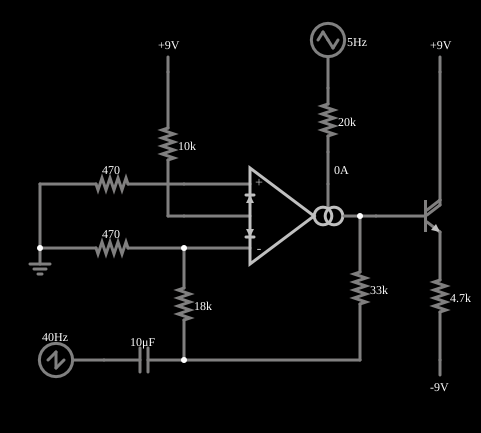

# Modulador em anel com OTA

<!-- navegacao:inicio -->
[Índice](README.md) · [Anterior: OTA Single Stage VCF (low pass)](ota-vcf-single.md) · [Próximo: LM137000 Gain Oddity](ota-gain.md)
<!-- navegacao:fim -->

## Objetivo

Mostrar um **modulador em anel**: o produto de dois sinais, em que um controla o ganho do outro, feito com um OTA e um par Darlington; a amplitude da saída se anula quando o sinal de controle passa por um ponto de referência.

## O circuito

<!-- esquema:inicio -->

<!-- esquema:fim -->

Um sinal dente de serra de $1\ \text{V}$ e $40\ \text{Hz}$ entra no OTA por um capacitor de $10\ \mu\text{F}$ e dois resistores de $470\ \Omega$. Uma onda triangular de $\pm 10\ \text{V}$ (deslocada de $2{,}8\ \text{V}$) e $5\ \text{Hz}$ controla $I_{ABC}$ por um resistor de $20\ \text{k}\Omega$. Um par Darlington e um resistor de $4{,}7\ \text{k}\Omega$ para $-9\ \text{V}$ formam a saída; o OTA é alimentado com $\pm 9\ \text{V}$.

<!-- componentes:inicio -->
| N.º | Tipo | Elemento | Valores |
|----:|------|----------|---------|
| 0 | `OTAElm` | OTA (LM13700 style) | Positive Supply Voltage (5-20V) = 9; Negative Supply Voltage (V) = -9 |
| 1 | `DarlingtonElm` | darlington pair (NPN) |  |
| 4 | `ResistorElm` | resistor | Resistance (ohms) = 33k |
| 5 | `ResistorElm` | resistor | Resistance (ohms) = 18k |
| 7 | `CapacitorElm` | capacitor | Capacitance (F) = 10μ; Trapezoidal Approximation = sim; Initial Voltage (on Reset) = 1m; Series Resistance = 0 |
| 8 | `RailElm` | sawtooth gen | Max Voltage = 1; Waveform = Sawtooth; DC Offset (V) = 0; Internal Resistance (ohms) = 0; Show Voltage = não; Frequency (Hz) = 40; Phase Offset (degrees) = 0 |
| 9 | `ResistorElm` | resistor | Resistance (ohms) = 470 |
| 10 | `ResistorElm` | resistor | Resistance (ohms) = 470 |
| 12 | `GroundElm` | ground | Symbol = Earth |
| 14 | `ResistorElm` | resistor | Resistance (ohms) = 10k |
| 15 | `RailElm` | voltage source | Voltage = 9; Waveform = D/C; DC Offset (V) = 0; Internal Resistance (ohms) = 0 |
| 16 | `ResistorElm` | resistor | Resistance (ohms) = 4.7k |
| 17 | `RailElm` | voltage source | Voltage = -9; Waveform = D/C; DC Offset (V) = 0; Internal Resistance (ohms) = 0 |
| 18 | `RailElm` | triangle gen | Max Voltage = 10; Waveform = Triangle; DC Offset (V) = 2.8; Internal Resistance (ohms) = 0; Show Voltage = não; Frequency (Hz) = 5; Phase Offset (degrees) = 0 |
| 19 | `ResistorElm` | resistor | Resistance (ohms) = 20k |
| 20 | `RailElm` | voltage source | Voltage = 9; Waveform = D/C; DC Offset (V) = 0; Internal Resistance (ohms) = 0 |
<!-- componentes:fim -->

## Teoria

O **amplificador operacional de transcondutância** (OTA, aqui no estilo do LM13700) é uma fonte de corrente controlada por tensão: a corrente de saída é proporcional à tensão diferencial de entrada,

$$I_{out} = g_m\,(V_+ - V_-),\qquad g_m \approx \frac{I_{ABC}}{2V_T}\ \ (\approx 19{,}2\ I_{ABC}\ \text{a }25^\circ\text{C}),$$

e a transcondutância $g_m$ é controlada pela corrente de polarização $I_{ABC}$ (*amplifier bias current*), que entra num terminal próprio. Variando $I_{ABC}$ varia-se o ganho do circuito: é por isso que o OTA é a base dos amplificadores controlados por tensão (VCA), dos filtros controlados (VCF) e dos moduladores.

Se a corrente de controle for proporcional a um sinal $m(t)$ que muda de sinal, o ganho $g_m \propto m$ também muda de sinal, e a saída é o **produto** $v_{out} \propto m(t)\,v_{in}(t)$. Para $m(t) = M\cos\omega_m t$ e $v_{in} = V\cos\omega_s t$, o produto contém só as frequências soma e diferença,

$$M V\cos\omega_m t\cos\omega_s t = \tfrac12 MV\left[\cos(\omega_s - \omega_m)t + \cos(\omega_s + \omega_m)t\right],$$

sem as portadoras originais: por isso o nome *ring modulator*.

## Resultados esperados

O simulador dá, para a amplitude pico a pico do sinal no resistor de $4{,}7\ \text{k}\Omega$ em janelas de $12{,}5\ \text{ms}$:

| Controle (centro da janela) | Amplitude pico a pico |
|---|---:|
| $-1{,}2\ \text{V}$ ($t = 30\ \text{ms}$) | $0{,}91\ \text{V}$ |
| $+2{,}8\ \text{V}$ ($t = 50\ \text{ms}$) | $0{,}07\ \text{V}$ |
| $+6{,}8\ \text{V}$ ($t = 70\ \text{ms}$) | $0{,}29\ \text{V}$ |

A amplitude é mínima quando o controle vale $2{,}8\ \text{V}$ (o centro da triangular), o ponto em que o sinal modulador muda de sinal, e cresce dos dois lados: o sinal de entrada é multiplicado pela distância ao ponto de controle.

## O que observar

Observe a saída: perto de cada cruzamento do controle por $2{,}8\ \text{V}$ a amplitude quase desaparece e depois volta, com a fase invertida. O sinal de entrada (dente de serra) não aparece sozinho na saída: só o produto.

## Limites do modelo

- Os números acima são amplitudes pico a pico em janelas de tempo que incluem trechos de controle diferentes, por isso são indicativos; o documento verifica três delas.
- Num modulador em anel de verdade, as duas entradas são multiplicadas com polaridade; aqui o OTA só aceita a corrente de controle de um sinal, e o exemplo usa um deslocamento de $2{,}8\ \text{V}$ para centrá-la.

## Referências

Texas Instruments, *LM13700 Dual Operational Transconductance Amplifiers with Linearizing Diodes and Buffers* (folha de dados); Horowitz e Hill, *The Art of Electronics*, seção sobre amplificadores de transcondutância.

O circuito deste exemplo faz parte da coleção do simulador original de Paul Falstad e Iain Sharp (CircuitJS1); a explicação é deste projeto.
