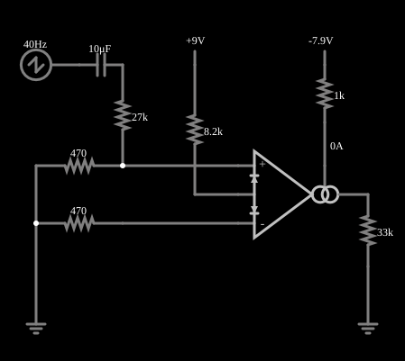

# Amplificador controlado por tensão com OTA

<!-- navegacao:inicio -->
[Índice](README.md) · [Próximo: OTA Single Stage VCF (low pass)](ota-vcf-single.md)
<!-- navegacao:fim -->

## Objetivo

Mostrar o **amplificador controlado por tensão** (VCA) com um OTA: a amplitude da saída é proporcional à corrente de controle $I_{ABC}$, que se ajusta com uma tensão.

## O circuito

<!-- esquema:inicio -->

<!-- esquema:fim -->

Um sinal dente de serra de $1\ \text{V}$ de pico e $40\ \text{Hz}$ passa por um capacitor de acoplamento de $10\ \mu\text{F}$ e por um divisor ($27\ \text{k}\Omega$ e $470\ \Omega$) que o reduz a cerca de $1{,}7\ \%$ para a entrada diferencial do OTA (alimentado com $\pm 9\ \text{V}$). A saída vai a $+9\ \text{V}$ por $8{,}2\ \text{k}\Omega$ e a uma carga de $33\ \text{k}\Omega$. A corrente $I_{ABC}$ vem de uma tensão de controle (*Voltage for Iabc*, de $-9$ a $-6\ \text{V}$) por um resistor de $1\ \text{k}\Omega$.

<!-- componentes:inicio -->
| N.º | Tipo | Elemento | Valores |
|----:|------|----------|---------|
| 0 | `OTAElm` | OTA (LM13700 style) | Positive Supply Voltage (5-20V) = 9; Negative Supply Voltage (V) = -9 |
| 1 | `ResistorElm` | resistor | Resistance (ohms) = 470 |
| 2 | `ResistorElm` | resistor | Resistance (ohms) = 470 |
| 4 | `GroundElm` | ground | Symbol = Earth |
| 5 | `CapacitorElm` | capacitor | Capacitance (F) = 10μ; Trapezoidal Approximation = sim; Initial Voltage (on Reset) = 1m; Series Resistance = 0 |
| 6 | `RailElm` | sawtooth gen | Max Voltage = 1; Waveform = Sawtooth; DC Offset (V) = 0; Internal Resistance (ohms) = 0; Show Voltage = não; Frequency (Hz) = 40; Phase Offset (degrees) = 0 |
| 8 | `ResistorElm` | resistor | Resistance (ohms) = 8.2k |
| 9 | `RailElm` | voltage source | Voltage = 9; Waveform = D/C; DC Offset (V) = 0; Internal Resistance (ohms) = 0 |
| 10 | `ResistorElm` | resistor | Resistance (ohms) = 1k |
| 11 | `VarRailElm` | voltage source | Min Voltage = -9; Max Voltage = -6; Slider Text = Voltage for Iabc |
| 12 | `ResistorElm` | resistor | Resistance (ohms) = 33k |
| 13 | `GroundElm` | ground | Symbol = Earth |
| 14 | `ResistorElm` | resistor | Resistance (ohms) = 27k |
<!-- componentes:fim -->

## Teoria

O **amplificador operacional de transcondutância** (OTA, aqui no estilo do LM13700) é uma fonte de corrente controlada por tensão: a corrente de saída é proporcional à tensão diferencial de entrada,

$$I_{out} = g_m\thinspace(V_+ - V_-),\qquad g_m \approx \frac{I_{ABC}}{2V_T}\ \ (\approx 19{,}2\ I_{ABC}\ \text{a }25^\circ\text{C}),$$

e a transcondutância $g_m$ é controlada pela corrente de polarização $I_{ABC}$ (*amplifier bias current*), que entra num terminal próprio. Variando $I_{ABC}$ varia-se o ganho do circuito: é por isso que o OTA é a base dos amplificadores controlados por tensão (VCA), dos filtros controlados (VCF) e dos moduladores.

## Resultados esperados

Com o simulador, variando a tensão de controle, medi a amplitude da saída (no resistor de $33\ \text{k}\Omega$) e a corrente $I_{ABC} = (V_{ctrl} - V_{pino})/1\ \text{k}\Omega$:

| Controle | $I_{ABC}$ | Amplitude da saída | Amplitude / $I_{ABC}$ |
|---:|---:|---:|---:|
| $-9{,}0\ \text{V}$ | $0$ | $0$ | |
| $-7{,}89\ \text{V}$ (exemplo) | $0{,}0625\ \text{mA}$ | $0{,}067\ \text{V}$ | $1{,}07\ \text{V/mA}$ |
| $-7{,}0\ \text{V}$ | $0{,}82\ \text{mA}$ | $0{,}850\ \text{V}$ | $1{,}04\ \text{V/mA}$ |
| $-6{,}0\ \text{V}$ | $1{,}78\ \text{mA}$ | $1{,}873\ \text{V}$ | $1{,}05\ \text{V/mA}$ |

A amplitude é proporcional a $I_{ABC}$ (cerca de $1{,}05\ \text{V}$ por miliampère), o comportamento de um VCA; com $I_{ABC} = 0$ não há ganho. No estado inicial do exemplo, a saída tem amplitude de $0{,}067\ \text{V}$ para uma entrada de $1\ \text{V}$.

## O que observar

Arraste o cursor de controle de $-9$ a $-6\ \text{V}$ e veja a amplitude da senoide de saída crescer de zero a mais de $1{,}8\ \text{V}$. O que se controla é o ganho, sem mexer no sinal: é o princípio do controle de volume por tensão e da envoltória de um sintetizador.

## Limites do modelo

- A relação linear só vale para entradas pequenas: o par diferencial do OTA satura acima de $\pm 26\ \text{mV}$ de entrada diferencial, motivo do divisor de $27\ \text{k}\Omega$ para $470\ \Omega$.
- A tabela acima foi obtida com o simulador variando o cursor; o documento verifica só o estado inicial do exemplo.

## Referências

Texas Instruments, *LM13700 Dual Operational Transconductance Amplifiers with Linearizing Diodes and Buffers* (folha de dados); Horowitz e Hill, *The Art of Electronics*, seção sobre amplificadores de transcondutância.

O circuito deste exemplo faz parte da coleção do simulador original de Paul Falstad e Iain Sharp (CircuitJS1); a explicação é deste projeto.
