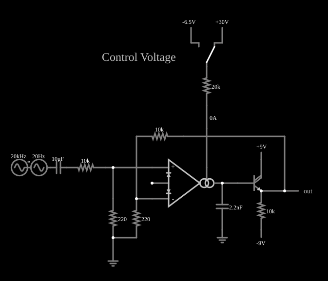

# Filtro passa-baixas de um estágio controlado por tensão com OTA

<!-- navegacao:inicio -->
[Índice](README.md) · [Anterior: OTA Voltage Controlled Amplifier (VCA)](ota-vca.md) · [Próximo: OTA Ring Modulator](ota-ringmod.md)
<!-- navegacao:fim -->

## Objetivo

Mostrar um **filtro passa-baixas controlado por tensão** (VCF) de um estágio com OTA: um OTA carregando um capacitor é um integrador cuja frequência de corte depende da corrente de controle.

## O circuito

<!-- esquema:inicio -->

<!-- esquema:fim -->

Um sinal de $20\ \text{Hz}$ ($1\ \text{V}$ de pico) e outro de $20\ \text{kHz}$ ($0{,}25\ \text{V}$ de pico) são somados e passam por um filtro com um OTA ($\pm 9\ \text{V}$) e um capacitor de $2{,}2\ \text{nF}$, com um par Darlington como *buffer* de saída. Uma chave de duas posições liga a corrente $I_{ABC}$ a uma de duas tensões de controle ($-6{,}5\ \text{V}$ ou $+30\ \text{V}$, por um resistor de $20\ \text{k}\Omega$).

<!-- componentes:inicio -->
| N.º | Tipo | Elemento | Valores |
|----:|------|----------|---------|
| 0 | `OTAElm` | OTA (LM13700 style) | Positive Supply Voltage (5-20V) = 9; Negative Supply Voltage (V) = -9 |
| 1 | `DarlingtonElm` | darlington pair (NPN) |  |
| 2 | `ResistorElm` | resistor | Resistance (ohms) = 10k |
| 3 | `RailElm` | voltage source | Voltage = -9; Waveform = D/C; DC Offset (V) = 0; Internal Resistance (ohms) = 0 |
| 6 | `ResistorElm` | resistor | Resistance (ohms) = 10k |
| 8 | `ResistorElm` | resistor | Resistance (ohms) = 220 |
| 10 | `ResistorElm` | resistor | Resistance (ohms) = 220 |
| 12 | `GroundElm` | ground | Symbol = Earth |
| 17 | `CapacitorElm` | capacitor | Capacitance (F) = 2.2n; Trapezoidal Approximation = sim; Initial Voltage (on Reset) = 1m; Series Resistance = 0 |
| 19 | `ResistorElm` | resistor | Resistance (ohms) = 20k |
| 20 | `ResistorElm` | resistor | Resistance (ohms) = 10k |
| 21 | `CapacitorElm` | capacitor | Capacitance (F) = 10μ; Trapezoidal Approximation = sim; Initial Voltage (on Reset) = 1m; Series Resistance = 0 |
| 25 | `RailElm` | voltage source | Voltage = -6.5; Waveform = D/C; DC Offset (V) = 0; Internal Resistance (ohms) = 0 |
| 26 | `RailElm` | voltage source | Voltage = 30; Waveform = D/C; DC Offset (V) = 0; Internal Resistance (ohms) = 0 |
| 27 | `Switch2Elm` | switch (SPDT) | Momentary Switch = não; Group Number (for linking) = 0; # of Throws = 2; Keyboard Shortcut = ; On Resistance (ohms) = 0 |
| 28 | `GroundElm` | ground | Symbol = Earth |
| 30 | `VoltageElm` | A/C source | Max Voltage = 1; Waveform = A/C; DC Offset (V) = 0; Internal Resistance (ohms) = 0; Show Voltage = não; Frequency (Hz) = 20; Phase Offset (degrees) = 0 |
| 31 | `RailElm` | A/C source | Max Voltage = 250m; Waveform = A/C; DC Offset (V) = 0; Internal Resistance (ohms) = 0; Show Voltage = não; Frequency (Hz) = 20k; Phase Offset (degrees) = 0 |
| 32 | `TextElm` | text | Text = Control Voltage; Size = 24; Draw Bar On Top = não; Color = #c0c0c0 |
| 33 | `OutputElm` | output | Show Voltage = não |
| 35 | `RailElm` | voltage source | Voltage = 9; Waveform = D/C; DC Offset (V) = 0; Internal Resistance (ohms) = 0 |
<!-- componentes:fim -->

## Teoria

O **amplificador operacional de transcondutância** (OTA, aqui no estilo do LM13700) é uma fonte de corrente controlada por tensão: a corrente de saída é proporcional à tensão diferencial de entrada,

$$I_{out} = g_m\,(V_+ - V_-),\qquad g_m \approx \frac{I_{ABC}}{2V_T}\ \ (\approx 19{,}2\ I_{ABC}\ \text{a }25^\circ\text{C}),$$

e a transcondutância $g_m$ é controlada pela corrente de polarização $I_{ABC}$ (*amplifier bias current*), que entra num terminal próprio. Variando $I_{ABC}$ varia-se o ganho do circuito: é por isso que o OTA é a base dos amplificadores controlados por tensão (VCA), dos filtros controlados (VCF) e dos moduladores.

Um OTA que carrega um capacitor $C$ é um **integrador**: $C\,dV_o/dt = g_m(V_i - V_o)$ com realimentação, o que dá um filtro passa-baixas de um polo com frequência de corte

$$f_c = \frac{g_m}{2\pi C}\propto I_{ABC}.$$

Para $|H| = 1/\sqrt{1 + (f/f_c)^2}$, uma componente em $f \ll f_c$ passa com ganho $1$, e uma em $f \gg f_c$ é atenuada por $f_c/f$.

## Resultados esperados

O simulador dá:

- **Chave na posição inicial:** a componente de $20\ \text{Hz}$ passa sem atenuação e a de $20\ \text{kHz}$ também: a excursão da saída de $20\ \text{kHz}$ é de $0{,}48\ \text{V}$ pico a pico, os $0{,}5\ \text{V}$ da entrada (ganho de $0{,}96$; $f_c$ bem acima de $20\ \text{kHz}$, em torno de $70\ \text{kHz}$ para um polo simples).
- **Chave na outra posição** (corrente de controle menor): a componente de $20\ \text{kHz}$ cai a $0{,}07\ \text{V}$ pico a pico, atenuada $7$ vezes ($-17\ \text{dB}$), o que corresponde a $f_c\approx 2{,}8\ \text{kHz}$ para um polo simples; a componente de $20\ \text{Hz}$ continua passando.

## O que observar

Mude a chave durante a simulação e veja a componente rápida (de $20\ \text{kHz}$) desaparecer da saída, enquanto a lenta (de $20\ \text{Hz}$) fica. As frequências de corte acima são estimativas para um polo simples a partir da atenuação medida, não valores calculados pelo $g_m$ do modelo.

## Limites do modelo

- A atenuação de $7$ vezes e o ganho de $0{,}96$ foram medidos com janelas de tempo de $0{,}2\ \text{ms}$; as frequências de corte, deduzidas, supõem um filtro de um polo ideal.
- O OTA tem uma faixa linear limitada a poucas dezenas de milivolts de entrada diferencial; sinais maiores distorcem.

## Referências

Texas Instruments, *LM13700 Dual Operational Transconductance Amplifiers with Linearizing Diodes and Buffers* (folha de dados); Horowitz e Hill, *The Art of Electronics*, seção sobre amplificadores de transcondutância.

O circuito deste exemplo faz parte da coleção do simulador original de Paul Falstad e Iain Sharp (CircuitJS1); a explicação é deste projeto.
