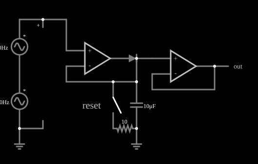

# Detector de pico

<!-- navegacao:inicio -->
[Índice](README.md) · [Anterior: Full-Wave Rectifier](amp-fullrect.md) · [Próximo: Integrator](amp-integ.md)
<!-- navegacao:fim -->

## Objetivo

Mostrar o detector de pico com amplificador operacional: o capacitor guarda o maior valor que a entrada atingiu, e um segundo operacional (seguidor) lê essa tensão sem descarregá-la. O sinal de entrada é a soma de duas senoides e, por isso, tem picos de alturas diferentes.

## O circuito

<!-- esquema:inicio -->

<!-- esquema:fim -->

A entrada é a soma de duas fontes senoidais em série: $5\ \text{V}$ de pico a $40\ \text{Hz}$ e $3\ \text{V}$ de pico a $110\ \text{Hz}$ (máximo possível de $8\ \text{V}$). O primeiro operacional carrega, por um diodo, um capacitor de $10\ \mu\text{F}$ ligado à terra; a tensão do capacitor volta à sua entrada inversora, fechando a malha. O segundo operacional é um seguidor que lê o capacitor e alimenta o elemento de saída. Um interruptor momentâneo ("reset"), em série com um resistor de $10\ \Omega$, pode descarregar o capacitor. Dois osciloscópios mostram a entrada e a saída.

<!-- componentes:inicio -->
| N.º | Tipo | Elemento | Valores |
|----:|------|----------|---------|
| 0 | `OpAmpElm` | op-amp | Max Output (V) = 15; Min Output (V) = -15; Gain = 100k |
| 1 | `OpAmpElm` | op-amp | Max Output (V) = 15; Min Output (V) = -15; Gain = 100k |
| 2 | `DiodeElm` | diode | Model = default |
| 9 | `CapacitorElm` | capacitor | Capacitance (F) = 10μ; Trapezoidal Approximation = sim; Initial Voltage (on Reset) = 1m; Series Resistance = 0 |
| 10 | `GroundElm` | ground | Symbol = Earth |
| 11 | `GroundElm` | ground | Symbol = Earth |
| 13 | `VoltageElm` | A/C source | Max Voltage = 5; Waveform = A/C; DC Offset (V) = 0; Internal Resistance (ohms) = 0; Show Voltage = não; Frequency (Hz) = 40; Phase Offset (degrees) = 0 |
| 14 | `VoltageElm` | A/C source | Max Voltage = 3; Waveform = A/C; DC Offset (V) = 0; Internal Resistance (ohms) = 0; Show Voltage = não; Frequency (Hz) = 110; Phase Offset (degrees) = 0 |
| 17 | `SwitchElm` | switch (SPST) | Momentary Switch = sim; IEC Symbol = não; Label (for linking) = ; Keyboard Shortcut = ; On Resistance (ohms) = 0 |
| 18 | `ResistorElm` | resistor | Resistance (ohms) = 10 |
| 21 | `ProbeElm` | voltmeter | Show Voltage = não; Value = Voltage; Scale = Auto; Use Circle Symbol = não; Series Resistance (0 = infinite) = 0 |
| 23 | `OutputElm` | output | Show Voltage = não |
| 24 | `TextElm` | text | Text = reset; Size = 20; Draw Bar On Top = não; Color = #c0c0c0 |
<!-- componentes:fim -->

## Teoria

Com a realimentação pela tensão do capacitor, o primeiro operacional ajusta a sua saída para que o capacitor fique igual à entrada, **enquanto** a entrada estiver acima da tensão armazenada: o diodo conduz e o capacitor carrega. Quando a entrada cai abaixo da tensão do capacitor, a saída do operacional vai ao limite negativo, o diodo fica reverso e o capacitor mantém a carga. A tensão guardada, portanto, acompanha o **máximo** do sinal:

$$V_C(t) = \max_{\tau \le t}\, V_\text{in}(\tau)\quad\text{(menos a queda por fuga).}$$

O diodo não entra no erro, porque está dentro da malha de realimentação. O seguidor impede que a carga de saída descarregue o capacitor. A única perda vem da corrente reversa do diodo, que descarrega o capacitor devagar, com taxa $dV/dt = I_\text{rev}/C$.

## Resultados esperados

A soma das duas senoides só atinge o pico de $8\ \text{V}$ se os máximos coincidirem. Nos valores simulados:

| Instante | Entrada | Saída (pico guardado) |
|----------|--------:|----------------------:|
| $10\ \text{ms}$ | $4{,}699\ \text{V}$ | $6{,}054\ \text{V}$ |
| $30\ \text{ms}$ | $7{,}610\ \text{V}$ | $7{,}627\ \text{V}$ |
| $50\ \text{ms}$ | $0{,}004\ \text{V}$ | $7{,}627\ \text{V}$ |
| $70\ \text{ms}$ | $-7{,}607\ \text{V}$ | $7{,}958\ \text{V}$ |
| $200\ \text{ms}$ | $-0{,}017\ \text{V}$ | $7{,}957\ \text{V}$ |

A saída só sobe (a cada novo pico mais alto) e desce muito devagar: a corrente reversa do diodo é de $0{,}17\ \mu\text{A}$, o que dá uma queda de $0{,}17\ \mu\text{A}/10\ \mu\text{F} \approx 17\ \text{mV/s}$. As verificações conferem a saída em dois instantes e o mínimo e o máximo dela entre $0{,}1$ e $0{,}2\ \text{s}$.

## O que observar

- A saída forma uma "escada" que sobe a cada pico novo e fica constante entre eles.
- Aperte o botão "reset" (o interruptor) para descarregar o capacitor e começar a medir um novo pico.
- Quando a entrada vai a valores negativos, a saída do primeiro operacional vai ao limite negativo ($-15\ \text{V}$) e o diodo isola o capacitor.

## Limites do modelo

A queda lenta do valor guardado depende da fuga do diodo, que o modelo traz com um valor fixo. O operacional é ideal, de modo que não há erro de *slew rate* na captura de picos rápidos. Em um circuito real, o capacitor também perde carga pela corrente de polarização do seguidor e pelo próprio dielétrico.

## Referências

- A. S. Sedra e K. C. Smith, *Microeletrônica*, Pearson.
- P. Horowitz e W. Hill, *The Art of Electronics*, Cambridge University Press.
- W. G. Jung, *Op Amp Applications Handbook*, Newnes.

O circuito deste exemplo faz parte da coleção do simulador original de Paul Falstad e Iain Sharp (CircuitJS1); a explicação é deste projeto.
