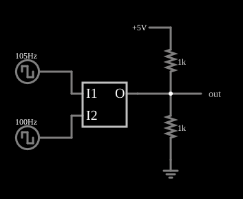

# Comparador de fase (tipo II)

<!-- navegacao:inicio -->
[Índice](README.md) · [Anterior: Type I PLL](pll.md) · [Próximo: Phase Comparator Internals](phasecompint.md)
<!-- navegacao:fim -->

## Objetivo

Mostrar o comparador de fase e frequência (tipo II): ele tem saída de três estados e, ao contrário da XOR, indica **qual** das duas entradas tem a frequência maior, mesmo quando as frequências são diferentes.

## O circuito

<!-- esquema:inicio -->

<!-- esquema:fim -->

Duas fontes de onda quadrada de $0$ a $5\ \text{V}$, uma de $105\ \text{Hz}$ (entrada $I_1$) e outra de $100\ \text{Hz}$ (entrada $I_2$), alimentam o comparador de fase. A saída ($O$) tem três estados: alta ($5\ \text{V}$), baixa ($0\ \text{V}$) ou em alta impedância. Dois resistores de $1\ \text{k}\Omega$, um ligado a $5\ \text{V}$ e outro à terra, formam um divisor que leva o nó de saída a $2{,}5\ \text{V}$ quando o comparador está em alta impedância. Um elemento de saída e três osciloscópios mostram o resultado.

<!-- componentes:inicio -->
| N.º | Tipo | Elemento | Valores |
|----:|------|----------|---------|
| 0 | `RailElm` | square wave gen | Max Voltage = 2.5; Waveform = Square Wave; DC Offset (V) = 2.5; Internal Resistance (ohms) = 0; Show Voltage = não; Specify As = Frequency/Duty Cycle; Frequency (Hz) = 105; Phase Offset (degrees) = 0; Duty Cycle = 50; Rise/Fall Time (s) = 0 |
| 1 | `RailElm` | square wave gen | Max Voltage = 2.5; Waveform = Square Wave; DC Offset (V) = 2.5; Internal Resistance (ohms) = 0; Show Voltage = não; Specify As = Frequency/Duty Cycle; Frequency (Hz) = 100; Phase Offset (degrees) = 0; Duty Cycle = 50; Rise/Fall Time (s) = 0 |
| 3 | `PhaseCompElm` | phase comparator | High Logic Voltage = 5 |
| 5 | `ResistorElm` | resistor | Resistance (ohms) = 1k |
| 6 | `ResistorElm` | resistor | Resistance (ohms) = 1k |
| 7 | `OutputElm` | output | Show Voltage = não |
| 8 | `RailElm` | voltage source | Voltage = 5; Waveform = D/C; DC Offset (V) = 0; Internal Resistance (ohms) = 0 |
| 9 | `GroundElm` | ground | Symbol = Earth |
<!-- componentes:fim -->

## Teoria

O comparador de fase tipo II é feito de dois *flip-flops* sensíveis à borda de subida. Uma borda em $I_1$ ativa o primeiro ($\text{UP}$) e uma borda em $I_2$ ativa o segundo ($\text{DOWN}$); quando os dois estão ativos, ambos são zerados. A saída é:

- **alta** se só o $\text{UP}$ estiver ativo (a borda de $I_1$ veio primeiro);
- **baixa** se só o $\text{DOWN}$ estiver ativo (a borda de $I_2$ veio primeiro);
- **em alta impedância** nos demais casos.

A largura do pulso é a diferença de tempo entre as bordas das duas entradas, e portanto proporcional à defasagem. Se $f_1 > f_2$, o $\text{UP}$ fica ativo uma parte de cada ciclo de $I_2$, entre a borda de $I_1$ e a de $I_2$ seguinte; ao longo de um ciclo de batimento essa parte vai de $0$ a $100\%$, com média de $50\%$. Logo, com $f_1 > f_2$ a saída é alta durante a metade do tempo e em alta impedância na outra metade, e o valor médio no divisor é

$$\overline{v} = 2{,}5\ \text{V} + \tfrac12\,(5 - 2{,}5)\ \text{V} = 3{,}75\ \text{V}.$$

Se $f_1 < f_2$, seria $2{,}5 - 1{,}25 = 1{,}25\ \text{V}$. Com as frequências iguais, a saída pulsa só em torno de $2{,}5\ \text{V}$ e o valor médio mede a fase.

## Resultados esperados

Em uma janela de $0{,}2\ \text{s}$ (um ciclo de batimento):

| Grandeza | Teoria | Simulador |
|----------|-------:|----------:|
| Valor médio da saída | $3{,}75\ \text{V}$ | $3{,}750\ \text{V}$ |
| Máximo / mínimo | $5\ \text{V}$ / $2{,}5\ \text{V}$ | $5{,}000\ \text{V}$ / $2{,}500\ \text{V}$ |

O mínimo de $2{,}5\ \text{V}$ mostra que o comparador nunca puxa a saída para baixo (só para cima, e depois em alta impedância), como a teoria prevê para $f_1 > f_2$. As verificações conferem o valor médio e os extremos.

## O que observar

- A saída tem pulsos altos (de $5\ \text{V}$) com largura variável sobre um patamar de $2{,}5\ \text{V}$ (alta impedância); nunca passa abaixo de $2{,}5\ \text{V}$.
- Invertendo as frequências das duas fontes, a saída passa a ter pulsos para baixo (até $0\ \text{V}$).
- Este é o detector de fase usado nos PLLs de tipo II (exemplos "Type II PLL"): com malha fechada, o erro de fase se anula.

## Limites do modelo

O comparador é um modelo digital ideal, sem atraso nem zona morta. A saída em alta impedância é o que permite que o filtro integre apenas o erro, mas depende de a carga (aqui, o divisor) ser a única que define o nível.

## Referências

- R. E. Best, *Phase-Locked Loops: Design, Simulation, and Applications*, McGraw-Hill.
- F. M. Gardner, *Phaselock Techniques*, Wiley.
- B. Razavi, *Design of Analog CMOS Integrated Circuits*, McGraw-Hill.

O circuito deste exemplo faz parte da coleção do simulador original de Paul Falstad e Iain Sharp (CircuitJS1); a explicação é deste projeto.
