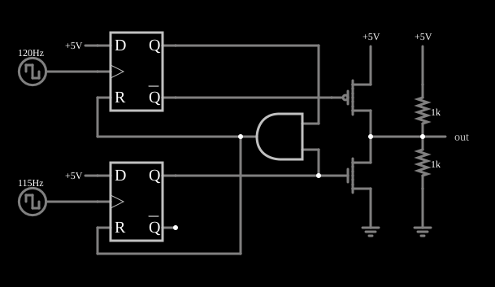

# Comparador de fase por dentro

<!-- navegacao:inicio -->
[Índice](README.md) · [Anterior: Phase Comparator (Type II)](phasecomp.md) · [Próximo: Type II PLL](pll2.md)
<!-- navegacao:fim -->

## Objetivo

Mostrar como o comparador de fase tipo II é feito com componentes básicos: dois *flip-flops* tipo D, uma porta AND para zerá-los e um estágio de saída de três estados com dois MOSFETs.

## O circuito

<!-- esquema:inicio -->

<!-- esquema:fim -->

Duas fontes de onda quadrada de $0$ a $5\ \text{V}$, de $120\ \text{Hz}$ e $115\ \text{Hz}$, acionam as entradas de relógio de dois *flip-flops* D, cujas entradas de dados estão em $5\ \text{V}$. A saída $Q$ de cada um alimenta uma porta AND, cuja saída zera ambos os *flip-flops*. Um MOSFET de canal P (ligado a $5\ \text{V}$) conduz quando o primeiro está ativo, e um de canal N (ligado à terra), quando o segundo está; quando nenhum conduz, a saída fica em alta impedância. Os mesmos dois resistores de $1\ \text{k}\Omega$ do exemplo anterior levam a saída a $2{,}5\ \text{V}$ em alta impedância.

<!-- componentes:inicio -->
| N.º | Tipo | Elemento | Valores |
|----:|------|----------|---------|
| 0 | `DFlipFlopElm` | D flip-flop | High Logic Voltage = 5; Reset Pin = sim; Set Pin = não; Invert Set/Reset = não |
| 1 | `DFlipFlopElm` | D flip-flop | High Logic Voltage = 5; Reset Pin = sim; Set Pin = não; Invert Set/Reset = não |
| 6 | `NMosfetElm` | MOSFET | Model = default-digital; Swap D/S = não |
| 7 | `PMosfetElm` | MOSFET | Model = default-digital; Swap D/S = não |
| 11 | `GroundElm` | ground | Symbol = Earth |
| 12 | `RailElm` | voltage source | Voltage = 5; Waveform = D/C; DC Offset (V) = 0; Internal Resistance (ohms) = 0 |
| 13 | `RailElm` | square wave gen | Max Voltage = 2.5; Waveform = Square Wave; DC Offset (V) = 2.5; Internal Resistance (ohms) = 0; Show Voltage = não; Specify As = Frequency/Duty Cycle; Frequency (Hz) = 120; Phase Offset (degrees) = 0; Duty Cycle = 50; Rise/Fall Time (s) = 0 |
| 14 | `RailElm` | square wave gen | Max Voltage = 2.5; Waveform = Square Wave; DC Offset (V) = 2.5; Internal Resistance (ohms) = 0; Show Voltage = não; Specify As = Frequency/Duty Cycle; Frequency (Hz) = 115; Phase Offset (degrees) = 0; Duty Cycle = 50; Rise/Fall Time (s) = 0 |
| 15 | `RailElm` | voltage source | Voltage = 5; Waveform = D/C; DC Offset (V) = 0; Internal Resistance (ohms) = 0 |
| 16 | `RailElm` | voltage source | Voltage = 5; Waveform = D/C; DC Offset (V) = 0; Internal Resistance (ohms) = 0 |
| 22 | `ResistorElm` | resistor | Resistance (ohms) = 1k |
| 23 | `ResistorElm` | resistor | Resistance (ohms) = 1k |
| 24 | `RailElm` | voltage source | Voltage = 5; Waveform = D/C; DC Offset (V) = 0; Internal Resistance (ohms) = 0 |
| 25 | `GroundElm` | ground | Symbol = Earth |
| 26 | `OutputElm` | output | Show Voltage = não |
| 28 | `AndGateElm` | AND gate | # of Inputs = 2; High Logic Voltage = 5; Schmitt Inputs = não; Invert Inputs = não; Propagation Delay (s) = 0; DeMorgan's Symbol = não |
<!-- componentes:fim -->

## Teoria

A borda de subida da entrada de relógio do primeiro *flip-flop* faz $Q_1 = 1$ (pois $D = 1$) e a do segundo faz $Q_2 = 1$. Quando $Q_1 = Q_2 = 1$, a porta AND zera os dois. O estado ($Q_1, Q_2$) é, portanto, $(1,0)$, $(0,1)$ ou $(0,0)$: alta, baixa ou alta impedância, que é a lógica do comparador do exemplo anterior.

Com $f_1 > f_2$ e o mesmo raciocínio daquele exemplo, o valor médio é de $3{,}75\ \text{V}$ no caso ideal. Aqui o MOSFET de saída tem queda e resistência próprias, e a tensão de pico é um pouco menor que $5\ \text{V}$.

## Resultados esperados

Em uma janela de $0{,}2\ \text{s}$ (um ciclo de batimento de $5\ \text{Hz}$):

| Grandeza | Teoria (ideal) | Simulador |
|----------|---------------:|----------:|
| Valor médio da saída | $3{,}75\ \text{V}$ | $3{,}715\ \text{V}$ |
| Máximo | $5\ \text{V}$ | $4{,}93\ \text{V}$ |
| Mínimo | $2{,}5\ \text{V}$ | $2{,}50\ \text{V}$ |

A pequena diferença do máximo é a queda no MOSFET de canal P ao fornecer corrente ao divisor de $1\ \text{k}\Omega$ (resistência de condução do modelo). O resultado é o mesmo do comparador pronto, que o exemplo anterior verifica. As verificações conferem o valor médio e os extremos.

## O que observar

- Acompanhe os dois *flip-flops* e a porta AND: um pulso curto de zeramento aparece quando os dois ficam ativos.
- A saída nunca vai abaixo de $2{,}5\ \text{V}$ porque $f_1 > f_2$ (a entrada de $120\ \text{Hz}$ é a rápida).
- Compare com o comparador do exemplo anterior: o comportamento é igual, com a diferença do estágio de saída.

## Limites do modelo

Os *flip-flops* e a porta são ideais, sem atraso: um comparador real tem uma "zona morta" quando o atraso do zeramento é maior que a defasagem, e pulsos estreitos (*glitches*) quando as bordas coincidem. Os MOSFETs usam o modelo digital padrão do simulador.

## Referências

- R. E. Best, *Phase-Locked Loops: Design, Simulation, and Applications*, McGraw-Hill.
- B. Razavi, *Design of Analog CMOS Integrated Circuits*, McGraw-Hill.
- F. M. Gardner, *Phaselock Techniques*, Wiley.

O circuito deste exemplo faz parte da coleção do simulador original de Paul Falstad e Iain Sharp (CircuitJS1); a explicação é deste projeto.
