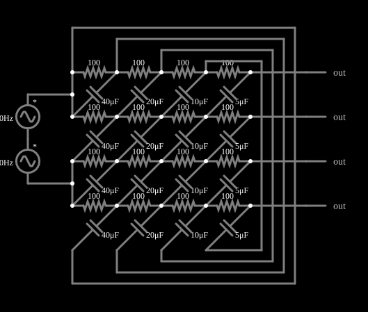

# Rede de sequência de fase

<!-- navegacao:inicio -->
[Índice](README.md) · [Anterior: Resistor Cube](cube.md) · [Próximo: 3-Phase Wye-Wye Balanced Load](3phasewye.md)
<!-- navegacao:fim -->

## Objetivo

Mostrar uma rede RC de várias seções que, alimentada por duas tensões senoidais em oposição de fase, produz **quatro** saídas de mesma amplitude defasadas de $90^\circ$ entre si (um conjunto de sinais em quadratura).

## O circuito

<!-- esquema:inicio -->

<!-- esquema:fim -->

Duas fontes senoidais de $5\ \text{V}$ de pico e $40\ \text{Hz}$, ligadas em série (o ponto de ligação entre elas é a referência), dão duas tensões iguais e de fases opostas. Cada uma alimenta duas das quatro fileiras de resistores de $100\ \Omega$; capacitores de $40$, $20$, $10$ e $5\ \mu\text{F}$ ligam cada fileira à vizinha de modo diagonal, formando uma rede de quatro seções RC. Quatro pontos de saída ficam no fim de cada fileira.

<!-- componentes:inicio -->
| N.º | Tipo | Elemento | Valores |
|----:|------|----------|---------|
| 0 | `ResistorElm` | resistor | Resistance (ohms) = 100 |
| 1 | `ResistorElm` | resistor | Resistance (ohms) = 100 |
| 2 | `ResistorElm` | resistor | Resistance (ohms) = 100 |
| 3 | `ResistorElm` | resistor | Resistance (ohms) = 100 |
| 4 | `CapacitorElm` | capacitor | Capacitance (F) = 40μ; Trapezoidal Approximation = sim; Initial Voltage (on Reset) = 1m; Series Resistance = 0 |
| 5 | `CapacitorElm` | capacitor | Capacitance (F) = 20μ; Trapezoidal Approximation = sim; Initial Voltage (on Reset) = 1m; Series Resistance = 0 |
| 6 | `CapacitorElm` | capacitor | Capacitance (F) = 10μ; Trapezoidal Approximation = sim; Initial Voltage (on Reset) = 1m; Series Resistance = 0 |
| 7 | `CapacitorElm` | capacitor | Capacitance (F) = 5μ; Trapezoidal Approximation = sim; Initial Voltage (on Reset) = 1m; Series Resistance = 0 |
| 8 | `ResistorElm` | resistor | Resistance (ohms) = 100 |
| 9 | `ResistorElm` | resistor | Resistance (ohms) = 100 |
| 10 | `ResistorElm` | resistor | Resistance (ohms) = 100 |
| 11 | `ResistorElm` | resistor | Resistance (ohms) = 100 |
| 12 | `CapacitorElm` | capacitor | Capacitance (F) = 40μ; Trapezoidal Approximation = sim; Initial Voltage (on Reset) = 1m; Series Resistance = 0 |
| 13 | `CapacitorElm` | capacitor | Capacitance (F) = 20μ; Trapezoidal Approximation = sim; Initial Voltage (on Reset) = 1m; Series Resistance = 0 |
| 14 | `CapacitorElm` | capacitor | Capacitance (F) = 10μ; Trapezoidal Approximation = sim; Initial Voltage (on Reset) = 1m; Series Resistance = 0 |
| 15 | `CapacitorElm` | capacitor | Capacitance (F) = 5μ; Trapezoidal Approximation = sim; Initial Voltage (on Reset) = 1m; Series Resistance = 0 |
| 16 | `CapacitorElm` | capacitor | Capacitance (F) = 40μ; Trapezoidal Approximation = sim; Initial Voltage (on Reset) = 1m; Series Resistance = 0 |
| 17 | `CapacitorElm` | capacitor | Capacitance (F) = 20μ; Trapezoidal Approximation = sim; Initial Voltage (on Reset) = 1m; Series Resistance = 0 |
| 18 | `CapacitorElm` | capacitor | Capacitance (F) = 10μ; Trapezoidal Approximation = sim; Initial Voltage (on Reset) = 1m; Series Resistance = 0 |
| 19 | `CapacitorElm` | capacitor | Capacitance (F) = 5μ; Trapezoidal Approximation = sim; Initial Voltage (on Reset) = 1m; Series Resistance = 0 |
| 20 | `ResistorElm` | resistor | Resistance (ohms) = 100 |
| 21 | `ResistorElm` | resistor | Resistance (ohms) = 100 |
| 22 | `ResistorElm` | resistor | Resistance (ohms) = 100 |
| 23 | `ResistorElm` | resistor | Resistance (ohms) = 100 |
| 24 | `ResistorElm` | resistor | Resistance (ohms) = 100 |
| 25 | `ResistorElm` | resistor | Resistance (ohms) = 100 |
| 26 | `ResistorElm` | resistor | Resistance (ohms) = 100 |
| 27 | `ResistorElm` | resistor | Resistance (ohms) = 100 |
| 28 | `CapacitorElm` | capacitor | Capacitance (F) = 40μ; Trapezoidal Approximation = sim; Initial Voltage (on Reset) = 1m; Series Resistance = 0 |
| 29 | `CapacitorElm` | capacitor | Capacitance (F) = 20μ; Trapezoidal Approximation = sim; Initial Voltage (on Reset) = 1m; Series Resistance = 0 |
| 30 | `CapacitorElm` | capacitor | Capacitance (F) = 10μ; Trapezoidal Approximation = sim; Initial Voltage (on Reset) = 1m; Series Resistance = 0 |
| 31 | `CapacitorElm` | capacitor | Capacitance (F) = 5μ; Trapezoidal Approximation = sim; Initial Voltage (on Reset) = 1m; Series Resistance = 0 |
| 55 | `OutputElm` | output | Show Voltage = não |
| 56 | `OutputElm` | output | Show Voltage = não |
| 57 | `OutputElm` | output | Show Voltage = não |
| 58 | `OutputElm` | output | Show Voltage = não |
| 63 | `VoltageElm` | A/C source | Max Voltage = 5; Waveform = A/C; DC Offset (V) = 0; Internal Resistance (ohms) = 0; Show Voltage = não; Frequency (Hz) = 40; Phase Offset (degrees) = 0 |
| 64 | `VoltageElm` | A/C source | Max Voltage = 5; Waveform = A/C; DC Offset (V) = 0; Internal Resistance (ohms) = 0; Show Voltage = não; Frequency (Hz) = 40; Phase Offset (degrees) = 0 |
<!-- componentes:fim -->

## Teoria

Um sistema de quatro fases com defasagem de $90^\circ$ entre elas, $v_k = A\sin(\omega t - k\,90^\circ)$, é a soma de uma componente de "sequência positiva" e outra de "sequência negativa". Uma **rede de sequência de fase** (ou filtro polifásico) é uma rede RC cuja resposta à sequência desejada é bem maior que à indesejada, o que é usado para gerar sinais em quadratura a partir de um par de sinais em oposição de fase em receptores de rádio.

Cada seção RC de constante $\tau = RC$ tem sua frequência característica $f_k = 1/(2\pi R C_k)$; para $R = 100\ \Omega$ e $C = 40$, $20$, $10$ e $5\ \mu\text{F}$ elas valem $39{,}8$, $79{,}6$, $159$ e $318\ \text{Hz}$, e as seções em cascata dão uma faixa de frequências em que a defasagem é quase exatamente $90^\circ$ (a fonte aqui tem $40\ \text{Hz}$, junto da primeira).

## Resultados esperados

Resolvendo a rede em regime senoidal por uma integração numérica independente, as quatro saídas têm a mesma amplitude, $3{,}1497\ \text{V}$, e fases de $-76{,}48^\circ$, $-166{,}53^\circ$, $+103{,}52^\circ$ e $+13{,}47^\circ$: defasagens sucessivas de $-90{,}05^\circ$, $-89{,}95^\circ$, $-90{,}05^\circ$ e $-89{,}95^\circ$ (isto é, quadratura com erro de $0{,}05^\circ$). A primeira e a terceira saídas estão em oposição de fase, assim como a segunda e a quarta.

Variando a frequência das fontes na integração independente (cálculo à parte, sem verificação no simulador), a quadratura se mantém ao longo de três oitavas e se perde fora dela:

| frequência | amplitude das saídas | defasagem entre saídas sucessivas |
|-----------:|---------------------:|:----------------------------------|
| $10\ \text{Hz}$ | $4{,}20\ \text{V}$ | $-47{,}9^\circ$, $-132{,}1^\circ$, $-47{,}9^\circ$ |
| $20\ \text{Hz}$ | $3{,}56\ \text{V}$ | $-74{,}6^\circ$, $-105{,}5^\circ$, $-74{,}6^\circ$ |
| $40\ \text{Hz}$ | $3{,}15\ \text{V}$ | $-90{,}05^\circ$, $-89{,}95^\circ$, $-90{,}05^\circ$ |
| $80\ \text{Hz}$ | $2{,}96\ \text{V}$ | $-89{,}98^\circ$, $-90{,}02^\circ$, $-89{,}98^\circ$ |
| $160\ \text{Hz}$ | $2{,}96\ \text{V}$ | $-90{,}02^\circ$, $-89{,}98^\circ$, $-90{,}02^\circ$ |
| $320\ \text{Hz}$ | $3{,}15\ \text{V}$ | $-89{,}95^\circ$, $-90{,}05^\circ$, $-89{,}95^\circ$ |
| $640\ \text{Hz}$ | $3{,}57\ \text{V}$ | $-74{,}2^\circ$, $-105{,}8^\circ$, $-74{,}2^\circ$ |

As verificações conferem a quadratura no instante em que a primeira saída está no pico ($t = 0{,}5115625\ \text{s}$, depois do transitório): a primeira vale $+3{,}1497\ \text{V}$, a terceira $-3{,}1497\ \text{V}$, e a segunda e a quarta são nulas; um quarto de ciclo depois ($t = 0{,}5240625\ \text{s}$) a segunda saída está nula e a primeira em $-3{,}1497\ \text{V}$ (tolerância de $0{,}02\ \text{V}$ para os zeros, e 1% para os picos).

## O que observar

- Nos osciloscópios as quatro formas de onda são senoides idênticas e deslocadas de um quarto de período uma da outra.
- Mude a frequência das fontes (duplo clique): de $40$ a $320\ \text{Hz}$ a quadratura se mantém dentro de $0{,}1^\circ$; fora dessa faixa o erro de fase cresce.
- Observe que a amplitude das saídas também varia pouco nessa faixa (de $3{,}15$ a $2{,}96\ \text{V}$).

## Limites do modelo

O texto do funcionamento da rede é qualitativo (o simulador apenas mostra a quadratura nas saídas); o dimensionamento de uma rede polifásica real usa a teoria de filtros polifásicos (Gingell, 1973), e depende da carga ligada às saídas (aqui, praticamente sem carga). Componentes ideais.

## Referências

- P. Horowitz e W. Hill, *The Art of Electronics*, Cambridge University Press.
- C. K. Alexander e M. N. O. Sadiku, *Fundamentos de Circuitos Elétricos*, AMGH.

O circuito deste exemplo faz parte da coleção do simulador original de Paul Falstad e Iain Sharp (CircuitJS1); a explicação é deste projeto.
