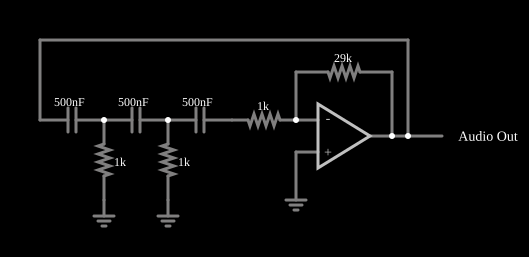

# Oscilador de deslocamento de fase

<!-- navegacao:inicio -->
[Índice](README.md) · [Anterior: Relaxation Oscillator](relaxosc.md) · [Próximo: Triangle Wave Generator](triangle.md)
<!-- navegacao:fim -->

## Objetivo

Mostrar o oscilador de deslocamento de fase (*phase-shift*): um amplificador inversor cuja realimentação passa por três seções RC que, juntas, deslocam a fase em $180^\circ$ na frequência de oscilação, de modo que o sinal retorna em fase com a entrada e o circuito oscila com uma senoide.

## O circuito

<!-- esquema:inicio -->

<!-- esquema:fim -->

Um amplificador operacional inversor tem resistor de realimentação $R_f = 29\ \text{k}\Omega$. A saída passa por uma rede de três capacitores de $500\ \text{nF}$ em série, com resistores de $1\ \text{k}\Omega$ a cada nó, e chega à entrada inversora (o último resistor liga ao terra virtual). A entrada não inversora está ligada à terra. Um elemento de saída de áudio ($8\ \text{kHz}$) e dois osciloscópios acompanham o circuito: um na saída e outro no último resistor da rede.

<!-- componentes:inicio -->
| N.º | Tipo | Elemento | Valores |
|----:|------|----------|---------|
| 0 | `CapacitorElm` | capacitor | Capacitance (F) = 500n; Trapezoidal Approximation = sim; Initial Voltage (on Reset) = 1m; Series Resistance = 0 |
| 1 | `CapacitorElm` | capacitor | Capacitance (F) = 500n; Trapezoidal Approximation = sim; Initial Voltage (on Reset) = 1m; Series Resistance = 0 |
| 2 | `CapacitorElm` | capacitor | Capacitance (F) = 500n; Trapezoidal Approximation = sim; Initial Voltage (on Reset) = 1m; Series Resistance = 0 |
| 3 | `ResistorElm` | resistor | Resistance (ohms) = 1k |
| 4 | `ResistorElm` | resistor | Resistance (ohms) = 1k |
| 5 | `ResistorElm` | resistor | Resistance (ohms) = 1k |
| 6 | `GroundElm` | ground | Symbol = Earth |
| 7 | `GroundElm` | ground | Symbol = Earth |
| 8 | `OpAmpElm` | op-amp | Max Output (V) = 15; Min Output (V) = -15; Gain = 100k |
| 10 | `ResistorElm` | resistor | Resistance (ohms) = 29k |
| 16 | `GroundElm` | ground | Symbol = Earth |
| 17 | `AudioOutputElm` | audio output | Duration (s) = 1; Sampling Rate = 8000 |
<!-- componentes:fim -->

## Teoria

O amplificador inversor já provoca um deslocamento de $180^\circ$. Para oscilar (critério de Barkhausen), a rede de realimentação deve provocar outros $180^\circ$ e o ganho de laço deve ser no mínimo 1. Três seções RC passa-altas iguais atingem $180^\circ$ quando

$$f_0 = \frac{1}{2\pi RC\sqrt{6}} = \frac{1}{2\pi\cdot 1\ \text{k}\Omega\cdot 500\ \text{nF}\cdot\sqrt 6}\approx 130\ \text{Hz}.$$

Nessa frequência a rede atenua o sinal por um fator de $29$, de modo que o ganho do amplificador deve ser pelo menos

$$\frac{R_f}{R} \ge 29 \quad\Longrightarrow\quad R_f \ge 29\ \text{k}\Omega.$$

Com $R_f$ exatamente em $29\ \text{k}\Omega$ o ganho de laço é 1 e a oscilação é marginal: com ganho de laço um pouco acima de 1 a amplitude cresce até a saturação do operacional, e um pouco abaixo ela decai devagar.

## Resultados esperados

A frequência de oscilação prevista é $f_0 \approx 129{,}96\ \text{Hz}$. Como o arquivo já guarda tensões iniciais nos capacitores, a oscilação existe desde o início, com cerca de $13\ \text{V}$ de pico (abaixo da saturação de $15\ \text{V}$, portanto senoidal); o pico diminui muito devagar, de $13{,}2\ \text{V}$ perto de $0{,}05\ \text{s}$ para $12{,}9\ \text{V}$ perto de $0{,}8\ \text{s}$, o que mostra que, no modelo, o ganho de laço fica ligeiramente abaixo de 1. As verificações medem a frequência e o pico da saída numa janela de $0{,}1\ \text{s}$ (tolerância de 3%).

## O que observar

- A saída é uma senoide de cerca de $130\ \text{Hz}$, bem mais pura que a de um oscilador de relaxação, e não chega a ser achatada pela saturação.
- Observe, com o tempo, a amplitude decair lentamente.
- Reduza $R_f$ bem abaixo de $29\ \text{k}\Omega$ e a oscilação se extingue (a teoria prevê que um valor maior sustenta e amplifica a oscilação até a saturação).

## Limites do modelo

A condição de oscilação é crítica (ganho exatamente no limite) e, no mundo real, a amplitude depende de pequenas diferenças de ganho e de saturação. O modelo é ideal, sem ruído nem tolerância de componentes, que seriam o que dá a partida em um circuito real.

## Referências

- A. S. Sedra e K. C. Smith, *Microeletrônica*, Pearson.
- P. Horowitz e W. Hill, *The Art of Electronics*, Cambridge University Press.
- R. L. Boylestad e L. Nashelsky, *Dispositivos Eletrônicos e Teoria de Circuitos*, Pearson.

O circuito deste exemplo faz parte da coleção do simulador original de Paul Falstad e Iain Sharp (CircuitJS1); a explicação é deste projeto.
