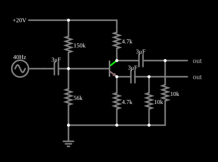

# Divisor de fase de ganho unitário

<!-- navegacao:inicio -->
[Índice](README.md) · [Anterior: Common-Emitter Amplifier](ceamp.md) · [Próximo: Schmitt Trigger](schmitt.md)
<!-- navegacao:fim -->

## Objetivo

Mostrar um divisor de fase (ou inversor): um único transistor produz, a partir de um sinal de entrada, dois sinais de mesma amplitude e fases opostas, um no coletor e outro no emissor.

## O circuito

<!-- esquema:inicio -->

<!-- esquema:fim -->

A alimentação é de $20\ \text{V}$. Um divisor de $150\ \text{k}\Omega$ e $56\ \text{k}\Omega$ polariza a base. O coletor e o emissor têm resistores iguais de $4{,}7\ \text{k}\Omega$. O sinal (uma senoide de $3\ \text{V}$ de pico e $40\ \text{Hz}$) entra pela base por um capacitor de $3\ \mu\text{F}$; as duas saídas (coletor e emissor) saem por capacitores de $3\ \mu\text{F}$ para resistores de $10\ \text{k}\Omega$.

<!-- componentes:inicio -->
| N.º | Tipo | Elemento | Valores |
|----:|------|----------|---------|
| 1 | `ResistorElm` | resistor | Resistance (ohms) = 150k |
| 2 | `ResistorElm` | resistor | Resistance (ohms) = 56k |
| 3 | `NTransistorElm` | transistor | Beta/hFE = 100; Swap E/C = não; Draw Circle = não; Model = default |
| 4 | `ResistorElm` | resistor | Resistance (ohms) = 4.7k |
| 6 | `CapacitorElm` | capacitor | Capacitance (F) = 3μ; Trapezoidal Approximation = sim; Initial Voltage (on Reset) = 1m; Series Resistance = 0 |
| 7 | `RailElm` | A/C source | Max Voltage = 3; Waveform = A/C; DC Offset (V) = 0; Internal Resistance (ohms) = 0; Show Voltage = não; Frequency (Hz) = 40; Phase Offset (degrees) = 0 |
| 8 | `GroundElm` | ground | Symbol = Earth |
| 9 | `RailElm` | voltage source | Voltage = 20; Waveform = D/C; DC Offset (V) = 0; Internal Resistance (ohms) = 0 |
| 10 | `ResistorElm` | resistor | Resistance (ohms) = 4.7k |
| 11 | `CapacitorElm` | capacitor | Capacitance (F) = 3μ; Trapezoidal Approximation = sim; Initial Voltage (on Reset) = 1m; Series Resistance = 0 |
| 12 | `ResistorElm` | resistor | Resistance (ohms) = 10k |
| 14 | `CapacitorElm` | capacitor | Capacitance (F) = 3μ; Trapezoidal Approximation = sim; Initial Voltage (on Reset) = 1m; Series Resistance = 0 |
| 15 | `ResistorElm` | resistor | Resistance (ohms) = 10k |
| 17 | `OutputElm` | output | Show Voltage = não |
| 18 | `OutputElm` | output | Show Voltage = não |
<!-- componentes:fim -->

## Teoria

O transistor bipolar do simulador (modelo "default") segue o modelo de Ebers–Moll, com $V_{BE}$ e $V_{BC}$ as tensões base-emissor e base-coletor (para um NPN):

$$I_C = I_s\left(e^{V_{BE}/V_T} - e^{V_{BC}/V_T}\right) - \frac{I_s}{\beta_R}\left(e^{V_{BC}/V_T} - 1\right),\qquad I_B = \frac{I_s}{\beta}\left(e^{V_{BE}/V_T} - 1\right) + \frac{I_s}{\beta_R}\left(e^{V_{BC}/V_T} - 1\right),$$

com $I_s = 10^{-13}\ \text{A}$, $\beta = 100$, $\beta_R = 1$ e $V_T = 25{,}865\ \text{mV}$; sem efeito Early, sem capacitâncias e sem resistências série. Na **região ativa** ($V_{BE} \approx 0{,}65$ a $0{,}75\ \text{V}$, junção base-coletor com polarização inversa) isso se reduz a $I_C = \beta I_B = I_s\,e^{V_{BE}/V_T}$, com transcondutância $g_m = I_C/V_T$ e resistência de emissor $r_e = V_T/I_E$. O PNP é o complementar, com todas as tensões e correntes invertidas.

## Resultados esperados

Como $I_C \approx I_E$, as variações de corrente passam pelos dois resistores iguais, $R_C = R_E = R$:

- no **emissor**, $v_e \approx v_b$ (seguidor de emissor, ganho $\approx +1$);
- no **coletor**, $v_c = -R_C\,i_c \approx -R_C\,v_b/R_E = -v_b$ (ganho $\approx -1$).

Os dois sinais têm a mesma amplitude e fases opostas: servem para excitar um estágio push-pull ou uma ponte. Os ganhos são só aproximadamente $\pm 1$, porque $r_e$ está em série com $R_E$ (reduzindo o do coletor) e as cargas diferem.

## O que observar

Em regime, a integração numérica independente dá as amplitudes das duas saídas (nas cargas de $10\ \text{k}\Omega$): emissor entre $-2.879$ e $2.918\ \text{V}$; coletor entre $-2.947$ e $2.908\ \text{V}$ (as duas com amplitude de $\approx 2{,}9\ \text{V}$, para $3\ \text{V}$ na entrada: ganhos de $\approx 0{,}98$). No instante em que a entrada está no pico positivo ($t = 0{,}10625\ \text{s}$), o emissor vale $-2.873\ \text{V}$ e o coletor, $+2.902\ \text{V}$: em oposição de fase. As verificações conferem os extremos das duas saídas e os dois valores no instante do pico (tolerância de 1%).

## Limites do modelo

- Compare as duas saídas nos osciloscópios: mesma amplitude, fases opostas.
- Os resistores de coletor e de emissor devem ser iguais para o divisor ser simétrico; mude um deles e o ganho correspondente muda.
- Esse circuito alimenta um amplificador push-pull que precisa de dois sinais em oposição.

## Referências

O modelo não tem capacitâncias; um divisor de fase real tem impedâncias de saída diferentes nos dois terminais (baixa no emissor, alta no coletor), que afetam o ganho em carga. A distorção aumenta com a amplitude do sinal.

O circuito deste exemplo faz parte da coleção do simulador original de Paul Falstad e Iain Sharp (CircuitJS1); a explicação é deste projeto.
