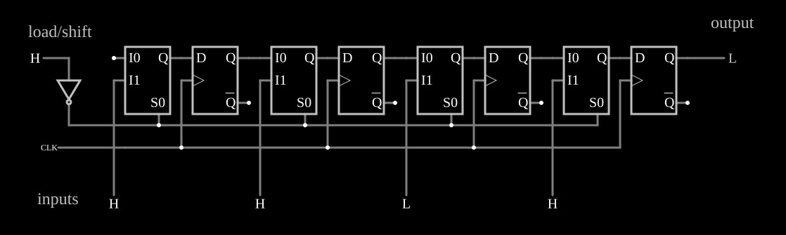

# Registrador de deslocamento paralelo-série

<!-- navegacao:inicio -->
[Índice](README.md) · [Anterior: Serial-In Parallel-Out](sipo-sr.md) · [Próximo: Universal](unishiftreg.md)
<!-- navegacao:fim -->

## Objetivo

Mostrar o registrador que **carrega** quatro bits de uma vez e depois os envia, um por pulso do relógio, por uma única saída: a conversão paralelo-série de um transmissor serial.

## O circuito

<!-- esquema:inicio -->

<!-- esquema:fim -->

Quatro flip-flops D disparados pela borda de subida, com um multiplexador de 2 para 1 antes de cada $D$. A entrada *load/shift* (elemento 26) comanda os multiplexadores: em $0$, cada flip-flop recebe a sua entrada paralela (elementos 19 a 22, *inputs*, da esquerda para a direita); em $1$, recebe a saída do flip-flop anterior. O relógio é uma onda quadrada de $100\ \text{Hz}$, e a saída série (elemento 27, *output*) é o $Q$ do último flip-flop. O exemplo abre com *load/shift* $= 1$, as entradas paralelas em $1, 1, 0, 1$ e os flip-flops zerados.

<!-- componentes:inicio -->
| N.º | Tipo | Elemento | Valores |
|----:|------|----------|---------|
| 0 | `DFlipFlopElm` | D flip-flop | High Logic Voltage = 5; Reset Pin = não; Set Pin = não; Invert Set/Reset = não |
| 1 | `DFlipFlopElm` | D flip-flop | High Logic Voltage = 5; Reset Pin = não; Set Pin = não; Invert Set/Reset = não |
| 2 | `MultiplexerElm` | Multiplexer | High Logic Voltage = 5; # of Select Bits = 1; Inverted Output = não; Strobe Pin = não; Input Mode = Individual Inputs; Bus Select = não |
| 5 | `MultiplexerElm` | Multiplexer | High Logic Voltage = 5; # of Select Bits = 1; Inverted Output = não; Strobe Pin = não; Input Mode = Individual Inputs; Bus Select = não |
| 6 | `DFlipFlopElm` | D flip-flop | High Logic Voltage = 5; Reset Pin = não; Set Pin = não; Invert Set/Reset = não |
| 8 | `MultiplexerElm` | Multiplexer | High Logic Voltage = 5; # of Select Bits = 1; Inverted Output = não; Strobe Pin = não; Input Mode = Individual Inputs; Bus Select = não |
| 9 | `DFlipFlopElm` | D flip-flop | High Logic Voltage = 5; Reset Pin = não; Set Pin = não; Invert Set/Reset = não |
| 10 | `RailElm` | square wave gen | Max Voltage = 2.5; Waveform = Square Wave; DC Offset (V) = 2.5; Internal Resistance (ohms) = 0; Show Voltage = não; Specify As = Frequency/Duty Cycle; Frequency (Hz) = 100; Phase Offset (degrees) = 0; Duty Cycle = 50; Rise/Fall Time (s) = 0 |
| 19 | `LogicInputElm` | logic input | Momentary Switch = não; High Logic Voltage = 5; Low Voltage = 0; Numeric = não; Ternary = não; Keyboard Shortcut =  |
| 20 | `LogicInputElm` | logic input | Momentary Switch = não; High Logic Voltage = 5; Low Voltage = 0; Numeric = não; Ternary = não; Keyboard Shortcut =  |
| 21 | `LogicInputElm` | logic input | Momentary Switch = não; High Logic Voltage = 5; Low Voltage = 0; Numeric = não; Ternary = não; Keyboard Shortcut =  |
| 22 | `LogicInputElm` | logic input | Momentary Switch = não; High Logic Voltage = 5; Low Voltage = 0; Numeric = não; Ternary = não; Keyboard Shortcut =  |
| 26 | `LogicInputElm` | logic input | Momentary Switch = não; High Logic Voltage = 5; Low Voltage = 0; Numeric = não; Ternary = não; Keyboard Shortcut =  |
| 27 | `LogicOutputElm` | logic output | Threshold = 2.5; Current Required = não; Numeric = não; Ternary = não |
| 28 | `InverterElm` | inverter | Slew Rate (V/ns) = 500m; High Logic Voltage = 5; DeMorgan's Symbol = não |
| 29 | `TextElm` | text | Text = load/shift; Size = 24; Draw Bar On Top = não; Color = #c0c0c0 |
| 30 | `TextElm` | text | Text = inputs; Size = 24; Draw Bar On Top = não; Color = #c0c0c0 |
| 31 | `TextElm` | text | Text = output; Size = 24; Draw Bar On Top = não; Color = #c0c0c0 |
| 32 | `MultiplexerElm` | Multiplexer | High Logic Voltage = 5; # of Select Bits = 1; Inverted Output = não; Strobe Pin = não; Input Mode = Individual Inputs; Bus Select = não |
<!-- componentes:fim -->

## Teoria

- **Carga** (*load/shift* $= 0$): na borda de subida, $Q_k \leftarrow P_k$ para todos os $k$.
- **Deslocamento** (*load/shift* $= 1$): $Q_0 \leftarrow 0$ (a entrada série do primeiro está em $0$) e $Q_k \leftarrow Q_{k-1}$.

Depois de uma carga, a saída mostra primeiro o bit da última posição e, a cada pulso, o bit da posição anterior: os quatro bits saem em série, do último ao primeiro, e depois só zeros. É o inverso do [Serial-In Parallel-Out](sipo-sr.md); juntos formam um enlace serial.

## Resultados esperados

Com *load/shift* em $0$ até $12\ \text{ms}$ e em $1$ depois, o simulador carrega os bits na borda de $10\ \text{ms}$ e a saída série mostra $1$ ($10$–$20\ \text{ms}$), $0$ ($20$–$30\ \text{ms}$), $1$ ($30$–$40\ \text{ms}$), $1$ ($40$–$50\ \text{ms}$) e então $0$: as entradas paralelas lidas da direita para a esquerda. Mantendo *load/shift* em $0$, a carga se repete a cada borda e a saída fica no valor da última entrada paralela, $1$.

## O que observar

Ponha *load/shift* em $0$ por um período, volte a $1$ e acompanhe no osciloscópio os bits saindo um a um.

## Limites do modelo

- Os multiplexadores e os flip-flops não têm atraso.

## Referências

Mano e Ciletti, *Digital Design*, capítulo sobre registradores de deslocamento; Texas Instruments, folha de dados do SN74165.

O circuito deste exemplo faz parte da coleção do simulador original de Paul Falstad e Iain Sharp (CircuitJS1); a explicação é deste projeto.
